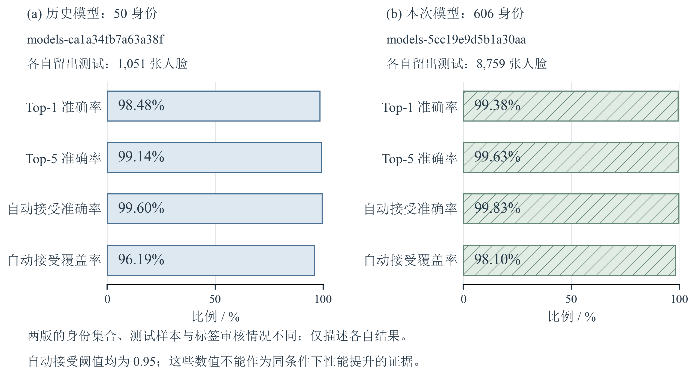
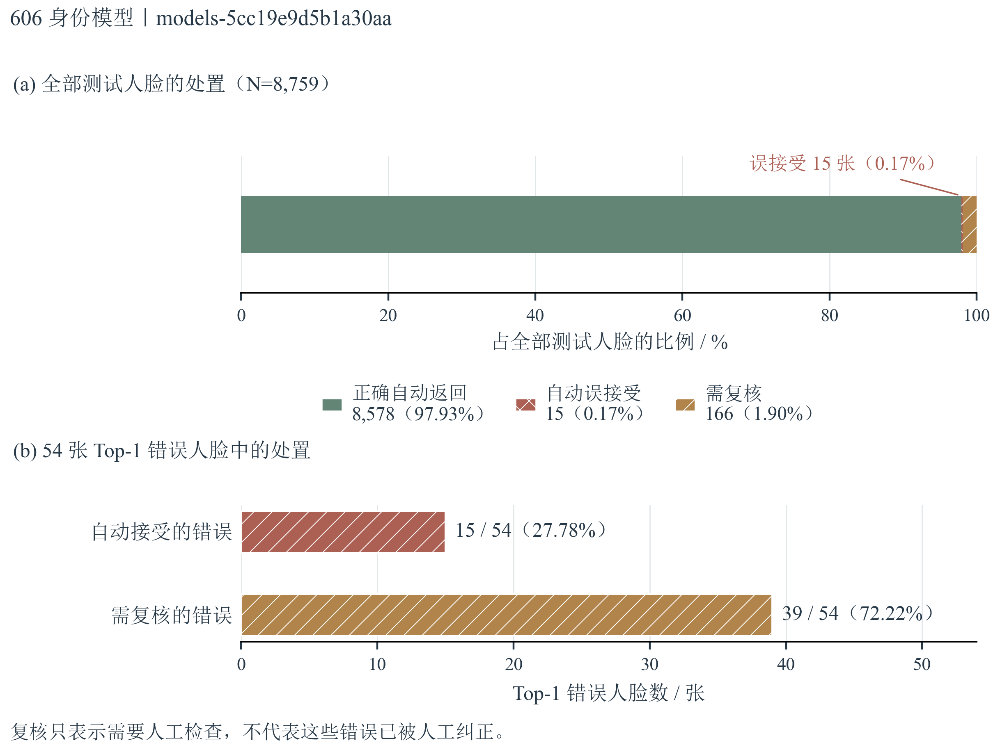
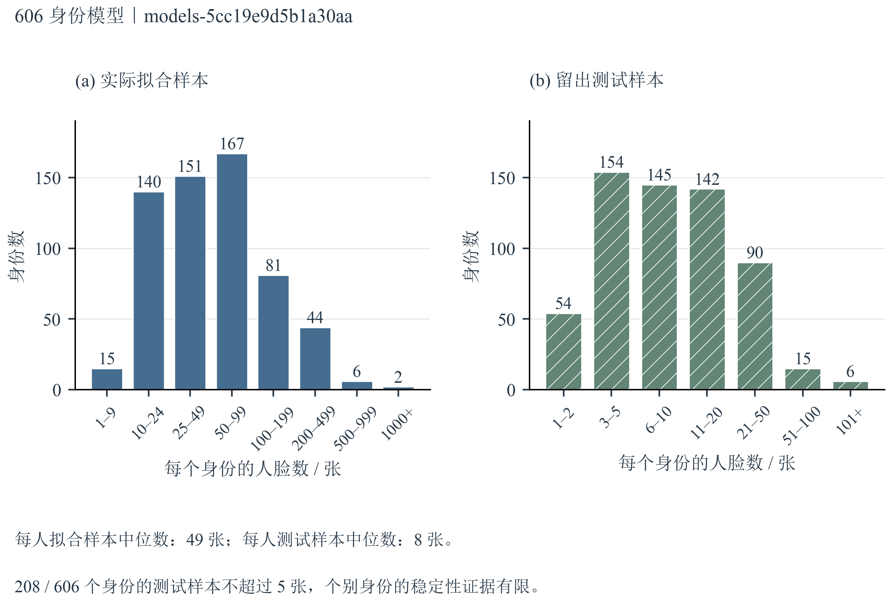

# 正式 606 人モデルの精度評価報告

[English](MODEL_ACCURACY_20261103.md) | [简体中文](MODEL_ACCURACY_20261103.zh-CN.md) | [日本語](MODEL_ACCURACY_20261103.ja.md)

報告日は 2026-11-03。訓練完了日時は 2026-11-03 03:06:50（UTC+8）。

**本報告の主モデルは 606 人を含む `models-5cc19e9d5b1a30aa` である。** ホールドアウトのテスト顔 8,759 枚に対する Top-1 正解率は **99.38%（8,705 / 8,759）** だった。確率 0.95 を自動受理閾値とした場合、自動受理結果の正解率は **99.83%**、カバレッジは **98.10%** だった。

これらは検出と品質選別を通過した既知人物の顔クロップとディレクトリラベルの一致度を測る指標である。ディレクトリラベルは画像ごとの人手確認が済んでいないため、任意のユーザー写真の実際の認識成功率としては解釈できない。

## 1. 対象となるモデルの版

| 項目 | 今回の正式モデル、主モデル | 歴史的モデル、参照のみ |
| --- | --- | --- |
| モデル Release | [`models-5cc19e9d5b1a30aa`](https://github.com/AhsokaTano26/Seiyuu-FaceID/releases/tag/models-5cc19e9d5b1a30aa) | [`models-ca1a34fb7a63a38f`](https://github.com/AhsokaTano26/Seiyuu-FaceID/releases/tag/models-ca1a34fb7a63a38f) |
| 内蔵人物数 | **606** | **50** |
| テスト真値のある人物数 | 606 | 49 |
| 実際の適合に使った顔数 | 49,858 | 4,064 |
| ホールドアウトのテスト顔数 | 8,759 | 1,051 |
| 分類ヘッド SHA-256 の先頭 16 文字 | `b0121a7e86d4d100` | `c9dcffea88abfb01` |
| バックボーンと分類器 | 凍結 AdaFace IR101 + R50、標準化 + 多項ロジスティック回帰 | 同系統の構成で、分類ヘッドと人物範囲が異なる |

**版の識別にはモデル Release タグと分類ヘッドのチェックサムを使用する。** アプリのコード版、ランタイム名、ディレクトリ名だけでは両モデルを区別できない。過去の `v0.1.0` リリースも上記 50 人分類ヘッドを使っており、別の 606 人モデルを表すものではない。

今回の 606 人分類ヘッドの完全な SHA-256 を示す。

```text
b0121a7e86d4d100b1b6c419fa2832aeddd14cb69908b62e75de7b3cf6eeb381
```

今回のモデルの `model_id` は配備受入記録に紐づく。

```text
b929a36dce6a6d3a29aa17b87f0685b5faea31538d993a7ae761d7bfb2baa582
```

過去の 50 人分類ヘッドの完全な SHA-256 を示す。

```text
c9dcffea88abfb014bb62651412b3ce818cf0e6fa8c52c494caaebe5b08b45be
```

この作業環境の `models/selected/classifier.npz` は引き続き過去の 50 人ファイルを保存している。今回の 606 人訓練成果物は `data/experiments/transfer_20261103/mac/full/candidate/` にある。同じ既定パスによる版の取り違えを防ぐため、再確認時は必ずチェックサムを照合する。

## 2. データと訓練の集計定義

元の FP32 2 バックボーンを維持し、Mac で後続の特徴抽出と分類ヘッド訓練を完了した。サーバーから移した既存特徴は数値一致を検査して継続利用した。分類ヘッドは `StandardScaler + LogisticRegression(C=1, class_weight=balanced)` を維持し、最大反復数は 1,500、モデル乱数シードは 20261014、データ分割シードは 20261103 とした。

| データ処理段階 | 数量 | 単位または説明 |
| --- | ---: | --- |
| 候補人物範囲 | 667 | ディレクトリ規則による選別と別名統一後の人物数 |
| 処理待ち原画像 | 258,670 | 画像 |
| 前処理で保持しなかった数 | 197,907 | 複数人、顔なし、低信頼度、品質、読取失敗などを含む |
| 重複除去前の保持顔 | 60,763 | 単一顔クロップ記録 |
| 完全重複の除去 | 749 | 顔記録 |
| 人物ラベルをまたぐ重複成分の除去 | 1,033 | 顔記録 |
| 有効出典成分が不足した人物の記録 | 364 | 顔記録 |
| 最終データプール | **58,617** | 606 人の顔クロップ |

訓練サンプルは原画像で検出顔がちょうど 1 つ、検出スコアが 0.8 以上、顔サイズが 48 ピクセル以上、Laplacian 鮮明度が 20 以上である必要がある。原画像 SHA-256、クロップ SHA-256、知覚ハッシュの推移的重複成分でグループ化し、知覚ハッシュのハミング距離が 4 以下なら統合した。ラベルをまたぐ成分は除外した。各人物はこの処理後に少なくとも 10 出典成分を保持する必要がある。

| 分割 | 顔数 | 用途 |
| --- | ---: | --- |
| 元の訓練集合 | 41,067 | 検証集合と統合して適合 |
| 元の検証集合 | 8,791 | 訓練集合と統合して適合 |
| **実際の適合プール** | **49,858** | 標準化パラメータと分類ヘッドはこのプールのみで適合 |
| **ホールドアウトのテスト集合** | **8,759** | 適合に使わず、訓練サンプル数にも含めない |

ここでの訓練サンプル数は **実際の適合に使った位置合わせ済み顔クロップ 49,858 枚**を指す。原画像 258,670 枚や上流バックボーンの事前訓練サンプルはこの数に含まれない。全人物と実際の訓練数は Release の [TRAINING_SAMPLES.csv](https://github.com/AhsokaTano26/Seiyuu-FaceID/releases/download/models-5cc19e9d5b1a30aa/TRAINING_SAMPLES.csv)を参照。

## 3. 精度指標と歴史的参照

表と図 1 の両モデルは、それぞれ自身のテスト集合を使用する。人物集合、サンプル構成、ラベル確認状況、過去の調整履歴が異なるため、**同一タスクで新モデルがどれだけ精度を改善したかを示すものではない**。

| 指標 | 過去の 50 人モデル | 今回の 606 人モデル |
| --- | ---: | ---: |
| Top-1 正解率 | 98.48%（1,035 / 1,051） | **99.38%（8,705 / 8,759）** |
| Top-1 誤り数 | 16 | 54 |
| Top-5 ヒット率 | 99.14%（1,042 / 1,051） | **99.63%（8,727 / 8,759）** |
| Macro-F1 | 99.10% | **99.16%** |
| 平衡正解率、クラス再現率のマクロ平均 | 99.12% | **99.34%** |
| 自動受理正解率、閾値 0.95 | 99.60%（1,007 / 1,011） | **99.83%（8,578 / 8,593）** |
| 自動受理カバレッジ、閾値 0.95 | 96.19%（1,011 / 1,051） | **98.10%（8,593 / 8,759）** |
| 正しい自動返却率、分母は全テスト顔 | 95.81%（1,007 / 1,051） | **97.93%（8,578 / 8,759）** |
| 自動誤受理数 | 4 | **15** |
| 要確認のフラグ数 | 40 | **166** |

Macro-F1 と平衡正解率のマクロ平均は、テスト真値のあるクラスのみを含む。過去版は 49 クラス、今回は全 606 クラスである。



図 1 はそれぞれ完全な Release タグ、人物数、テストサンプル数を明記する。横軸は 0% から始め、高正解率間の小さな数値差を軸切断で誇張しない。[PDF](figures/model_accuracy_20261103/model_version_metrics.pdf) · [SVG](figures/model_accuracy_20261103/model_version_metrics.svg)。

## 4. 99.38%、99.83%、98.10% の読み方

- **Top-1 正解率 99.38%** は全テスト顔 8,759 枚を分母とし、第 1 候補が正しかった 8,705 枚を数える。
- **自動受理正解率 99.83%** は、確率 0.95 以上で自動受理された 8,593 枚のみを分母とし、正解は 8,578 枚である。
- **カバレッジ 98.10%** は、8,759 枚中 8,593 枚が自動受理閾値に達し、残り 166 枚が要確認となった割合である。
- **正しい自動返却率 97.93%** は、正解かつ閾値到達の 8,578 枚が全テスト顔に占める割合である。

99.83% は分母が小さく、全入力に対する Top-1 正解率の代わりには使えない。各リクエストが 99.83% の確率で正しい結果を受け取ることを意味するものでもない。

| 今回のテスト処置 | Top-1 正解 | Top-1 誤り | 合計 |
| --- | ---: | ---: | ---: |
| 自動受理、確率 0.95 以上 | 8,578 | 15 | 8,593 |
| 要確認 | 127 | 39 | 166 |
| **合計** | **8,705** | **54** | **8,759** |

Top-1 誤り 54 枚のうち、15 枚は自動受理され、39 枚は要確認とされた。要確認はシステムの処置フラグであり、人が誤りを確認・修正済みという意味ではない。自動誤受理は全テスト顔の **0.17%（15 / 8,759）** を占める。



図 2 の (a) の分母は全テスト顔 8,759 枚、(b) はそのうち Top-1 誤りの 54 枚である。[PDF](figures/model_accuracy_20261103/model606_threshold_outcomes.pdf) · [SVG](figures/model_accuracy_20261103/model606_threshold_outcomes.svg)。

## 5. 人物別サンプル数と証拠の強さ

| 1 人当たりのサンプル数 | 最小 | 中央値 | 最大 |
| --- | ---: | ---: | ---: |
| 実際の適合に使った顔数 | 8 | 49 | 1,483 |
| ホールドアウトのテスト顔数 | 2 | 8 | 244 |

606 人中、**208 人（34.32%）はテスト顔が 5 枚以下**、**353 人（58.25%）は 10 枚以下**である。全体の 99.38% から全人物に同程度の安定した認識性能があるとは結論できない。サンプルの少ない人物は今回全問正解でも、さらに独立した出典のサンプルで検証する必要がある。



図 3 の縦軸は人物数、横軸は顔数の区間である。区間幅は異なり、棒の幅はカテゴリ区間を示すだけで連続密度を表さない。両図は同じ 606 人を集計している。[PDF](figures/model_accuracy_20261103/model606_sample_support.pdf) · [SVG](figures/model_accuracy_20261103/model606_sample_support.svg)。

## 6. 結論の適用範囲

1. **ラベルの制限。** 真値はディレクトリ名を引き継ぎ、画像ごとの人手確認は未実施である。誤ラベルは訓練と評価に影響し得る。
2. **出典独立性の制限。** 完全重複と知覚的重複の成分は分離したが、同じ写真集、撮影場面、似た連写がグループをまたぐ可能性は残る。撮影出典の完全な独立性は証明できない。
3. **入力条件の制限。** テスト入力は単一顔、検出スコア 0.8 以上、品質検査を通過した顔クロップである。サービスの検出閾値は 0.5 で、実際のリクエストには低信頼度、複数人、顔なし、検出失敗も含まれ得る。これらは上記精度の分母に入っていない。
4. **閉集合の制限。** テスト真値はすべて内蔵人物であり、未知人物、キャラクター画像、モデル外人物の拒否性能はこの結果から検証できない。0.95 は分類確率の閾値で、実環境の正解率を較正済み保証する値ではない。
5. **歴史的参照の制限。** 過去の 50 人テスト集合は以前のモデル選択に使われ、今回の集合とも異なる。同一条件の改善を判断するには、共通の人手確認済みテスト集合、固定評価プロトコル、対応のある比較が必要になる。

本報告が支持するのは、**`models-5cc19e9d5b1a30aa` が今回のディレクトリラベルと選別済み閉集合ホールドアウトで Top-1 99.38% を得た**という結論である。任意の写真、未知人物、各内蔵人物に一律の精度を約束するものではない。

## 7. データ出典、再現、図の受入検査

報告指標は保存済みテスト確率から再計算した。過去版は凍結テスト特徴と対応する分類ヘッドで再計算した。公開集計には版、指標、件数、区間統計、証拠ファイルのハッシュのみを残し、写真、各サンプルの予測、顔特徴、API キーは含めない。

| 出典 | 用途 |
| --- | --- |
| [aggregate_metrics.json](figures/model_accuracy_20261103/aggregate_metrics.json) | 本報告と 3 図の集計データ、版の指紋、元証拠のハッシュ |
| [figure_manifest.json](figures/model_accuracy_20261103/figure_manifest.json) | 図の出典、集計データ、画像ハッシュ、実際の描画ライブラリとフォント |
| [quality_review.json](figures/model_accuracy_20261103/quality_review.json) | 数値、画像描画、グレースケール、フォント埋め込み、ファイルリンクの受入記録 |
| [新モデル Release](https://github.com/AhsokaTano26/Seiyuu-FaceID/releases/tag/models-5cc19e9d5b1a30aa) | 606 人モデル、チェックサム、完全なサンプル数一覧 |
| [歴史的最適化記録](CLASSIFIER_OPTIMIZATION.ja.md) | 50 人モデルの歴史的テスト定義と結果 |
| [N150 の歴史的回帰記録](N150_BENCHMARK.ja.md) | 旧版のランタイム一致性記録。新版の精度として扱わない |

ローカル非公開証拠は `data/experiments/transfer_20261103/mac/full/` にあり、`report.json`、`training/holdout_scores.npz`、`training/features_and_splits.npz` を含む。過去の凍結データは `data/training/` にある。これらの非公開ファイルは報告やモデル Release に添付しない。

リポジトリルートから 3 図を再現する。

```bash
uv run --no-project --python 3.13 \
  --with matplotlib==3.10.9 --with numpy==2.5.4 \
  python tools/draw_model_accuracy_report.py
```

描画スクリプト [draw_model_accuracy_report.py](../tools/draw_model_accuracy_report.py)は集計 JSON のみを読み取る。各図に 400 dpi PNG、PDF、SVG があり、Markdown には PNG を埋め込む。実際の中国語フォントは **SimSun（宋体）**、英語と通常の数字は **Times New Roman** で、本機では代替フォントを使用していない。文字の網羅、PNG と PDF の描画、グレースケールの可読性、PDF フォント埋め込みを確認済みで、結果は上記受入記録を参照。
