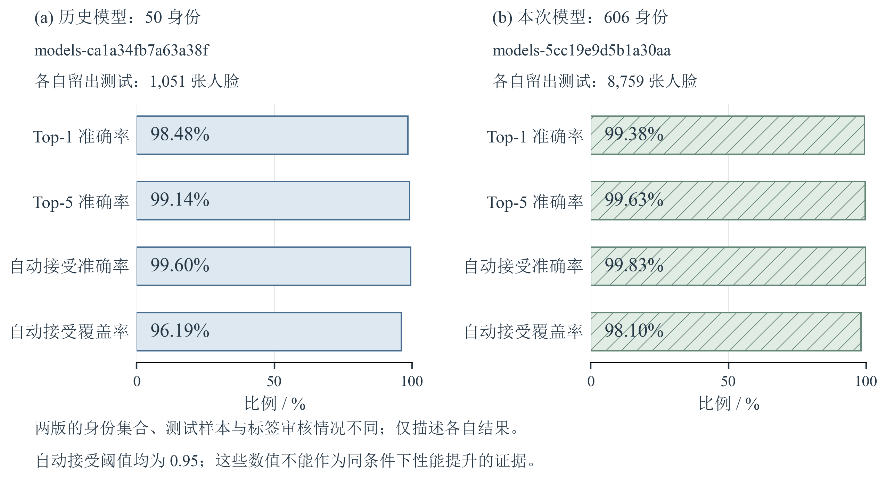
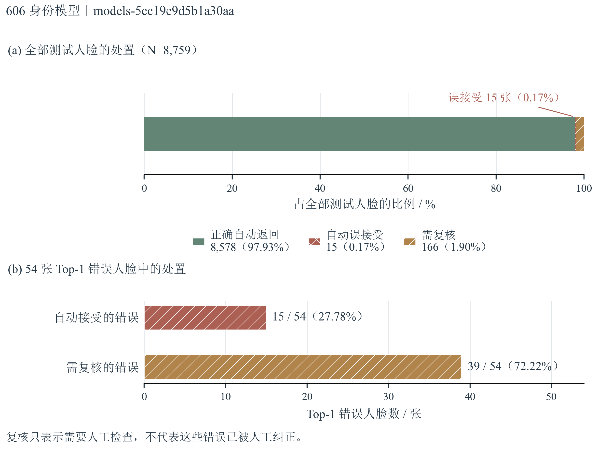
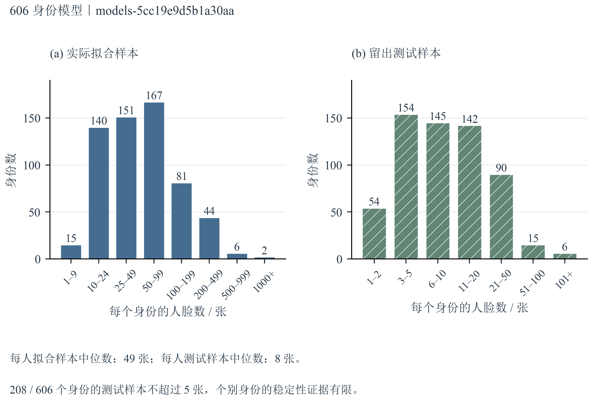

# Model accuracy evaluation report for the official 606-identity model

[English](MODEL_ACCURACY_20261103.md) | [简体中文](MODEL_ACCURACY_20261103.zh-CN.md) | [日本語](MODEL_ACCURACY_20261103.ja.md)

Report date is 2026-11-03. Training completed at 2026-11-03 03:06:50 (UTC+8).

**The main model in this report is `models-5cc19e9d5b1a30aa`, containing 606 identities.** Its Top-1 accuracy on 8,759 holdout test faces is **99.38% (8,705 / 8,759)**. With a probability threshold of 0.95 for automatic acceptance, accepted-result accuracy is **99.83%** and coverage is **98.10%**.

These metrics measure agreement between directory labels and known-identity face crops that passed detection and quality filtering. Directory labels have not been manually checked image by image, so the metrics cannot be interpreted as real recognition success rates for arbitrary user photos.

## 1. Model versions covered

| Item | Official model in this report, the main model | Historical model for reference only |
| --- | --- | --- |
| Model Release | [`models-5cc19e9d5b1a30aa`](https://github.com/AhsokaTano26/Seiyuu-FaceID/releases/tag/models-5cc19e9d5b1a30aa) | [`models-ca1a34fb7a63a38f`](https://github.com/AhsokaTano26/Seiyuu-FaceID/releases/tag/models-ca1a34fb7a63a38f) |
| Built-in identities | **606** | **50** |
| Identities with test ground truth | 606 | 49 |
| Faces actually used for fitting | 49,858 | 4,064 |
| Holdout test faces | 8,759 | 1,051 |
| First 16 characters of head SHA-256 | `b0121a7e86d4d100` | `c9dcffea88abfb01` |
| Backbones and classifier | Frozen AdaFace IR101 + R50, standardization + multinomial logistic regression | Same architecture type, with a different head and identity scope |

**Identify versions using the model Release tag and classification-head checksum.** Application code version, runtime name, or directory name alone cannot distinguish these models. The historical `v0.1.0` release also used the 50-identity head above and does not denote another 606-identity model.

The complete SHA-256 of this 606-identity head is below.

```text
b0121a7e86d4d100b1b6c419fa2832aeddd14cb69908b62e75de7b3cf6eeb381
```

This model's `model_id` is bound to the deployment acceptance record.

```text
b929a36dce6a6d3a29aa17b87f0685b5faea31538d993a7ae761d7bfb2baa582
```

The complete SHA-256 of the historical 50-identity head is below.

```text
c9dcffea88abfb014bb62651412b3ce818cf0e6fa8c52c494caaebe5b08b45be
```

This workspace's `models/selected/classifier.npz` still stores the historical 50-identity file. The 606-identity training artifacts are saved under `data/experiments/transfer_20261103/mac/full/candidate/`. Review must check checksums to prevent mixing versions that share the same default path.

## 2. Data and training definitions

The original FP32 dual backbones were retained. Subsequent feature extraction and head training were completed on Mac, continuing from existing features migrated from the server and checked for numerical parity. The head retained `StandardScaler + LogisticRegression(C=1, class_weight=balanced)`, with a maximum of 1,500 iterations, model random seed 20261014, and data-split seed 20261103.

| Data-processing stage | Count | Unit or explanation |
| --- | ---: | --- |
| Candidate identity scope | 667 | Identities after directory-rule filtering and alias normalization |
| Original images queued | 258,670 | Images |
| Not retained by preprocessing | 197,907 | Includes multiple faces, no face, low confidence, quality filters, and read failures |
| Faces retained before deduplication | 60,763 | Single-face crop records |
| Exact duplicates removed | 749 | Face records |
| Cross-identity duplicate components removed | 1,033 | Face records |
| Records belonging to identities with too few valid source components | 364 | Face records |
| Final data pool | **58,617** | Face crops from 606 identities |

Training samples required exactly one face detected in the original image, a detection score of at least 0.8, face size of at least 48 pixels, and Laplacian sharpness of at least 20. Transitive duplicate components were formed using original-image SHA-256, crop SHA-256, and perceptual hashes. Perceptual hashes with Hamming distance at most 4 were merged, and cross-label components were excluded. Each identity had to retain at least 10 source components after this processing.

| Split | Faces | Use |
| --- | ---: | --- |
| Original training set | 41,067 | Merged with validation for fitting |
| Original validation set | 8,791 | Merged with training for fitting |
| **Actual fitting pool** | **49,858** | Both standardization parameters and the head fitted only on this pool |
| **Holdout test set** | **8,759** | Excluded from fitting and training-sample counts |

Here, training-sample count therefore means **49,858 aligned face crops actually used for fitting**. The 258,670 original images and upstream-backbone pretraining samples are outside that count. Every identity and its actual training count are listed in the Release's [TRAINING_SAMPLES.csv](https://github.com/AhsokaTano26/Seiyuu-FaceID/releases/download/models-5cc19e9d5b1a30aa/TRAINING_SAMPLES.csv).

## 3. Accuracy metrics and historical reference

The two model versions in this table and Figure 1 use their own test sets. Identity sets, sample composition, label review, and earlier tuning histories differ. **These results do not establish an accuracy improvement on the same task.**

| Metric | Historical 50-identity model | Current 606-identity model |
| --- | ---: | ---: |
| Top-1 accuracy | 98.48% (1,035 / 1,051) | **99.38% (8,705 / 8,759)** |
| Top-1 errors | 16 | 54 |
| Top-5 hit rate | 99.14% (1,042 / 1,051) | **99.63% (8,727 / 8,759)** |
| Macro-F1 | 99.10% | **99.16%** |
| Balanced accuracy, macro-average class recall | 99.12% | **99.34%** |
| Automatic-acceptance accuracy at 0.95 | 99.60% (1,007 / 1,011) | **99.83% (8,578 / 8,593)** |
| Automatic-acceptance coverage at 0.95 | 96.19% (1,011 / 1,051) | **98.10% (8,593 / 8,759)** |
| Correct automatic-return rate, denominator of all test faces | 95.81% (1,007 / 1,051) | **97.93% (8,578 / 8,759)** |
| Incorrect automatic acceptances | 4 | **15** |
| Flagged for review | 40 | **166** |

Macro-F1 and balanced-accuracy macro averages include only classes with ground-truth samples in the test set, totaling 49 classes for the historical version and all 606 for this model.



Figure 1 specifies the full Release tag, identity count, and test sample size for each version. The horizontal axis starts at 0% to avoid exaggerating small differences between high accuracies through a truncated axis. [PDF](figures/model_accuracy_20261103/model_version_metrics.pdf) · [SVG](figures/model_accuracy_20261103/model_version_metrics.svg).

## 4. Interpreting 99.38%, 99.83%, and 98.10%

- **Top-1 accuracy of 99.38%** uses all 8,759 test faces as the denominator, with 8,705 correct first candidates.
- **Automatic-acceptance accuracy of 99.83%** uses only the 8,593 automatically accepted faces with probability at least 0.95, of which 8,578 are correct.
- **Coverage of 98.10%** means that 8,593 of 8,759 faces reach the acceptance threshold, while the remaining 166 are flagged for review.
- **Correct automatic-return rate of 97.93%** is the fraction of all test faces represented by the 8,578 both correct and above threshold.

The smaller denominator of 99.83% means it cannot replace Top-1 accuracy across all inputs. It also does not mean every request has a 99.83% chance of receiving a correct return.

| Test disposition | Top-1 correct | Top-1 incorrect | Total |
| --- | ---: | ---: | ---: |
| Automatically accepted, probability at least 0.95 | 8,578 | 15 | 8,593 |
| Flagged for review | 127 | 39 | 166 |
| **Total** | **8,705** | **54** | **8,759** |

Of 54 Top-1 errors, 15 were still automatically accepted and 39 were flagged for review. A review flag is a system disposition and does not indicate that a human has confirmed or corrected these errors. Incorrect automatic acceptances account for **0.17% (15 / 8,759)** of all test faces.



Figure 2 uses all 8,759 test faces as the denominator in (a), and the 54 Top-1 errors as the denominator in (b). [PDF](figures/model_accuracy_20261103/model606_threshold_outcomes.pdf) · [SVG](figures/model_accuracy_20261103/model606_threshold_outcomes.svg).

## 5. Per-identity sample support and strength of evidence

| Samples per identity | Minimum | Median | Maximum |
| --- | ---: | ---: | ---: |
| Faces actually used for fitting | 8 | 49 | 1,483 |
| Holdout test faces | 2 | 8 | 244 |

Among 606 identities, **208 (34.32%) have at most 5 test faces** and **353 (58.25%) have at most 10**. Overall accuracy of 99.38% cannot establish equally stable recognition for every identity. Even perfect observed results for identities with few samples still require more independent-source samples for validation.



Figure 3 has identity counts on the vertical axis and face-count intervals on the horizontal axis. Intervals differ in width, and bar widths only denote categories, without representing continuous density. Both panels describe the same 606 identities. [PDF](figures/model_accuracy_20261103/model606_sample_support.pdf) · [SVG](figures/model_accuracy_20261103/model606_sample_support.svg).

## 6. Scope of conclusions

1. **Label limitations.** Directory names supply ground truth and have not been manually verified image by image. Mislabels may affect training and evaluation.
2. **Source-independence limitations.** Exact and perceptual duplicate components are isolated, but images from the same photo book, scene, or similar burst may still cross groups. Complete photographic-source independence is unproven.
3. **Input-condition limitations.** Test inputs are crops filtered for a single face, detection score at least 0.8, and image quality. The service detection threshold is 0.5, so real requests may also contain low-confidence faces, multiple people, no faces, or detection failures. Those cases are absent from the accuracy denominator above.
4. **Closed-set limitations.** All test identities are built into the model. These results do not validate rejection of unknown people, character images, or out-of-model identities. The 0.95 value is a classification-probability threshold and provides no calibrated guarantee of real-world correctness.
5. **Historical-reference limitations.** The historical 50-identity test set participated in earlier model selection and differs from this test set. Comparing improvements under identical conditions requires a shared, manually verified test set, a fixed evaluation protocol, and paired comparisons.

The supported conclusion is that **`models-5cc19e9d5b1a30aa` achieved Top-1 accuracy of 99.38% on this filtered closed-set holdout with directory labels**. It provides no uniform accuracy promise for arbitrary photos, unknown identities, or each built-in identity.

## 7. Sources, reproduction, and figure acceptance checks

Report metrics were recalculated from saved test probabilities. Historical metrics were recalculated using frozen historical test features and the corresponding head. Public aggregates retain only versions, metrics, counts, binned statistics, and evidence-file hashes. They exclude photos, per-sample predictions, face features, and API keys.

| Source | Purpose |
| --- | --- |
| [aggregate_metrics.json](figures/model_accuracy_20261103/aggregate_metrics.json) | Aggregates for this report and three figures, version fingerprints, and original-evidence hashes |
| [figure_manifest.json](figures/model_accuracy_20261103/figure_manifest.json) | Figure sources, aggregate data, image hashes, and actual plotting libraries and fonts |
| [quality_review.json](figures/model_accuracy_20261103/quality_review.json) | Acceptance records for numbers, rendered images, grayscale, font embedding, and file links |
| [New-model Release](https://github.com/AhsokaTano26/Seiyuu-FaceID/releases/tag/models-5cc19e9d5b1a30aa) | 606-identity model, checksums, and complete sample-count list |
| [Historical optimization record](CLASSIFIER_OPTIMIZATION.md) | Historical test definitions and results for the 50-identity model |
| [Historical N150 regression record](N150_BENCHMARK.md) | Runtime parity for the old model, excluded from new-model accuracy claims |

Local private evidence is under `data/experiments/transfer_20261103/mac/full/`, including `report.json`, `training/holdout_scores.npz`, and `training/features_and_splits.npz`. Historical frozen data are under `data/training/`. These private files are not distributed with the report or model Release.

Reproduce the three figures from the repository root.

```bash
uv run --no-project --python 3.13 \
  --with matplotlib==3.10.9 --with numpy==2.5.4 \
  python tools/draw_model_accuracy_report.py
```

The plotting script, [draw_model_accuracy_report.py](../tools/draw_model_accuracy_report.py), reads aggregate JSON only. Each figure is provided as 400 dpi PNG, PDF, and SVG, with PNG embedded in Markdown. The actual Chinese font was **SimSun**, and English text and ordinary numerals used **Times New Roman**, without fallback fonts on this machine. Character coverage, PNG and PDF rendering, grayscale readability, and PDF font embedding were checked, with results in the acceptance records above.
