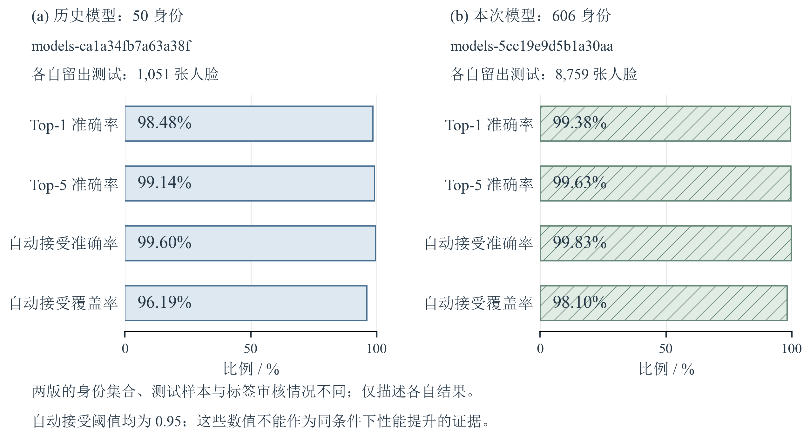
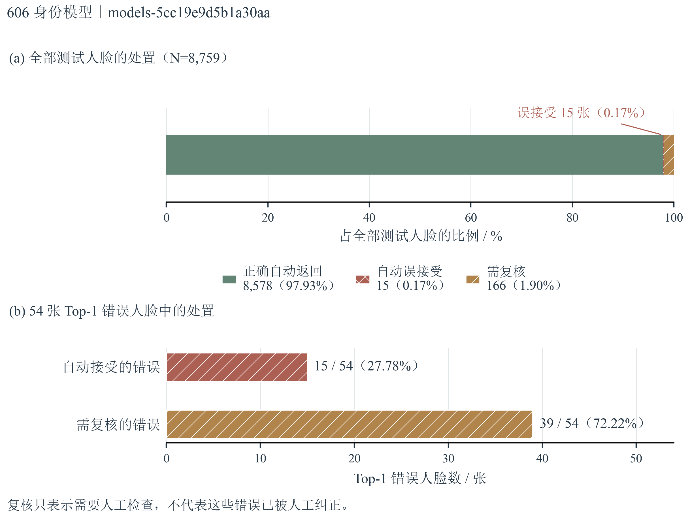
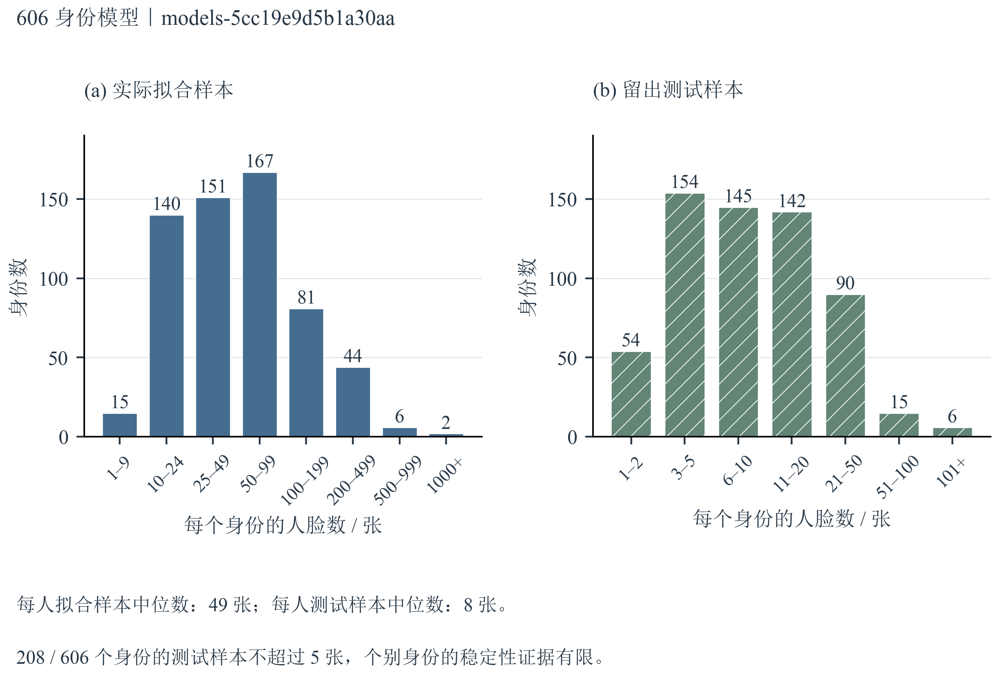

# 模型准确率评估报告 606 身份正式模型

[English](MODEL_ACCURACY_20261103.md) | [简体中文](MODEL_ACCURACY_20261103.zh-CN.md) | [日本語](MODEL_ACCURACY_20261103.ja.md)

报告日期为 2026-11-03。训练完成时间为 2026-11-03 03:06:50（UTC+8）。

**本报告的主模型是 `models-5cc19e9d5b1a30aa`，包含 606 个身份。**
它在 8,759 张留出测试人脸上的 Top-1 准确率为 **99.38%（8,705 / 8,759）**。
以概率 0.95 为自动接受阈值时，自动接受结果的准确率为 **99.83%**，覆盖率为 **98.10%**。

这些指标衡量的是经过检测、质量筛选的已知身份人脸裁剪与目录标签的一致程度。
目录标签尚未逐张人工核验，因此不能将它们解释为任意用户照片的真实识别成功率。

## 1. 报告对应哪个版本

| 项目 | 本次正式模型（主模型） | 历史模型（仅作参照） |
| --- | --- | --- |
| 模型 Release | [`models-5cc19e9d5b1a30aa`](https://github.com/AhsokaTano26/Seiyuu-FaceID/releases/tag/models-5cc19e9d5b1a30aa) | [`models-ca1a34fb7a63a38f`](https://github.com/AhsokaTano26/Seiyuu-FaceID/releases/tag/models-ca1a34fb7a63a38f) |
| 内置身份数 | **606** | **50** |
| 测试集有真值的身份数 | 606 | 49 |
| 实际拟合人脸数 | 49,858 | 4,064 |
| 留出测试人脸数 | 8,759 | 1,051 |
| 分类头 SHA-256 前 16 位 | `b0121a7e86d4d100` | `c9dcffea88abfb01` |
| 骨干与分类器 | 冻结 AdaFace IR101 + R50，标准化 + 多项逻辑回归 | 同类架构，另一套分类头及身份范围 |

**应使用模型 Release 标签与分类头校验值识别版本。**
应用代码版本号、运行时名称或目录名不能单独区分这两个模型。
历史 `v0.1.0` 发布也使用上述 50 身份分类头，不代表另一个 606 身份模型。

本次 606 身份分类头的完整 SHA-256。

```text
b0121a7e86d4d100b1b6c419fa2832aeddd14cb69908b62e75de7b3cf6eeb381
```

本次模型的 `model_id`，与部署验收记录绑定。

```text
b929a36dce6a6d3a29aa17b87f0685b5faea31538d993a7ae761d7bfb2baa582
```

历史 50 身份分类头的完整 SHA-256。

```text
c9dcffea88abfb014bb62651412b3ce818cf0e6fa8c52c494caaebe5b08b45be
```

本工作区的 `models/selected/classifier.npz` 仍保存历史 50 身份文件。
本次 606 身份训练产物保存在
`data/experiments/transfer_20261103/mac/full/candidate/`。
复核时必须检查校验值，避免因默认路径相同而混用版本。

## 2. 本次数据与训练口径

本次保留原有 FP32 双骨干，在 Mac 上完成后续特征提取与分类头训练，
并接续使用从服务器迁移、经过数值一致性检查的已有特征。
分类头沿用 `StandardScaler + LogisticRegression(C=1, class_weight=balanced)`，
最大迭代次数 1,500，模型随机种子 20261014。数据划分种子为 20261103。

| 数据处理阶段 | 数量 | 单位或说明 |
| --- | ---: | --- |
| 候选身份范围 | 667 | 经目录规则筛选并统一别名后的身份 |
| 排队处理的原图 | 258,670 | 图片 |
| 预处理未保留 | 197,907 | 包括多人、无脸、低置信度、质量或读取等筛选情况 |
| 去重前保留的人脸 | 60,763 | 单人脸裁剪记录 |
| 精确重复剔除 | 749 | 人脸记录 |
| 跨身份重复组件剔除 | 1,033 | 人脸记录 |
| 有效来源组件不足的身份所对应记录 | 364 | 人脸记录 |
| 最终数据池 | **58,617** | 606 个身份的人脸裁剪 |

训练样本要求原图检测到恰好一张人脸，该脸检测分数至少为 0.8，
人脸尺寸至少为 48 像素，Laplacian 清晰度至少为 20。
按原图 SHA-256、裁剪 SHA-256 和感知哈希的传递重复组件分组，
感知哈希汉明距离不超过 4 时合并。跨标签组件排除。
身份须在上述处理后保有至少 10 个来源组件。

| 划分 | 人脸数 | 用途 |
| --- | ---: | --- |
| 原训练集 | 41,067 | 与验证集合并拟合 |
| 原验证集 | 8,791 | 与训练集合并拟合 |
| **实际拟合池** | **49,858** | 标准化参数和分类头均只在该池拟合 |
| **留出测试集** | **8,759** | 未进入拟合，也不计入训练样本数 |

因此，这里的“训练样本数”指 **49,858 张实际用于拟合的对齐人脸裁剪**，
不是 258,670 张原图，也不是上游骨干的预训练样本数。
全部身份及其实际训练数可查看 Release 的
[TRAINING_SAMPLES.csv](https://github.com/AhsokaTano26/Seiyuu-FaceID/releases/download/models-5cc19e9d5b1a30aa/TRAINING_SAMPLES.csv)。

## 3. 准确率指标与历史参照

下表与图 1 中的两版模型分别使用自己的测试集。
它们的身份集合、样本构成、标签审核情况与既往调参历史不同，
**不能据此宣称新模型在同一任务上取得了多少准确率提升**。

| 指标 | 历史 50 身份模型 | 本次 606 身份模型 |
| --- | ---: | ---: |
| Top-1 准确率 | 98.48%（1,035 / 1,051） | **99.38%（8,705 / 8,759）** |
| Top-1 错误数 | 16 | 54 |
| Top-5 命中率 | 99.14%（1,042 / 1,051） | **99.63%（8,727 / 8,759）** |
| Macro-F1 | 99.10% | **99.16%** |
| 平衡准确率（类别召回率宏平均） | 99.12% | **99.34%** |
| 自动接受准确率，阈值 0.95 | 99.60%（1,007 / 1,011） | **99.83%（8,578 / 8,593）** |
| 自动接受覆盖率，阈值 0.95 | 96.19%（1,011 / 1,051） | **98.10%（8,593 / 8,759）** |
| 正确自动返回率，分母为全部测试人脸 | 95.81%（1,007 / 1,051） | **97.93%（8,578 / 8,759）** |
| 自动误接受数 | 4 | **15** |
| 标记需复核数 | 40 | **166** |

Macro-F1 与平衡准确率的宏平均仅包含测试集中有真值样本的类别。
历史版为 49 类，本次为全部 606 类。



图 1。图中分别注明完整 Release 标签、身份数和测试样本量。
横轴从 0% 开始，避免截断坐标轴夸大高准确率之间的细小数值差异。
[PDF](figures/model_accuracy_20261103/model_version_metrics.pdf) ·
[SVG](figures/model_accuracy_20261103/model_version_metrics.svg)。

## 4. 为什么 99.38%、99.83% 和 98.10% 不矛盾

- **Top-1 准确率 99.38%**。8,759 张测试人脸全部计入分母，第一候选正确 8,705 张。
- **自动接受准确率 99.83%**。只在概率达到 0.95、被自动接受的 8,593 张中计算，正确 8,578 张。
- **覆盖率 98.10%**。8,759 张中有 8,593 张达到自动接受阈值。其余 166 张标记需复核。
- **正确自动返回率 97.93%**。8,578 张既正确又达到阈值，占全部测试人脸的比例。

99.83% 的分母较小，不能替代对全部输入计算的 Top-1 准确率，
也不等于每个请求都有 99.83% 的概率得到正确返回。

| 本次测试处置 | Top-1 正确 | Top-1 错误 | 合计 |
| --- | ---: | ---: | ---: |
| 自动接受（概率至少 0.95） | 8,578 | 15 | 8,593 |
| 标记需复核 | 127 | 39 | 166 |
| **合计** | **8,705** | **54** | **8,759** |

54 张 Top-1 错误中，15 张仍被自动接受，39 张被标记需复核。
“需复核”是系统处置标记，不表示这些错误已由人工确认或纠正。
自动误接受占全部测试人脸的 **0.17%（15 / 8,759）**。



图 2。(a) 的分母为全部 8,759 张测试人脸。(b) 的分母为其中 54 张 Top-1 错误人脸。
[PDF](figures/model_accuracy_20261103/model606_threshold_outcomes.pdf) ·
[SVG](figures/model_accuracy_20261103/model606_threshold_outcomes.svg)。

## 5. 每个身份的样本量与证据强度

| 每个身份的样本量 | 最小值 | 中位数 | 最大值 |
| --- | ---: | ---: | ---: |
| 实际拟合人脸数 | 8 | 49 | 1,483 |
| 留出测试人脸数 | 2 | 8 | 244 |

606 个身份中，**208 个（34.32%）的测试人脸不超过 5 张**，
**353 个（58.25%）不超过 10 张**。
因此，不能从总体 99.38% 推出每个身份都具有同等稳定的识别表现。
样本很少的身份即使在本次测试中全部正确，也仍需要更多独立来源样本验证。



图 3。纵轴为身份数量，横轴为人脸数区间。区间宽度不同，柱宽仅表示分类区间，
不代表连续密度。两幅图分别统计同一批 606 个身份。
[PDF](figures/model_accuracy_20261103/model606_sample_support.pdf) ·
[SVG](figures/model_accuracy_20261103/model606_sample_support.svg)。

## 6. 结论适用范围

1. **标签限制。** 本次真值沿用目录名，尚未逐张人工核验。错标可能影响训练和评估。
2. **来源独立性限制。** 已隔离精确与感知重复组件，但同一写真、同一拍摄场景、相似连拍仍可能跨组。不能证明拍摄来源完全独立。
3. **输入条件限制。** 测试输入是经过单脸、检测分数至少 0.8 及质量筛选的人脸裁剪。服务配置的检测阈值为 0.5，实际请求可能包含额外的低置信度、多人、无脸或检测失败情况。这些不在上述准确率分母内。
4. **封闭集限制。** 测试真值均属于模型内置身份。没有由此验证未知人物、角色图或模型外身份的拒识性能。0.95 是分类概率阈值，不是已经校准的现实正确率保证。
5. **历史参照限制。** 历史 50 身份测试集曾参与此前模型选择，且与本次测试集不同。若要判断同条件下的提升，需要建立共同的人工核验测试集、固定评估协议并进行配对比较。

本报告支持的结论是。**`models-5cc19e9d5b1a30aa` 在本次目录标签、经过筛选的封闭集留出测试上，Top-1 为 99.38%。**
它不构成对任意照片、未知身份或每一个内置身份的统一准确率承诺。

## 7. 数据来源、复现与图表验收

报告指标由已保存的测试概率重新计算。历史版使用其冻结测试特征与对应分类头复算。
公开汇总只保留版本、指标、计数、分箱统计和证据文件摘要，
不包含照片、逐样本预测、人脸特征或 API 密钥。

| 来源 | 用途 |
| --- | --- |
| [aggregate_metrics.json](figures/model_accuracy_20261103/aggregate_metrics.json) | 本报告与三张图的聚合数据、版本指纹及原始证据摘要 |
| [figure_manifest.json](figures/model_accuracy_20261103/figure_manifest.json) | 图源、聚合数据、图像摘要、实际绘图库与字体 |
| [quality_review.json](figures/model_accuracy_20261103/quality_review.json) | 数值、图片渲染、灰度、字体嵌入与文件链接验收记录 |
| [新模型 Release](https://github.com/AhsokaTano26/Seiyuu-FaceID/releases/tag/models-5cc19e9d5b1a30aa) | 606 身份模型、校验文件及完整样本数清单 |
| [历史优化记录](CLASSIFIER_OPTIMIZATION.zh-CN.md) | 50 身份模型的历史测试口径和结果 |
| [N150 历史回归记录](N150_BENCHMARK.zh-CN.md) | 旧版运行时一致性记录。不将其当作新版准确率 |

本地私有证据位于 `data/experiments/transfer_20261103/mac/full/`，
包括 `report.json`、`training/holdout_scores.npz` 和 `training/features_and_splits.npz`。
历史冻结数据位于 `data/training/`。这些私有文件不随报告或模型 Release 分发。

在仓库根目录复现三张图。

```bash
uv run --no-project --python 3.13 \
  --with matplotlib==3.10.9 --with numpy==2.5.4 \
  python tools/draw_model_accuracy_report.py
```

绘图脚本为 [draw_model_accuracy_report.py](../tools/draw_model_accuracy_report.py)，
只读取聚合 JSON。每张图同时提供 400 dpi PNG、PDF 和 SVG。Markdown 嵌入 PNG。
实际中文字体为 **SimSun（宋体）**，英文与普通数字为 **Times New Roman**，本机未使用替代字体。
已检查字符覆盖、PNG 与 PDF 渲染、灰度可读性及 PDF 字体嵌入。结果见上述验收记录。
