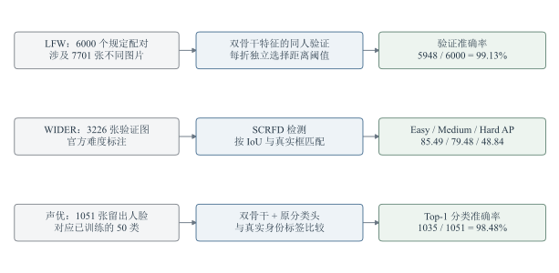
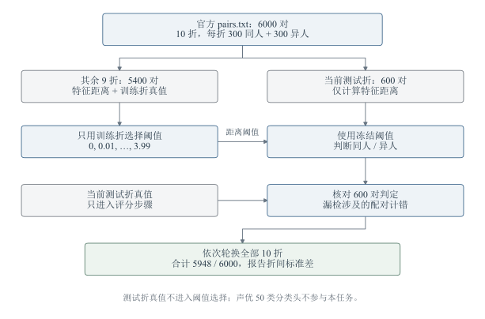
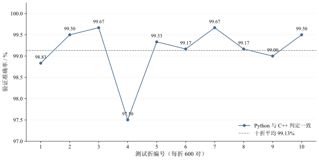
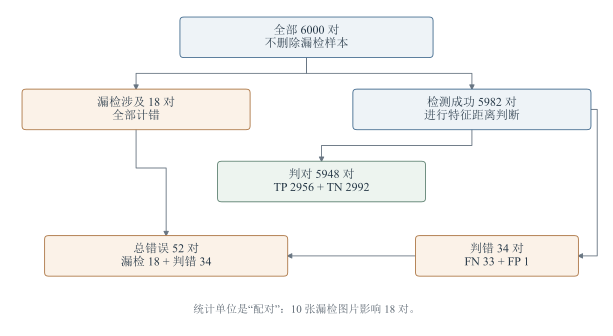
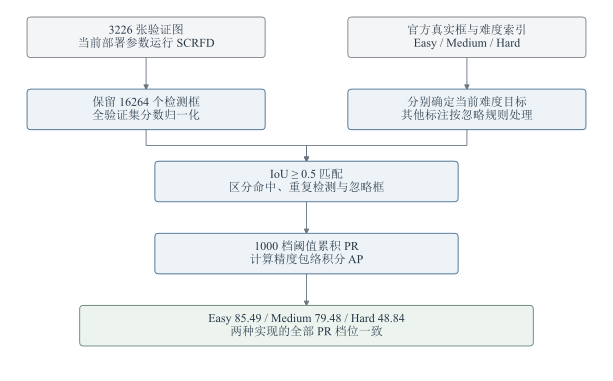
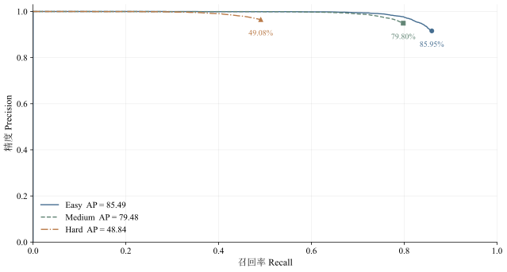
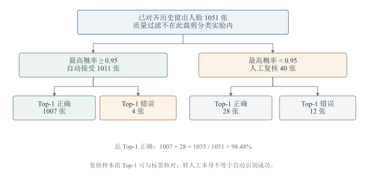
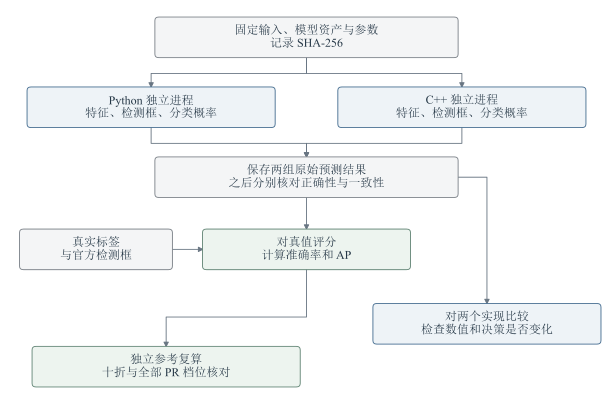

# LFW と WIDER FACE の全量プロトコルによる標準データセット精度

[English](STANDARD_DATASET_ACCURACY.md) | [简体中文](STANDARD_DATASET_ACCURACY.zh-CN.md) | [日本語](STANDARD_DATASET_ACCURACY.ja.md)

2026-10-28、本機で精度評価を完了した。先の[性能テスト](STANDARD_DATASET_BENCHMARK.ja.md)は遅延、資源使用量、出力一致性を対象としていた。今回は **LFW の規定全 6,000 ペア**、**WIDER FACE の検証画像全 3,226 枚**を使用し、元の声優 50 クラスの歴史的ホールドアウト 1,051 枚も再計算した。下記スコアは Python と C++ で一致し、独立した参照実装による再計算も通過した。

| 評価 | Python | C++ |
| --- | ---: | ---: |
| LFW、2 バックボーン融合による同一人物／別人検証の正解率 | **99.13%** | **99.13%** |
| WIDER FACE Easy、検出 AP × 100 | **85.49** | **85.49** |
| WIDER FACE Medium、検出 AP × 100 | **79.48** | **79.48** |
| WIDER FACE Hard、検出 AP × 100 | **48.84** | **48.84** |
| 声優 50 クラスの歴史的ホールドアウト、Top-1 分類正解率 | **98.48%** | **98.48%** |

C++ への移行による精度低下は見つからなかった。現行の配備設定では難しい場面の検出が依然として明確な弱点だった。LFW の検証正解率、WIDER の検出 AP、声優の分類正解率はそれぞれ別のタスクを評価する。

図の各行には固有の真値と統計定義があり、3 つの割合を 1 つの総合正解率に統合することはできない。

## LFW の 6,000 ペア・10 fold 検証

元の LFW 画像と公式 `pairs.txt` を使用し、ペアのランダム抽出は行っていない。リストは 10 fold で構成され、各 fold に同一人物 300 ペア、別人 300 ペア、計 6,000 ペアがあり、**異なる画像 7,701 枚**を使用する。ペアファイルの SHA-256 は [scikit-learn のデータ定義](https://github.com/scikit-learn/scikit-learn/blob/main/sklearn/datasets/_lfw.py)と一致し、`ea42330c62c92989f9d7c03237ed5d591365e89b3e649747777b70e692dc1592` である。ダウンロードには[固定リビジョンのミラー](https://huggingface.co/datasets/DerrickUnleashed/LFW/tree/f7571fa9dd5a5c31ab781de5227c6f1b6171c0c5)を使用し、画像アーカイブの出典とハッシュは[データ準備記録](STANDARD_DATASET_BENCHMARK.ja.md)を引き継いだ。

各原画像を既存 SCRFD で検出し、複数顔がある場合は面積最大の顔を選んだ。既存の 5 点テンプレートで 112×112 に位置合わせし、AdaFace IR101 と R50 の単位特徴を抽出した。融合は元の等重み連結を維持した。反転やマルチスケール拡張、モデルの再訓練は行っていない。

このタスクは特徴距離を直接比較し、**声優 50 クラス分類ヘッドを通さない**。各 fold では他の 5,400 ペアだけを使って二乗ユークリッド距離の閾値を選び、対象 fold の 600 ペアを評価した。候補閾値は `0, 0.01, …, 3.99` とし、閾値未満を同一人物と判定した。手順は [InsightFace の検証実装](https://github.com/deepinsight/insightface/blob/c6c3af7bd2d0a0bf4b78c78437357f3521aa5d52/recognition/arcface_torch/eval/verification.py)を参照した。アプリの分類確率閾値 `0.95` とは意味が異なる。

閾値選択とテスト採点を分離し、現在のテスト fold の真値を閾値探索に入れていない。

両実装とも **7,691／7,701 枚**で検出に成功した。残りの **10 枚**は **18 ペア**に関わる。この 18 ペアは同一人物／別人の元ラベルによらずすべて不正解とし、全 6,000 ペアを正解率の分母に残した。中央クロップによる救済や失敗サンプルの削除は行っていない。

| 特徴 | 正解数／6,000 | 10 fold 平均正解率 | fold 間の正解率標準偏差 |
| --- | ---: | ---: | ---: |
| AdaFace IR101 | 5,949 | 99.15% | 0.62 パーセントポイント |
| R50 | 5,948 | 99.13% | 0.60 パーセントポイント |
| 現行の 2 バックボーン融合 | **5,948** | **99.13%** | **0.60 パーセントポイント** |

3 行とも Python と C++ の結果は各 fold で同じだった。標準偏差は 10 fold 間の変動を示し、信頼区間ではない。単一バックボーンの行は参照用であり、既存声優分類ヘッドは元の 1,024 次元融合入力を使い続ける。

縦軸は fold 間の差を見るため 97%–100.25% の局所範囲を示す。点は全 10 fold の実測値で、平滑化していない。Python と C++ の各 fold 結果は重なる。

融合特徴の各 fold の正解数は順に **593、597、598、585、596、595、598、595、594、597** で、分母は各 600。選択した二乗距離閾値は順に `1.43, 1.41, 1.43, 1.43, 1.43, 1.53, 1.43, 1.43, 1.43, 1.43` だった。検出成功ペアでは TP=2,956、TN=2,992、FP=1、FN=33 で、これに前述の未検出 18 ペアが加わる。

標準特徴検証では、画像のぼけや小顔を理由に事前除外せず、品質不合格でも検出成功なら特徴を抽出した。アプリ品質閾値の通過状況は別に集計し、通過画像は 7,676 枚、両画像が通過したペアは 5,951 だった。カバレッジと検証正解率は分けて報告し、人手確認への移行を正解として数えていない。

## WIDER FACE 全検証集合の検出 AP

[WIDER FACE](https://mmlab.ie.cuhk.edu.hk/projects/WIDERFace/index.html) の全検証画像 3,226 枚を使用し、元の注釈には **39,708 顔**がある。Easy、Medium、Hard は公式難易度インデックスを使い、それぞれ 7,211、13,319、31,958 対象を評価する。難易度部分集合は合算しない。

評価は**現行の配備パラメータ**で行った。SCRFD `det_500m.onnx`、640×640 入力、長辺上限 1,920、検出スコア閾値 0.50、NMS IoU 0.40 を使用した。既存の単一スケール・反転なし前処理を使い、ベンチマーク向けの閾値引き下げ、入力拡大、テスト時拡張は行っていない。最終的に **16,264 検出枠**を残した。

評価は[公式評価ツールアーカイブ](http://shuoyang1213.me/WIDERFACE/support/eval_script/eval_tools.zip)にある MAT 注釈、`evaluation.m`、`boxoverlap.m`、`VOCap.m` の規則に従った。

- IoU 閾値は 0.5。公式の `+1` を含むピクセル面積規則を使用した。
- 予測枠を `(x, y, width, height)` に変換し、幅と高さは `x2-x1`、`y2-y1` とした。[SCRFD の出力実装](https://github.com/deepinsight/insightface/blob/c6c3af7bd2d0a0bf4b78c78437357f3521aa5d52/detection/scrfd/tools/test_widerface.py)と一致する。
- 全検証集合でスコアを正規化し、公式難易度インデックスに従って無視対象と重複検出を処理した。
- 1,000 段階の閾値で PR 曲線を累積し、精度包絡線の積分で AP を求めた。

| 難易度 | AP × 100 | 全保持検出枠での最大再現率 |
| --- | ---: | ---: |
| Easy | **85.49** | 85.95% |
| Medium | **79.48** | 79.80% |
| Hard | **48.84** | 49.08% |

曲線は全 1,000 段階の元結果を使用し、Python と C++ は重なる。終点マーカーは現行設定での最大再現率を示し、未観測の再現率区間に線を補っていない。

両実装の全検出枠・スコア JSON は完全に同じで、AP と PR 曲線の各段階の累積数も同じだった。Hard の AP は明確に低く、最大再現率も約 49.08% だった。現行設定の難しい対象の未検出は今後の改善課題となる。結果には検出スコア閾値と入力サイズの影響を含むため、別の評価設定でのモデル最高スコアとして扱えず、声優の個人分類正解率でもない。

## 声優 50 クラスホールドアウトの再推論

両実装がそれぞれ **位置合わせ済みホールドアウト顔全 1,051 枚**を読み直し、両バックボーンと分類ヘッドを実行した。古い確率を今回の推論出力として再利用していない。訓練特徴アーカイブのクラス順は現行モデルと同じで、テストインデックスは訓練・検証インデックスと排他的だった。

| 指標 | Python | C++ |
| --- | ---: | ---: |
| Top-1 正解数 | 1,035／1,051 | 1,035／1,051 |
| Top-1 正解率 | **98.48%** | **98.48%** |
| Top-5 正解率 | 99.14% | 99.14% |
| 閾値 0.95 での自動受理 | 1,011 | 1,011 |
| 自動受理中の誤判定 | 4 | 4 |
| 人手確認へ移行 | 40 | 40 |

1,051 件の Top-1 予測がすべて一致し、新たな誤判定はなかった。確率の最大絶対差は `3.5762786865234375e-7` だった。これは以前から繰り返し使用している歴史的ホールドアウトで、新規の独立テスト集合ではない。

## C++ 特徴出力と実装の照合

既存の本番 API は特徴を公開しない。今回は独立したソースコピーに評価専用の呼び出しモードを追加し、**既存の `detect → align → embed` 関数**を使って最大顔の特徴と元座標を返した。これらの関数や製品ソースは書き換えず、サーバーも更新していない。先に既存モードを抽出照合したところ、ランダムクロップの mode 2 と固定原画像 3 枚の mode 0 / 1 の出力は製品コアと全項目で一致した。評価コピーのビルドと CTest 3 件が通過した。WIDER と声優ホールドアウトには未変更の製品コアライブラリを直接使用した。

LFW 全量では、検出成功マスク、顔数、最大顔枠、ランドマーク、品質通過フラグが一致した。特徴の最大絶対差は約 **`2.98e-8`**、融合ペア距離の最大絶対差は約 **`4.77e-7`** だった。全 6,000 ペアの判定と正解／不正解マスクも一致した。

実行環境は **M4 Pro / 24 GiB、macOS ARM**、ネイティブ FTZ/DAZ は無効だった。Python と C++ は別プロセスで動作し、精度評価の推論は並行実行できるため、この処理時間を性能ベンチマークには使用していない。N150 の FTZ/DAZ の独立検証範囲は[対象機報告](N150_BENCHMARK.ja.md)を参照。本機 Mac の標準データセット成績を N150 で同規模の再推論を行った結果としては扱わない。

## 独立再計算と証拠

推論後、独立スクリプトが保存済み特徴、枠、ラベルから結果を再計算した。

精度は真値と比べた正しさを問い、一致性は 2 実装で結果が変わったかを問う。両方を別々に検証した。

- LFW は上流の正解率式、独立した正規化、`KFold(shuffle=False)` を使用し、各 fold で閾値を選び直して、正解数、未検出数、最終正解率を確認した。
- WIDER は[別の参照 Python 実装](https://github.com/wondervictor/WiderFace-Evaluation/blob/53474e0d35ecdd019052d4fff0813ea4037bd0cd/evaluation.py)の照合・PR 累積関数を使用し、両実装・3 難易度の **全 1,000 段階の曲線カウント**を項目ごとに確認した。IoU も公式 `boxoverlap.m` の予測ごとのベクトル式で別途計算した。
- 自己検査は完全な 10 fold、テスト fold の閾値リーク、未検出の誤り計上、重複検出、無視対象、IoU 境界、AP 積分を対象とした。参照再計算、モデル／ソース／成果物のハッシュ、ホールドアウトラベルの照合はすべて通過した。

ファイルは Git 無視対象の `data/experiments/standard-accuracy-20261028/` に保存した。

| ファイル | 用途 |
| --- | --- |
| `manifest.json`、`images/` | 規定の全ペア、画像ハッシュ、原画像 |
| `prepare_accuracy.py`、`infer.py` | データ準備と独立推論 |
| `evaluation-mode.patch`、`build-binding.json`、`diagnostic-smoke.json` | 特徴出力コピーの正確な差分、ビルドハッシュ、既存 API の照合 |
| `*-lfw-private.npz`、`*-wider-private.json`、`*-holdout-private.npz` | 元特徴、検出枠、分類確率。ローカルのみで保持 |
| `evaluate_accuracy.py`、`accuracy.json` | 完全な精度と各 fold の結果 |
| `audit_accuracy.py`、`accuracy-audit.json` | 独立参照再計算と数値比較 |
| `vendor/official/` | 出典を維持した元の公式注釈と評価式 |

主要なハッシュを以下に示す。

| 証拠 | SHA-256 |
| --- | --- |
| 公式評価ツールアーカイブ | `1cf49c8243fa8a1632efe7f6aa09fd7a3994ac838c9008bdbc9dd1d547bb234a` |
| 完全入力マニフェスト | `2b959830a950424206a6f439d3c3ab5e744fd1a6c2d5520bb9eaa52369396799` |
| 最終精度結果 | `6d83a994faece8300fdba89e4e23dcb310c50de12703ba6a6d53106f9d104ec5` |

公式アーカイブの `wider_face_val.mat` は、以前検証した WIDER 注釈アーカイブ内のファイルとバイト単位で一致した。写真、特徴、評価詳細、ビルド成果物は公開しない。モデルと配備は変更せず、push も行っていない。

図は [Python 描画関数](../tools/draw_documentation_figures.py)に由来し、既存結果の個人別ではない集計データを使用する。SVG、300 dpi PNG、PDF、再現方法は[図の出典説明](figures/README.ja.md)を参照。
