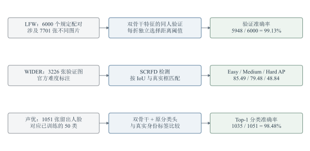
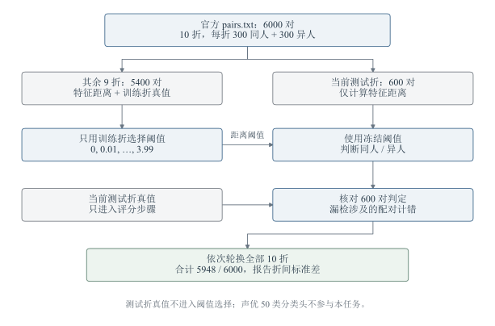
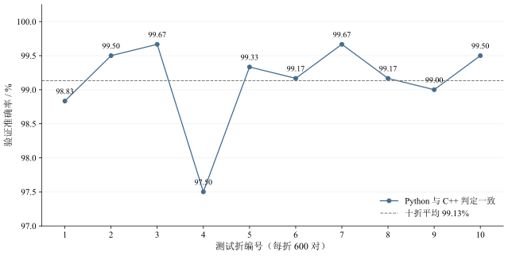
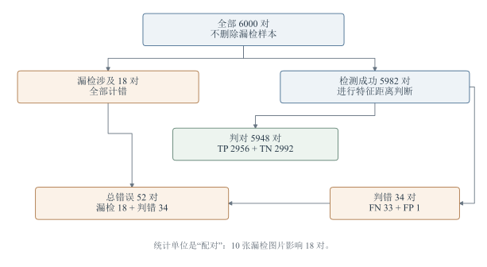
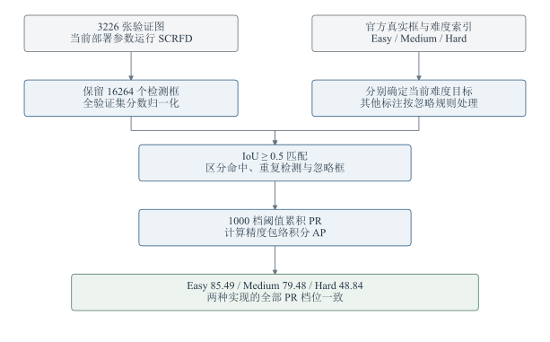
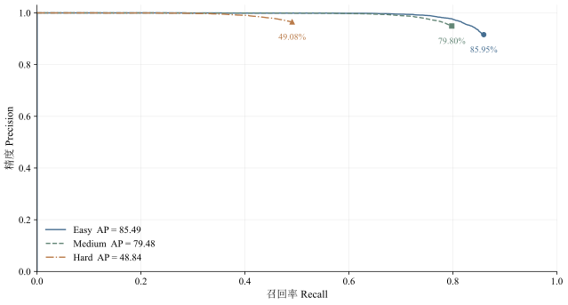
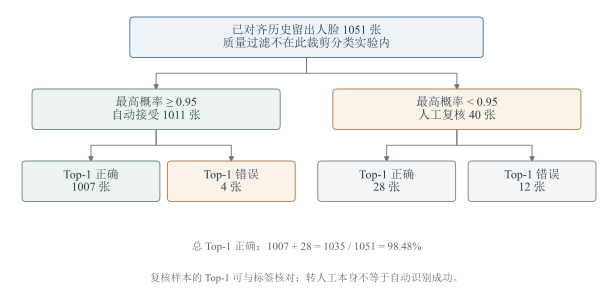
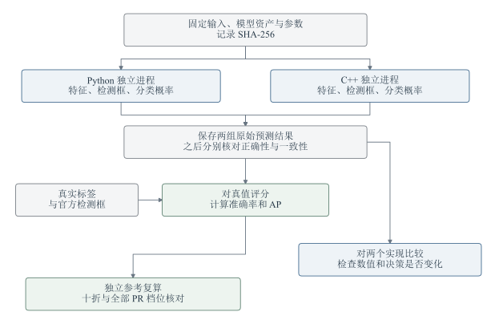

# Standard-dataset accuracy with full LFW and WIDER FACE protocols

[English](STANDARD_DATASET_ACCURACY.md) | [简体中文](STANDARD_DATASET_ACCURACY.zh-CN.md) | [日本語](STANDARD_DATASET_ACCURACY.ja.md)

Accuracy evaluation was completed locally on 2026-10-28. The earlier [performance test](STANDARD_DATASET_BENCHMARK.md) measured latency, resources, and output parity. This evaluation used **all 6,000 prescribed LFW pairs**, **all 3,226 WIDER FACE validation images**, and a fresh calculation on the original 50-class voice-actor historical holdout of 1,051 faces. Python and C++ obtained identical scores below, and recalculation with independent reference implementations passed.

| Evaluation | Python | C++ |
| --- | ---: | ---: |
| LFW dual-backbone fusion, same/different-person verification accuracy | **99.13%** | **99.13%** |
| WIDER FACE Easy detection AP × 100 | **85.49** | **85.49** |
| WIDER FACE Medium detection AP × 100 | **79.48** | **79.48** |
| WIDER FACE Hard detection AP × 100 | **48.84** | **48.84** |
| 50-class voice-actor historical holdout Top-1 classification accuracy | **98.48%** | **98.48%** |

No accuracy loss from the C++ migration was found. Detection in difficult scenes remained a clear weakness under the current deployment settings. LFW verification accuracy, WIDER detection AP, and voice-actor classification accuracy assess separate tasks.

Each row in the figure has its own ground truth and metric definition. The three percentages cannot be combined into one overall accuracy.

## LFW with 6,000 pairs and 10-fold verification

Original LFW images and the official `pairs.txt` were used, without randomly sampling pairs. The list contains 10 folds, each with 300 same-person and 300 different-person pairs, for 6,000 pairs involving **7,701 distinct images**. The pair-file SHA-256 matches the [scikit-learn dataset definition](https://github.com/scikit-learn/scikit-learn/blob/main/sklearn/datasets/_lfw.py) and is `ea42330c62c92989f9d7c03237ed5d591365e89b3e649747777b70e692dc1592`. Downloads used a [revision-pinned mirror](https://huggingface.co/datasets/DerrickUnleashed/LFW/tree/f7571fa9dd5a5c31ab781de5227c6f1b6171c0c5). Image archive sources and checksums follow the [data-preparation record](STANDARD_DATASET_BENCHMARK.md).

Each original image passed through the existing SCRFD detector. If multiple faces were present, the largest by area was selected, aligned to 112×112 using the existing five-point template, and used to extract unit AdaFace IR101 and R50 features. Fusion retained the original equally weighted concatenation. No flip or multiscale augmentation was used, and no model was retrained.

This task directly compares feature distances and **does not use the 50-class voice-actor head**. For each fold, only the other 5,400 pairs were used to choose a squared-Euclidean-distance threshold, then the fold's 600 pairs were evaluated. Candidate thresholds were `0, 0.01, …, 3.99`, with distances below the threshold classified as the same person. The procedure references the [InsightFace verification implementation](https://github.com/deepinsight/insightface/blob/c6c3af7bd2d0a0bf4b78c78437357f3521aa5d52/recognition/arcface_torch/eval/verification.py). This threshold has a different meaning from the application's `0.95` classification-probability threshold.

Threshold selection and test scoring were separate. Ground truth from the current test fold did not enter threshold search.

Both implementations detected faces successfully in **7,691/7,701 images**. The remaining **10 images** affected **18 pairs**. All 18 pairs were counted as incorrect regardless of their same/different-person labels, keeping all 6,000 pairs in the accuracy denominator. No central-crop fallback was used and no failures were removed.

| Features | Correct / 6,000 | Mean 10-fold accuracy | Standard deviation across folds |
| --- | ---: | ---: | ---: |
| AdaFace IR101 | 5,949 | 99.15% | 0.62 percentage points |
| R50 | 5,948 | 99.13% | 0.60 percentage points |
| Current dual-backbone fusion | **5,948** | **99.13%** | **0.60 percentage points** |

Python and C++ matched fold by fold for all three feature variants. The standard deviation describes variation across 10 folds and is not a confidence interval. The single-backbone rows are for reference. The existing voice-actor head continues to use the original 1,024-dimensional fused input.

The vertical axis shows a local range of 97%–100.25% to reveal fold differences. Points come from all ten measured folds without smoothing. Python and C++ fold results overlap.

Fused correct counts by fold were **593, 597, 598, 585, 596, 595, 598, 595, 594, 597**, each out of 600. Selected squared-distance thresholds were `1.43, 1.41, 1.43, 1.43, 1.43, 1.53, 1.43, 1.43, 1.43, 1.43`. Among pairs with successful detection, TP=2,956, TN=2,992, FP=1, and FN=33. The additional 18 pairs failed because of missed detections.

Standard feature verification did not discard samples in advance because of blur or small faces. Features were still extracted from images that failed application quality checks but passed detection. Application-quality coverage was reported separately, with 7,676 images passing and both images passing in 5,951 pairs. Coverage and verification accuracy were kept separate, and referral to human review was not counted as a correct result.

## WIDER FACE detection AP on the full validation set

All 3,226 [WIDER FACE](https://mmlab.ie.cuhk.edu.hk/projects/WIDERFace/index.html) validation images were used, with **39,708 annotated faces**. Official difficulty indices selected 7,211, 13,319, and 31,958 targets for Easy, Medium, and Hard, respectively. Difficulty subsets were not added together.

The evaluation used **current deployment parameters** with SCRFD `det_500m.onnx`, 640×640 input, maximum long side 1,920, detection-score threshold 0.50, and NMS IoU 0.40. Existing single-scale preprocessing without flipping was retained. The score threshold was not lowered, input size was not increased, and no test augmentation was added for the benchmark. **16,264 detection boxes** were retained.

Evaluation followed the MAT annotations and `evaluation.m`, `boxoverlap.m`, and `VOCap.m` rules in the [official evaluation-tool archive](http://shuoyang1213.me/WIDERFACE/support/eval_script/eval_tools.zip).

- IoU threshold was 0.5, using the official pixel-area convention that includes `+1`.
- Predicted boxes were converted to `(x, y, width, height)`, with width and height defined as `x2-x1` and `y2-y1`, matching [SCRFD's export implementation](https://github.com/deepinsight/insightface/blob/c6c3af7bd2d0a0bf4b78c78437357f3521aa5d52/detection/scrfd/tools/test_widerface.py).
- Scores were normalized across the full validation set. Ignored boxes and duplicate detections followed the official difficulty indices.
- PR curves were accumulated at 1,000 thresholds, with AP obtained by integrating the precision envelope.

| Difficulty | AP × 100 | Maximum recall using all retained boxes |
| --- | ---: | ---: |
| Easy | **85.49** | 85.95% |
| Medium | **79.48** | 79.80% |
| Hard | **48.84** | 49.08% |

The curves use all 1,000 raw threshold results. Python and C++ overlap. Endpoint markers show maximum recall under the current settings, without extending lines into unobserved recall ranges.

Complete detection-box and score JSON files were identical between implementations, as were AP and cumulative counts at every PR threshold. Hard AP was clearly low, with maximum recall around 49.08%. Missed difficult targets under this configuration warrant further work. The result includes the effects of the detection-score threshold and input size. It does not establish the model's highest score under other evaluation settings or measure voice-actor identity classification accuracy.

## Fresh inference on the 50-class voice-actor holdout

Both implementations separately reloaded all **1,051 aligned holdout faces** and ran both backbones and the head. Old probabilities were not reused as inference output for this run. The class order in the training-feature archive matched the current model, and test indices were disjoint from training and validation indices.

| Metric | Python | C++ |
| --- | ---: | ---: |
| Top-1 correct | 1,035/1,051 | 1,035/1,051 |
| Top-1 accuracy | **98.48%** | **98.48%** |
| Top-5 accuracy | 99.14% | 99.14% |
| Automatically accepted at 0.95 | 1,011 | 1,011 |
| Incorrect among automatic acceptances | 4 | 4 |
| Referred to human review | 40 | 40 |

All 1,051 Top-1 predictions matched, without additional errors. The maximum absolute probability difference was `3.5762786865234375e-7`. This remains the historical holdout used repeatedly in earlier work and does not constitute a newly created independent test set.

## C++ feature export and implementation checks

The production API does not expose features. An evaluation-only call mode was added to a separate source copy, invoking the **existing `detect → align → embed` functions** and returning the largest face's features and original coordinates. These functions and the product source were not rewritten, and the server was not updated. Existing call modes were checked on samples first. Mode 2 on random crops and modes 0 / 1 on 3 fixed originals matched product-core output item by item. The evaluation-copy build and 3 CTest tests passed. WIDER and the voice-actor holdout used the unmodified product core library directly.

Across all LFW images, detection-success masks, face counts, largest-face boxes, landmarks, and quality-pass flags matched. Maximum absolute feature difference was about **`2.98e-8`**, and maximum absolute fused pair-distance difference about **`4.77e-7`**. All 6,000 pair decisions and correct/incorrect masks matched.

The platform was **M4 Pro / 24 GiB, macOS ARM**, with native FTZ/DAZ disabled. Python and C++ ran in separate processes. Accuracy inference jobs could run concurrently, so their elapsed time was not used as a performance benchmark. The independent scope of N150 FTZ/DAZ checks is documented in the [target-machine report](N150_BENCHMARK.md). Mac standard-dataset scores are not presented as a rerun at the same scale on N150.

## Independent recalculation and evidence

After inference, independent scripts recalculated results from saved features, boxes, and labels.

Accuracy checks correctness against ground truth. Parity checks whether the implementations changed results. Both were checked separately.

- LFW used the upstream accuracy formula, independent normalization, and `KFold(shuffle=False)`, reselecting thresholds for every fold and checking per-fold correct counts, detection failures, and final accuracy.
- WIDER used matching and PR-accumulation functions from [another reference Python implementation](https://github.com/wondervictor/WiderFace-Evaluation/blob/53474e0d35ecdd019052d4fff0813ea4037bd0cd/evaluation.py) to compare **all 1,000 threshold counts** for both implementations and all three difficulties. IoU was also calculated using the official `boxoverlap.m` per-prediction vector formula.
- Self-checks covered complete ten-fold evaluation, test-fold threshold leakage, counting detection failures as errors, duplicate detections, ignored targets, IoU boundaries, and AP integration. Reference recalculation, model/source/artifact hashes, and holdout-label checks all passed.

Files are stored in Git-ignored `data/experiments/standard-accuracy-20261028/`.

| File | Purpose |
| --- | --- |
| `manifest.json`, `images/` | All prescribed pairs, image hashes, and originals |
| `prepare_accuracy.py`, `infer.py` | Data preparation and independent inference |
| `evaluation-mode.patch`, `build-binding.json`, `diagnostic-smoke.json` | Exact feature-export-copy changes, build hashes, and existing-interface checks |
| `*-lfw-private.npz`, `*-wider-private.json`, `*-holdout-private.npz` | Raw features, detection boxes, and classification probabilities kept locally only |
| `evaluate_accuracy.py`, `accuracy.json` | Full accuracy and per-fold results |
| `audit_accuracy.py`, `accuracy-audit.json` | Independent reference recalculation and numerical comparison |
| `vendor/official/` | Original official annotations and evaluation formulas, with provenance retained |

Key hashes are listed below.

| Evidence | SHA-256 |
| --- | --- |
| Official evaluation-tool archive | `1cf49c8243fa8a1632efe7f6aa09fd7a3994ac838c9008bdbc9dd1d547bb234a` |
| Complete input manifest | `2b959830a950424206a6f439d3c3ab5e744fd1a6c2d5520bb9eaa52369396799` |
| Final accuracy results | `6d83a994faece8300fdba89e4e23dcb310c50de12703ba6a6d53106f9d104ec5` |

The official archive's `wider_face_val.mat` is byte-identical to the file in the previously verified WIDER annotation archive. Photos, features, evaluation details, and build artifacts are not published. Models and deployments were unchanged, and nothing was pushed.

Figures come from the [Python plotting functions](../tools/draw_documentation_figures.py), using non-identity aggregates of existing results. SVG, 300 dpi PNG, PDF, and reproduction instructions are described in the [figure-source notes](figures/README.md).
