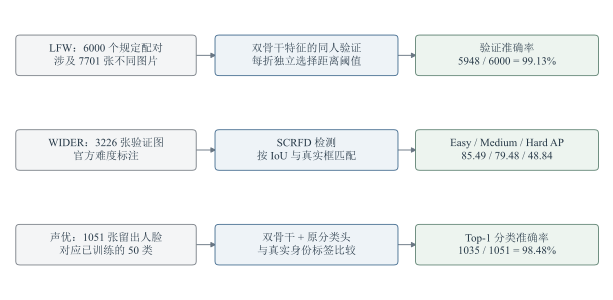
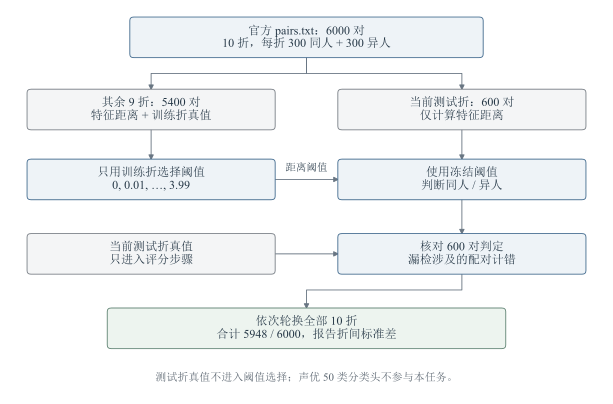
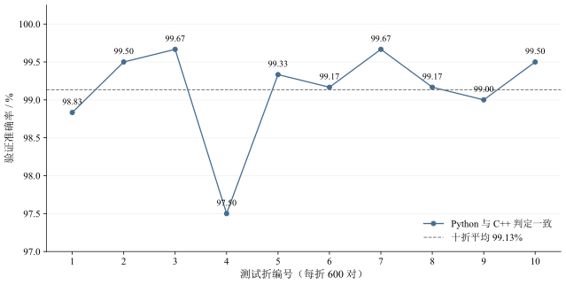
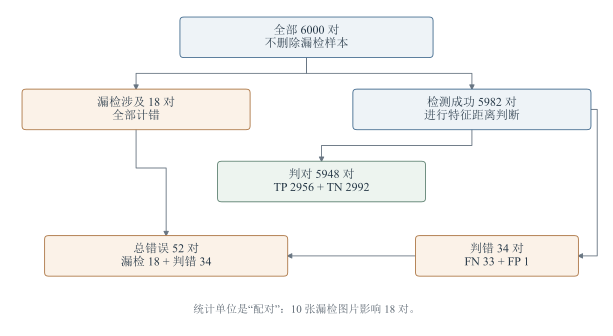
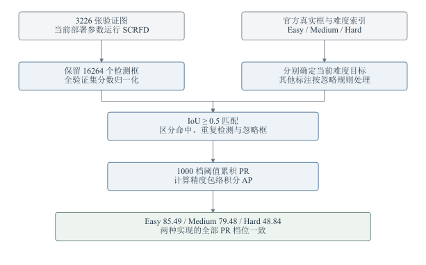
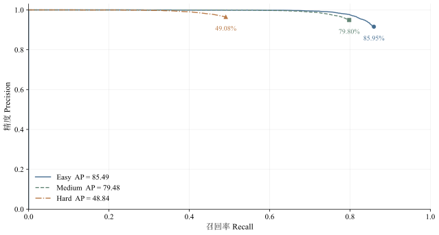
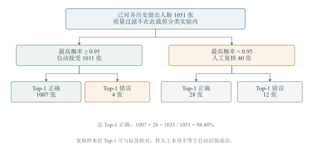
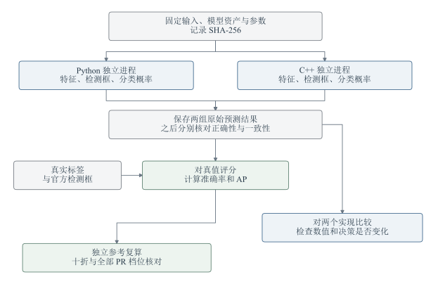

# 标准数据集准确率 LFW 与 WIDER FACE 全量协议

[English](STANDARD_DATASET_ACCURACY.md) | [简体中文](STANDARD_DATASET_ACCURACY.zh-CN.md) | [日本語](STANDARD_DATASET_ACCURACY.ja.md)

2026-10-28 在本机完成准确率评测，区别于此前只测延迟、资源和输出一致性的
[性能测试](STANDARD_DATASET_BENCHMARK.zh-CN.md)。本次使用 **LFW 全部 6,000 个规定配对**、
**WIDER FACE 全部 3,226 张验证图片**，并重新计算原声优 50 类的 1,051 张历史留出集。
Python 与 C++ 的下列分数相同，独立参考实现复算通过。

| 评测 | Python | C++ |
| --- | ---: | ---: |
| LFW。双骨干融合，同人／异人验证准确率 | **99.13%** | **99.13%** |
| WIDER FACE Easy。检测 AP × 100 | **85.49** | **85.49** |
| WIDER FACE Medium。检测 AP × 100 | **79.48** | **79.48** |
| WIDER FACE Hard。检测 AP × 100 | **48.84** | **48.84** |
| 声优 50 类历史留出。Top-1 分类准确率 | **98.48%** | **98.48%** |

本次没有发现 C++ 迁移导致掉准。当前部署设置下，困难场景检测仍是明显短板。
LFW 验证准确率、WIDER 检测 AP 与声优分类准确率分别评价不同任务。

图中三行各有自己的真值和统计口径，三个百分比不能合并为一个“总体准确率”。

## LFW 6,000 对、10 折验证

使用原始 LFW 图像和官方 `pairs.txt`，没有随机抽取配对。清单包含 10 折，每折
300 对同人、300 对异人，共 6,000 对，实际涉及 **7,701 张不同图片**。
配对文件 SHA-256 与 [scikit-learn 的数据定义](https://github.com/scikit-learn/scikit-learn/blob/main/sklearn/datasets/_lfw.py)
一致，为 `ea42330c62c92989f9d7c03237ed5d591365e89b3e649747777b70e692dc1592`。
下载使用[固定版本镜像](https://huggingface.co/datasets/DerrickUnleashed/LFW/tree/f7571fa9dd5a5c31ab781de5227c6f1b6171c0c5)，
图像归档来源及校验值沿用[数据准备记录](STANDARD_DATASET_BENCHMARK.zh-CN.md)。

每张原图使用现有 SCRFD 检测。存在多个人脸时选择面积最大的一个，再按现有
五点模板对齐为 112×112，提取 AdaFace IR101 与 R50 单位特征。融合方式保持
原来的等权拼接。测试不使用翻转或多尺度增强，也不重训模型。

该任务直接比较特征距离，**不经过声优 50 类分类头**。每折仅用另外 5,400 对选择
平方欧氏距离阈值，再评价本折 600 对。候选阈值为 `0, 0.01, …, 3.99`，小于阈值
判为同人。流程参考 [InsightFace 验证实现](https://github.com/deepinsight/insightface/blob/c6c3af7bd2d0a0bf4b78c78437357f3521aa5d52/recognition/arcface_torch/eval/verification.py)。
它与应用分类概率的 `0.95` 阈值含义不同。

阈值选择和测试评分分开。当前测试折的真值不进入阈值搜索。

两种实现都在 **7,691／7,701 张**图像上检测成功。其余 **10 张**涉及 **18 对**。
这 18 对全部计错，无论原标签为同人或异人，保留全部 6,000 对作为准确率分母。
没有使用中心裁剪补救或删除失败样本。

| 特征 | 答对／6,000 | 10 折平均准确率 | 折间准确率标准差 |
| --- | ---: | ---: | ---: |
| AdaFace IR101 | 5,949 | 99.15% | 0.62 个百分点 |
| R50 | 5,948 | 99.13% | 0.60 个百分点 |
| 当前双骨干融合 | **5,948** | **99.13%** | **0.60 个百分点** |

以上三行的 Python 与 C++ 结果逐折相同。标准差是 10 折之间的波动，不是置信区间。
单骨干表仅用于对照。现有声优分类头仍使用原来的 1,024 维融合输入。

纵轴显示 97%–100.25% 的局部区间，用于观察折间差异。点来自全部十折实测结果，未平滑。Python 和 C++ 的逐折结果重合。

融合的各折答对数依次为 **593、597、598、585、596、595、598、595、594、597**，
每折分母均为 600。选出的平方距离阈值依次为
`1.43, 1.41, 1.43, 1.43, 1.43, 1.53, 1.43, 1.43, 1.43, 1.43`。
在检测成功的配对中，TP=2,956、TN=2,992、FP=1、FN=33。另有上述 18 对漏检失败。

标准特征验证不因图像模糊或小脸而先删除样本，质量不合格但检测成功的图像仍提取
特征。另行统计应用质量门槛。7,676 张图像通过，5,951 对的两张图均通过。
这项覆盖率和验证准确率分开报告，不把转人工复核视为答对。

## WIDER FACE 完整验证集检测 AP

使用 [WIDER FACE](https://mmlab.ie.cuhk.edu.hk/projects/WIDERFace/index.html) 的全部
3,226 张验证图片，原始标注共 **39,708 张人脸**。Easy、Medium、Hard 使用官方
难度索引，分别评价 7,211、13,319、31,958 个目标，难度子集不作相加统计。

本次评价的是**当前部署参数**。SCRFD `det_500m.onnx`、640×640 输入、最长边
限制 1,920、检测分数门槛 0.50、NMS IoU 0.40。采用单尺度、无翻转的现有预处理，
没有为基准降低分数门槛、放大输入或增加测试增强。最终保留 **16,264 个检测框**。

评测使用[官方评测工具归档](http://shuoyang1213.me/WIDERFACE/support/eval_script/eval_tools.zip)
中的 MAT 标注、`evaluation.m`、`boxoverlap.m` 和 `VOCap.m` 规则。

- IoU 门槛 0.5，采用官方含 `+1` 的像素面积约定。
- 预测框按 `(x, y, width, height)` 转换，宽高为 `x2-x1`、`y2-y1`，与
  [SCRFD 的导出实现](https://github.com/deepinsight/insightface/blob/c6c3af7bd2d0a0bf4b78c78437357f3521aa5d52/detection/scrfd/tools/test_widerface.py) 一致。
- 全验证集分数归一化，按官方难度索引处理忽略框和重复检测。
- 1,000 档阈值累积 PR 曲线，精度包络积分得到 AP。

| 难度 | AP × 100 | 所有已保留检测框下的最大召回率 |
| --- | ---: | ---: |
| Easy | **85.49** | 85.95% |
| Medium | **79.48** | 79.80% |
| Hard | **48.84** | 49.08% |

曲线读取全部 1,000 档原始结果，Python 与 C++ 重合。末端标记给出当前参数下的最大召回率，未观测到的召回区间不补线。

两边的完整检测框及分数 JSON 完全相同，AP、PR 曲线各档累计数也相同。
Hard 的 AP 明显偏低，且最大召回率约 49.08%。当前配置下困难目标的漏检值得
后续优化。该结果包含检测分数门槛和输入尺寸的影响，不能当成使用其他评测设置
时的模型最高分，也不是声优身份分类准确率。

## 声优 50 类留出集 重新推理

两种实现分别重新读取全部 **1,051 张已对齐留出人脸**并运行双骨干与分类头。
没有复用旧概率作为本次推理输出。训练特征归档的类别顺序与当前模型一致，
测试索引与训练、验证索引互斥。

| 指标 | Python | C++ |
| --- | ---: | ---: |
| Top-1 答对 | 1,035／1,051 | 1,035／1,051 |
| Top-1 准确率 | **98.48%** | **98.48%** |
| Top-5 准确率 | 99.14% | 99.14% |
| 0.95 阈值自动接受 | 1,011 | 1,011 |
| 自动接受中的误判 | 4 | 4 |
| 转人工复核 | 40 | 40 |

1,051 个 Top-1 预测全部相同，没有新增误判。概率最大绝对差为
`3.5762786865234375e-7`。这仍是此前多次使用的历史留出集，不是新建的独立测试集。

## C++ 特征导出与实现核对

现有生产 API 不公开特征。本次在独立源码副本中新增仅用于评测的调用模式，调用
**原有的 `detect → align → embed` 函数**，返回最大人脸的特征与原始坐标。
没有改写这些函数或产品源码，也没有更新服务器。旧调用模式先通过抽样核对。
随机裁剪的 mode 2，以及 3 张固定原图的 mode 0 / 1，输出与产品核心逐项相同。
评测副本构建及 3 项 CTest 通过。WIDER 和声优留出集直接使用未修改的产品核心库。

全量 LFW 对照结果为。检测成功掩码、人脸数、最大人脸框、关键点及质量通过标记
相同。特征最大绝对差约 **`2.98e-8`**，融合配对距离最大绝对差约 **`4.77e-7`**。
6,000 对判定及答对／答错掩码全部一致。

运行平台为 **M4 Pro / 24 GiB、macOS ARM**，原生 FTZ/DAZ 关闭。Python 与 C++
在独立进程中运行，准确率推理可并行，不把这次作业耗时当作性能基准。
N150 上 FTZ/DAZ 的独立校验范围见 [目标机报告](N150_BENCHMARK.zh-CN.md)。本次不将
Mac 的标准数据成绩写成 N150 上同规模重新推理的结果。

## 独立复算与证据

推理结束后，独立脚本从保存的特征、框与标签重新计算结果。

准确率回答“与真值相比是否认对”，一致性回答“两个实现是否变化”。两者分别核对。

- LFW 使用上游的准确率公式、独立归一化及 `KFold(shuffle=False)`，逐折重选阈值，
  核对每折答对数、漏检数与最终准确率。
- WIDER 使用[另一份参考 Python 实现](https://github.com/wondervictor/WiderFace-Evaluation/blob/53474e0d35ecdd019052d4fff0813ea4037bd0cd/evaluation.py)
  的匹配和 PR 累计函数，对两种实现、三个难度的 **全部 1,000 档曲线计数**逐项核对。
  IoU 另按官方 `boxoverlap.m` 的逐预测向量公式计算。
- 自检覆盖完整十折、测试折阈值泄漏、漏检计错、重复检测、忽略目标、IoU 边界和 AP
  积分。参考复算、模型／源码／产物摘要与留出集标签核对均通过。

文件保存在被 Git 忽略的 `data/experiments/standard-accuracy-20261028/`。

| 文件 | 用途 |
| --- | --- |
| `manifest.json`、`images/` | 全部规定配对、图像摘要及原图 |
| `prepare_accuracy.py`、`infer.py` | 数据准备与独立推理 |
| `evaluation-mode.patch`、`build-binding.json`、`diagnostic-smoke.json` | 特征导出副本的精确差异、构建摘要与旧接口核对 |
| `*-lfw-private.npz`、`*-wider-private.json`、`*-holdout-private.npz` | 原始特征、检测框、分类概率，仅本地留存 |
| `evaluate_accuracy.py`、`accuracy.json` | 完整准确率与每折结果 |
| `audit_accuracy.py`、`accuracy-audit.json` | 独立参考复算与数值比较 |
| `vendor/official/` | 原始官方标注与评测公式，保留来源 |

关键摘要。

| 依据 | SHA-256 |
| --- | --- |
| 官方评测工具归档 | `1cf49c8243fa8a1632efe7f6aa09fd7a3994ac838c9008bdbc9dd1d547bb234a` |
| 完整输入清单 | `2b959830a950424206a6f439d3c3ab5e744fd1a6c2d5520bb9eaa52369396799` |
| 最终准确率结果 | `6d83a994faece8300fdba89e4e23dcb310c50de12703ba6a6d53106f9d104ec5` |

官方归档中的 `wider_face_val.mat` 与此前校验过的 WIDER 标注压缩包内文件字节一致。
本次不发布照片、特征、评测明细或构建产物。未改模型、未切换部署、未 push。

图源为 [Python 绘图函数](../tools/draw_documentation_figures.py)，使用已有结果的
非身份聚合数据。SVG、300 dpi PNG、PDF 和复现方法见 [图源说明](figures/README.zh-CN.md)。
