# Seiyuu-FaceID 技術解説 写真から本人判定まで

[English](TECHNICAL_ARCHITECTURE.md) | [简体中文](TECHNICAL_ARCHITECTURE.zh-CN.md) | [日本語](TECHNICAL_ARCHITECTURE.ja.md)

本書は 2026-10-27 から 2026-10-28 のコードと実験記録に基づき、認識フレームワーク全体を説明します。モデルが人物を識別する仕組み、各処理の目的、結果と性能値の解釈を中心に扱います。後半では C++ / Go 実装と N150 へのデプロイを説明します。

処理は **SCRFD 顔検出 → 品質検査 → 5点アライメント → AdaFace IR101 と R50 の特徴融合 → 標準化とロジスティック回帰 → しきい値判定** の順です。2つの特徴モデルは事前学習済みの重みを凍結し、本プロジェクトでは確認済みの 50 人について最後の分類ヘッドを学習します。推論はすべてローカルで実行します。

Python が参照実装です。C++ 推論コアと Go HTTP 層は Mac と Linux でビルドと起動を完了し、N150 では3組の HTTP ベースラインを測定しました。その後、非正規化数の処理コストを特定し、FTZ 版で 1,051 枚の切り抜き、12 枚の元画像の回帰確認、3プロセスの HTTP 測定を完了しました。平均リクエスト時間は約 0.681 秒、過去のホールドアウト Top-1 は 98.48% を維持しました。段階別の結果、リソースのトレードオフ、統計上の範囲は [N150 実機レポート](N150_BENCHMARK.ja.md) を参照してください。**2026-10-28 に製品ソースへ統合し、N150 の systemd サービスとして有効化しました。長期稼働と負荷試験の受け入れ確認は未完了です。**

## 読み方

図は [Python 描画関数](../tools/draw_documentation_figures.py) で生成し、拡大可能な SVG で掲載しています。
PNG、PDF、再現方法は [図のソース説明](figures/README.ja.md) にあります。

- [1. システムが解決する問題](#section-1)
- [2. 写真1枚の認識処理全体](#section-2)
- [3. SCRFD による顔検出](#section-3)
- [4. 品質検査と5点アライメント](#section-4)
- [5. 2つのバックボーンによる特徴抽出](#section-5)
- [6. 分類ヘッドによる人物名と確率の算出](#section-6)
- [7. モデルの学習と評価](#section-7)
- [8. 性能最適化の考え方](#section-8)
- [9. C++ コアと Go サービスの連携](#section-9)
- [10. 実験から分かること](#section-10)
- [11. N150 のデプロイと受け入れ確認](#section-11)
- [12. ディスクとログも実行時構成に含める理由](#section-12)
- [13. コード参照索引](#section-13)

<a id="section-1"></a>

## 1. システムが解決する問題

システムは写真を受け取り、顔を検出し、それぞれの顔を学習済みの人物に分類できるか判断します。モデルには 50 クラスが組み込まれ、出力はこの既知クラス間の分類結果です。

3つの問いを、それぞれ異なる処理が担当します。

| 問い | 担当処理 | 出力 |
| --- | --- | --- |
| 写真のどこに顔があるか | SCRFD 検出器 | 顔矩形、検出スコア、5点のランドマーク |
| 人物の識別に使える視覚的特徴は何か | AdaFace IR101、R50 | 各 512 次元の特徴ベクトル2本 |
| どの学習済み人物に特徴が最も合うか | ローカル分類ヘッド | 50 クラスの確率、上位5候補、受理または確認 |

リクエストごとに学習写真を1枚ずつ検索したり、ベクトルデータベースを参照したりはしません。学習写真はオフラインで分類器を学習するために使います。提供時に必要なのはモデルの重み、分類パラメーター、順序付きのクラス名だけなので、学習画像全体を読み込む必要はありません。

特徴抽出器は新しい写真も処理できますが、分類ヘッドが返せる名前は学習済みクラスに限られます。人物の追加にはラベルの準備と分類ヘッドの再学習、検証が必要です。サンプル管理画面に写真を追加しても、デプロイ済みモデルは自動更新されません。

写真内の複数の顔は個別に判定します。現在の処理には画像間の人物追跡、時系列投票、生体検知はありません。登録対象外の実在人物、キャラクター画像、大きな遮蔽などを確実に拒否できることも、検証済みの能力には含みません。

<a id="section-2"></a>

## 2. 写真1枚の認識処理全体

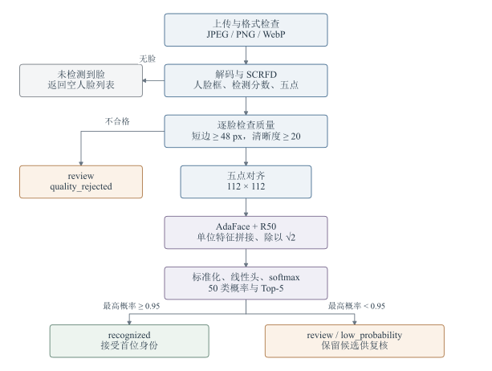

集合写真の処理は、画像デコード1回、顔検出1回、品質を満たした各顔の特徴抽出と分類に分けて考えられます。顔が増えると通常は両バックボーンの実行回数も増えます。1人の写真の処理時間で大人数の集合写真を代表させることはできません。

品質不合格の顔は直ちに確認対象として返し、大きなバックボーンを実行せず、人物候補も生成しません。品質は合格でも人物確率が不足する場合は、分類候補を手動確認用に残します。この2種類の `review` は理由が異なります。

Python の主処理は [runtime/pipeline.py](../src/seiyuu_faceid/runtime/pipeline.py)、対応する C++ 実装は [native/src/faceid.cc](../native/src/faceid.cc) にあります。

<a id="section-3"></a>

## 3. SCRFD による顔検出

### 3.1 検出モデルと入力

検出器は InsightFace の `buffalo_sc` モデルパックに由来する `det_500m.onnx` を使います。SCRFD は顔の位置とランドマークを求める専用の顔検出モデルです。上流実装は [SCRFD 公式リポジトリ](https://github.com/deepinsight/insightface/tree/master/detection/scrfd) にあります。本プロジェクトでは検出器を再学習していません。

前処理は次の順序です。

1. EXIF の向きを読み、正しい向きの画素を検出器へ渡します。
2. 元画像の長辺が 1920 ピクセルを超える場合は、その上限まで縦横比を保って縮小します。
3. さらに縦横比を保ってリサイズし、周囲を黒で埋めて 640 × 640 キャンバスの中央に配置します。
4. BGR を検出モデルが必要とする RGB に変換し、`(pixel - 127.5) / 128` で正規化します。
5. 配列をバッチ、チャネル、高さ、幅の順である `NCHW` に並べます。

余白を付けることで、長方形の画像を正方形に配置しても顔の縦横比を維持できます。長辺 1920 は検出前処理用の作業画像の上限で、640 × 640 は検出ネットワークの入力サイズです。この2つは別の値です。

アップロードの画素数制限は別の制御です。検出前の縮小では、圧縮ファイルを最初に画素へ展開する際のメモリを省けないため、アップロード入口で画像寸法を検査する必要があります。

### 3.2 複数スケールの出力と矩形の復元

現在の SCRFD エクスポートはストライド 8、16、32 の3スケールです。各スケールで顔スコア、矩形の距離、5点のオフセットを出力し、合計9組になります。各スケールの空間サンプリング密度が異なるため、サイズの異なる顔候補を提案できます。

コードは特徴マップの位置とストライドから候補中心を復元し、出力された距離を顔矩形とランドマークに変換します。検出スコア `≥ 0.50` の候補だけを残します。

同じ顔から重なった候補が複数出るため、非極大値抑制（NMS）で重複を除きます。重なりの尺度は次のとおりです。

$$
\operatorname{IoU}(A,B)=\frac{|A\cap B|}{|A\cup B|}
$$

高スコアの矩形から残し、その矩形との IoU が `0.40` を超える他の矩形を抑制します。最後に余白と拡縮を逆変換し、矩形とランドマークをデコード後の元画像の座標系へ戻します。品質検査とアライメントもこの座標系を使います。

**検出器内のデータフロー。** 3つのストライドが各3組のテンソルを出力し、合計9組から候補矩形を生成します。

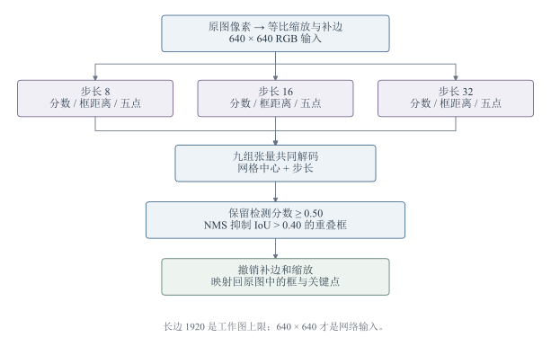

### 3.3 検出スコアと人物スコアの違い

`detector_score` は、その領域が顔であると検出器が判断するスコアです。誰の顔かを示す値ではありません。検出スコアが高くても、ぼけ、未知の人物、既知人物間の識別の難しさが残ることがあります。

検出の誤りは後段にも影響します。見落とした顔は分類に進まず、ランドマークの誤差は整列後の画素を変えます。切り抜き済みの顔だけをテストしても、これらの失敗経路は検証できません。

実装入口は [vision/detector.py](../src/seiyuu_faceid/vision/detector.py) の `SCRFDDetector.detect`、`_decode`、`_nms` です。

<a id="section-4"></a>

## 4. 品質検査と5点アライメント

### 4.1 明らかに認識に適さない顔を先に除く

品質検査は元画像の顔矩形を使い、低コストの2条件を確認します。

| 条件 | 現在のしきい値 | 目的 |
| --- | ---: | --- |
| 顔矩形の短辺 | 48 ピクセル以上 | 小さすぎる顔は識別できる細部が不足する |
| 鮮明度 | グレースケールのラプラシアン分散が 20.0 以上 | 局所的なエッジ変化が弱いぼけた顔を確認対象にする |

ラプラシアンは輝度の局所変化を捉えます。分散が低い領域には、ぼけやテクスチャ不足がよく見られます。ただし、学習された人物信頼度でも写真品質の総合評価でもなく、ノイズや高コントラストの影響も受けます。

返される `quality_score` は、サイズと鮮明度の打ち切り比率の平均です。

$$
q=\tfrac12\left[\min\left(1,\frac{s}{2s_{\min}}\right)+
\min\left(1,\frac{v}{2v_{\min}}\right)\right]
$$

`s` は矩形の短辺、`v` は鮮明度です。品質の受理には両方のしきい値を個別に満たす必要があり、この平均スコアだけで代替できません。既定値は [configs/n150.yaml](../configs/n150.yaml)、実装は [vision/quality.py](../src/seiyuu_faceid/vision/quality.py) にあります。

### 4.2 顔矩形の切り抜きだけでは足りない理由

同じ人物の写真でも、頭の傾き、撮影距離、矩形内の位置が異なります。矩形の切り抜きとリサイズだけでは入力内の目の位置が変わり、特徴ネットワークは人物差と幾何学的な差を同時に処理する必要があります。

5点アライメントは両目、鼻先、両口角を固定の ArcFace 112 テンプレートへ写像します。整列後の入力は 112 × 112 で、顔の主要な位置と向きがそろいます。

求めるのは、等方的な拡縮、回転、平行移動からなる2次元の相似変換です。

$$
\mathbf y \approx sR\mathbf x+\mathbf t
$$

`R` は回転、`s` は一様な拡縮、`t` は平行移動です。`estimateAffinePartial2D(..., LMEDS)` で変換を推定し、双線形補間で整列画像を生成します。元画像の外側は黒で埋めます。

**アライメントの幾何関係。** 顔矩形は位置の特定と品質検査に使い、変換は5点から推定します。

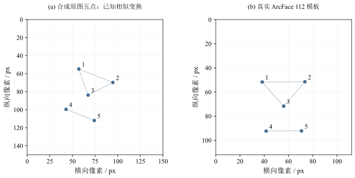

左側は既知の相似変換から構成した説明用の点で、評価写真ではありません。右側はコード中の実際のテンプレートです。どちらも左上を画素座標の原点とし、両軸の縮尺をそろえています。

この処理は3次元の顔を復元せず、強い横顔を正面顔には戻せません。2次元相似変換で説明できる位置差を減らします。

実装と固定テンプレートは [vision/alignment.py](../src/seiyuu_faceid/vision/alignment.py) にあります。テンプレート、補間方法、ランドマーク順序はモデル入力の契約に含まれ、変更時には再検証が必要です。

<a id="section-5"></a>

## 5. 2つのバックボーンによる特徴抽出

### 5.1 特徴ベクトルの意味

特徴抽出ネットワークは 112 × 112 の顔画素を数値ベクトルに写像します。これは embedding とも呼ばれます。各次元は人手で決めた顔部品の寸法ではなく、ベクトル全体で学習済みの人物識別情報を表します。

本プロジェクトは凍結した2つの事前学習済みバックボーンを使います。

| バックボーン | 入力の色順序 | 画素の正規化 | 出力 |
| --- | --- | --- | --- |
| AdaFace IR101 | BGR | `(pixel / 255 - 0.5) / 0.5` | 512 次元、その後 L2 正規化 |
| InsightFace R50 | RGB | `pixel / 127.5 - 1` | 512 次元、その後 L2 正規化 |

凍結とは、本プロジェクトで人物分類器を学習する際に両バックボーンの重みを更新しないことです。バックボーンは汎用的な顔表現を供給し、最後の分類ヘッドが本プロジェクトの人物ラベルとの関係を学習します。

AdaFace の上流手法は学習時に画質に応じた適応的マージンを使います。本プロジェクトはその学習済みバックボーンを順伝播に使うだけです。前述の 48 ピクセルとラプラシアン分散による品質検査は本プロジェクトの実行時ルールであり、別の仕組みです。[AdaFace 公式説明](https://github.com/mk-minchul/AdaFace) を参照してください。

### 5.2 個別に正規化してから連結する理由

両バックボーンの生出力を `a` と `r` とし、まず単位ベクトルを計算します。

$$
u_A=\frac{a}{\|a\|_2},\qquad
u_R=\frac{r}{\|r\|_2}
$$

続いて、学習時に固定した順序で連結します。

$$
f=\frac{[u_A;u_R]}{\sqrt2}\in\mathbb R^{1024}
$$

理想的な実数演算では `f` の L2 ノルムも 1 です。連結前の両部分が同じノルムを持つため、生出力の数値が大きいだけで片方が全体の尺度を支配することを防ぎます。

融合するのは **特徴** です。どちらのバックボーンも本プロジェクトの 50 クラスの人物確率を直接返しません。人物名を2回予測して投票する処理はありません。最後の分類器が両部分を同時に読み、次元ごとに異なる重みを学習できます。

**画素から 50 クラスのスコアまでの次元変化。** 色処理は個別に行い、特徴層で合流します。

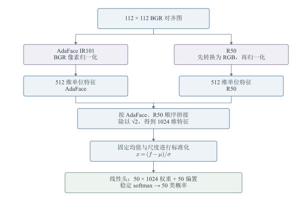

2つの事前学習済みネットワークが相補的な表現を提供する可能性が、両方を残す設計理由です。現在の移行実験では片方を削除したモデルの再学習と独立評価をしていないため、すべてのデータで必ず優れるとは断言できません。片方だけを動かすと分類器入力の意味と次元が変わり、元の分類器の動作を保つ最適化の範囲を超えます。

### 5.3 等価に見える処理も結果を変える可能性がある

3つの詳細を維持する必要があります。

- **色順序。** AdaFace は BGR、R50 は RGB を使うため、同じチャネル順序を共用できません。
- **計算順序。** AdaFace の段階的な正規化と代数的に簡略化した式は、浮動小数点ではビット単位で一致するとは限りません。
- **連結順序。** 最初の 512 次元は AdaFace、後半の 512 次元は R50 です。逆にすると分類ヘッドの重みが別の特徴に適用されます。

単位化には異常検査もあります。非有限値やほぼゼロのノルムはエラーにし、正常な顔特徴として扱いません。

実装入口は [vision/recognizer.py](../src/seiyuu_faceid/vision/recognizer.py) の `ONNXRecognizer.embed` と [vision/classifier.py](../src/seiyuu_faceid/vision/classifier.py) の `IdentityClassifier.embed` です。

<a id="section-6"></a>

## 6. 分類ヘッドによる人物名と確率の算出

### 6.1 標準化も必要な理由

連結ベクトル全体を単位化しても、学習集合上で各次元が同じ分布になるとは限りません。他の次元より変動幅が大きい次元が残ります。

学習時は `StandardScaler` で各次元の平均 `μ` と尺度 `σ` を推定し、推論でも同じ固定パラメーターを使います。

$$
x_j=\frac{f_j-\mu_j}{\sigma_j}
$$

提供中にアップロード写真から平均と分散を再推定しません。再推定すると同じ顔でもリクエストのバッチによって結果が変わり、学習済み分類ヘッドの入力分布から外れます。

現在の `mean` と `scale` は float64、特徴と分類係数は float32 です。Python は float32 配列から平均をインプレース減算して書き戻し、次に尺度で割って書き戻します。C++ はこの2か所の丸めを明示的に保ちます。FP32 モデルの維持はネットワークの重みを低精度量子化していないことを指し、すべての中間計算が float32 とは限りません。

### 6.2 ロジスティック回帰の役割

標準化後の特徴は 1024 次元、分類ヘッドは人物ごとに1行、合計 50 行の重みを持ちます。

$$
z_k=\sum_{j=1}^{1024}W_{k,j}x_j+b_k,\qquad k=1,\ldots,50
$$

`z_k` は正規化前のクラススコアで、logit と呼びます。続いて安定な softmax を使います。

$$
m=\max_k z_k,\qquad
p_k=\frac{\exp(z_k-m)}{\sum_{i=1}^{50}\exp(z_i-m)}
$$

最大値を引いても実数上の softmax は変わらず、大きな指数によるオーバーフローを避けられます。50 クラスの確率の合計は 1 です。

線形ヘッドのパラメーターは `50 × 1024 = 51,200` 個の重み係数と 50 個のバイアスだけで、2つの深層特徴ネットワークより大幅に少なくなります。主な仕事は抽出済み特徴の分類なので、最後の処理だけを高速化しても通常は前段の特徴抽出の主要な負荷は残ります。実際の割合は段階別の計測で確認します。

既定では確率上位5候補を返します。安定な降順ソートを使い、同点ではクラス索引順を維持して不要な順序変動を防ぎます。

### 6.3 人物の受理と手動確認

既定ルールでは、品質検査に合格し、最高クラススコアが `≥ 0.95` の場合に `recognized` と1位の人物を返します。それ以外は `review` です。

| 状況 | 状態 | 人物 | 候補 |
| --- | --- | --- | --- |
| 顔の検出なし | 顔リストが空 | なし | なし |
| 品質不合格 | `review / quality_rejected` | なし | 空、分類は未実行 |
| 品質合格、最高スコアがしきい値未満 | `review / low_probability` | なし | 上位候補を維持 |
| 品質合格、最高スコアがしきい値以上 | `recognized` | 1位の人物 | 上位候補を維持 |

ルールを説明する仮の例として、品質を満たす顔の A クラスが `0.97` なら A を受理します。A が `0.63`、B が `0.31` なら確認対象です。しきい値を下げれば受理数は増えますが、それだけで認識能力が向上したとはいえません。

### 6.4 0.95 は実世界の正解率を保証しない

50 個の確率は、既知の 50 クラスのうちモデルがどれを支持するかを表します。学習していない人物もこの 50 クラスへ確率を割り当てられ、高スコアになる場合があります。

したがって `0.95` は現在の分類スコアの受理しきい値であり、その人物である実際の確率が 95% と保証する値ではありません。未知人物の拒否性能を評価するには、正解付きの登録対象外の顔を加え、既知人物の誤拒否と誤認、未知人物の誤受理をそれぞれ集計し、しきい値を選ぶ必要があります。現在の実験ではこの検証を完了していません。

実装入口は [LinearIdentityHead](../src/seiyuu_faceid/vision/classifier.py) と [decide_candidates](../src/seiyuu_faceid/runtime/results.py) です。

<a id="section-7"></a>

## 7. モデルの学習と評価

### 7.1 学習とオンライン推論の分担

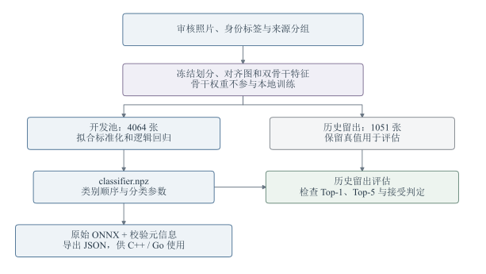

実際に学習するのは標準化パラメーターと多項ロジスティック回帰で、両バックボーンは変更しません。汎用顔特徴を再利用して本プロジェクト用の小さな分類器を学習でき、固定特徴上で候補ヘッドを比較できるため、探索ごとにニューラルネットワークを再実行せずに済みます。

再現スクリプトは `C=1.0`、`class_weight=balanced`、`max_iter=1500` を使います。`C` は正則化強度の逆数で、クラス平衡重みは各クラスのサンプル数の違いが学習へ与える影響を調整します。正確な設定は [tools/train_classifier.py](../tools/train_classifier.py) にあります。

学習には scikit-learn を使います。Python サービスの推論には出力済み配列の演算と ONNX Runtime だけが必要で、scikit-learn や PyTorch は読み込みません。C++ サービスでは Python インタープリターも不要です。モデル準備、学習、評価には引き続き Python ツールを使えます。

### 7.2 データの範囲と漏洩対策

| データ範囲 | 顔数 | 用途 |
| --- | ---: | --- |
| 元の学習集合 | 3,574 | 開発用の学習データ |
| 元の検証集合 | 490 | 学習集合と結合して現在の最終ヘッドを学習 |
| 現在の最終ヘッドの実際の学習集合 | **4,064** | 標準化と分類ヘッドの学習 |
| 過去のホールドアウト集合 | **1,051** | 現在のヘッドの学習には不使用 |
| 合計 | 5,115 | 50 人 |

**現在のモデルが実際に使ったデータ。** 学習集合と検証集合を結合して学習し、ホールドアウトは評価経路だけに渡します。

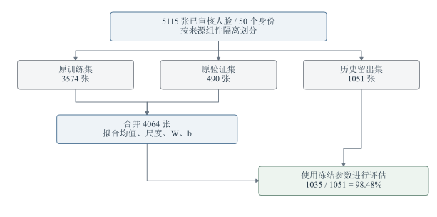

図のホールドアウトは現在のヘッドの学習には使っていませんが、過去の複数回のモデル選択に使われています。その履歴は成績の解釈にも影響します。

写真を無作為に振り分けるだけでは不十分です。同じ元画像からの切り抜き、重複ダウンロード、同じ出典群の類似写真が学習とテストの両方に入ると、評価が過度に楽観的になります。

今回の分類ヘッド探索では、サンプル識別子、出典グループ、元画像と切り抜きの SHA、任意の写真集グループから出典コンポーネントを構成します。重複関係でつながるサンプルを推移的に統合し、コンポーネント単位で学習と検証を分離します。標準化パラメーターも各 fold の学習データだけで推定します。

出典分離は漏洩を減らしますが、独立したテスト証拠を自動的に作るものではありません。過去のモデル選択に使った経緯があるため、本書では「過去のホールドアウト」と呼び、新たな汎化保証として扱いません。

### 7.3 最終的に分類ヘッドを置き換えなかった理由

正則化、クラス重み、特徴ブロック重み、出典コンポーネント重みを変えた 50 候補を探索しました。開発プール内で出典を分離した3分割 OOF 評価を行い、評価可能な各サンプルを、そのサンプルを学習していない fold のモデルで予測しました。

2クラスは出典コンポーネントが各1つだけで、学習と独立出典検証を両立できません。そのため OOF の対象は 4,062 枚、48 クラスですが、各 fold の学習には全 50 クラスを含みます。OOF の分母を全 4,064 枚と記載してはいけません。

| 指標 | 既存ヘッド | 探索で選ばれた候補 |
| --- | ---: | ---: |
| 選択用 OOF Top-1 | 3,977 / 4,062 | 3,986 / 4,062 |
| 過去のホールドアウト Top-1 | **1,035 / 1,051** | 1,033 / 1,051 |
| 0.95 しきい値での受理数 | 1,011 | 986 |
| うち誤受理数 | 4 | 4 |
| 確認が必要な数 | 40 | 65 |

OOF 行の「既存ヘッド」は、既存の設定で各学習 fold の標準化と分類器を再学習したものです。開発データ全体で学習したデプロイ用パラメーターをそのまま OOF に使ってはいません。最終デプロイパラメーターと新候補パラメーターを比較するのは、過去のホールドアウトの行です。

候補は OOF で少し優れましたが、既存の 16 件の誤りを修正せず、2件の誤りを追加し、確認対象も増やしました。そこで既存ヘッドを維持し、実行方法と実装の性能最適化に集中しました。ここでの受理数は切り抜き分類の実験結果で、アップロード元画像の検出、見落とし、品質選別は含みません。

全候補、選択手順、統計上の限界は [分類最適化記録](CLASSIFIER_OPTIMIZATION.ja.md) にあります。

### 7.4 現在の精度の読み方

既存モデルの過去のホールドアウト 1,051 枚での Top-1 は **1,035 / 1,051 = 98.48%**、Top-5 は **99.14%** です。Macro-F1 は **99.10%** で、テスト正解がある 49 人だけを平均しています。

Top-1 は1位が正しいか、Top-5 は正しい人物が上位5位以内かを測ります。どちらも 0.95 しきい値を通過して自動受理される割合ではありません。Macro-F1 は対象クラス別の F1 を平均するため、全切り抜き数で重み付けした正解率とも異なります。

これらは整列済みの顔の人物分類指標です。アップロードシステム全体はデコード、検出漏れ、アライメント、品質選別にも影響されるため、任意の利用者写真の端から端までの正解率が 98.48% とは主張できません。テスト集合には関連する出典コンポーネントもあるため、1,051 枚をすべて独立サンプルとみなすこともできません。

保守時には2種類の検証を区別します。

- **精度評価。** 人手の正解と比較し、人物を正しく認識したか調べます。
- **実行時の一致性評価。** 同じ入力で Python と C++ を比較し、移行で変化が生じたか調べます。両方が同じ誤った人物を返しても一致性は成立しますが、認識は誤りです。

<a id="section-8"></a>

## 8. 性能最適化の考え方

### 8.1 最初に時間の発生箇所を分ける

複数の顔を含むアップロードでは、端から端までの時間を次のように分けて考えられます。

$$
T_{\mathrm{HTTP}}\approx T_{\mathrm{転送と解析}}+T_{\mathrm{待機}}+
T_{\mathrm{デコード}}+T_{\mathrm{検出}}+
\sum_{\mathrm{各顔}}\left(T_{\mathrm{品質}}+
\mathbf1_{\mathrm{品質合格}}(T_{\mathrm{位置合わせ}}+T_{\mathrm{両バックボーン}}+T_{\mathrm{分類}})\right)
+T_{\mathrm{応答}}
$$

添字は順に、転送と解析、待機、デコード、検出、各顔、品質、品質合格、アライメント、両バックボーン、分類、応答を表します。各項は問題箇所を探すための近似的な処理時間です。112 × 112 の切り抜きだけの計測では検出と大きな画像のデコードを省きます。サーバー処理時間がアップロード解析と待機を除く場合もあり、ネットワーククライアント時間には転送も含まれます。範囲の異なる数値を同じ列で直接比較できません。

### 8.2 両バックボーンの並列実行とスレッド資源

両バックボーンは同じ整列画像を読み、相互のデータ依存はありません。逐次実行の時間はおよそ `T_A + T_R`、資源が十分な場合の並列実行は `max(T_A, T_R)` とスケジュール負荷の和に近づきます。ネットワーク計算量は減らず、実行の時間配置が変わります。

別の並列性もあります。ONNX Runtime は1モデルの演算子内部で複数スレッドを使えます。各バックボーンが主要計算スレッドを2本使うと、並列時には約4本分の計算資源を同時に争います。モデルごとのスレッド数をサービス全体の総数とは扱えません。

N150 設定は次のとおりです。

```yaml
runtime:
  intra_op_threads: 1
  detector_intra_op_threads: 2
  inter_op_threads: 1
  parallel_backbones: true
  allow_spinning: false
  enable_cpu_mem_arena: true
```

認識では両バックボーンが主要計算スレッドを1本ずつ使い、検出器は2本を維持します。検出は認識の前に実行するため、3ネットワークが同時に動くわけではありません。Go、OpenCV、その他のライブラリが追加のスレッドを持つことはあります。

ORT の待機スレッドはスピンにより次の処理を受け取る遅延を減らせますが、CPU サイクルを消費します。ここでは待機中の消費を減らすため無効にし、同時に起床遅延も確認します。`intra-op` は演算子内の並列性、`inter-op` はグラフノード間の並列性を管理します。後者は対応する実行モードでのみ有効で、本プロジェクトはグラフノードの並列実行を追加で有効にしていません。[ORT スレッド管理](https://onnxruntime.ai/docs/performance/tune-performance/threading.html) を参照してください。

検出器の2スレッド維持にはローカルの根拠があります。1スレッドへ変更したところ、12 枚の元画像でランドマークが最大約 `0.000183` ピクセル変わり、アライメントの補間後に一部の分類確率が約 `0.000149` 変化しました。検出器設定を戻すと、この集合の全出力の一致が回復しました。重みが不変でも画素処理全体が同一とは証明できません。

CPU arena はモデル実行時のメモリ割り当てと再利用に使います。ローカルで無効化してもピーク RSS の減少は約 17 MiB にとどまったため、既定値を維持しました。対象機での効果は別途計測が必要です。

### 8.3 C++ / Go 化で最適化できるもの

既存の Python コードも ONNX Runtime 経由で最適化済みの演算子を呼び出し、畳み込みを Python ループで要素ごとに計算していません。ONNX Runtime は execution provider で下位演算を実行するため、呼び出し言語の変更だけでネットワーク計算は減りません。[ORT Python API と実行方式](https://onnxruntime.ai/docs/api/python/api_summary.html) を参照してください。

C++ / Go 実装で変えられるのは、プロセス依存関係、画像デコードと前処理、オブジェクト割り当て、呼び出し構成、HTTP 層です。ONNX の重み維持は移行範囲を限定しますが、入力画素と出力数値の検証は必要です。

C++ 化による数倍の高速化は約束していません。以前の平均 HTTP 時間約 9.7% 減は、Mac でネイティブ実行系全体を Python サービスと比較した結果で、言語だけの効果には分解できません。後の N150 ベースラインでは同設定のネイティブ版の平均時間差は約 0.12% にすぎず、確かな高速化を示さず、ピーク RSS は約 19.5% 高くなりました。[実機結果](N150_BENCHMARK.ja.md) を参照してください。Go の実行時、cgo 境界、OpenCV、ORT のメモリなどのコストも残ります。

追加診断により、N150 の主な異常な計算コストを **FP32 非正規化数の処理** に特定しました。同じ3枚の切り抜きと逐次 kernel で FTZ/DAZ だけを切り替えると、両バックボーン合計時間の中央値が 11.471 秒から 0.721 秒へ下がり、生出力、特徴、確率は一致しました。これは言語変更と独立したボトルネックの証拠です。候補 C++ コアは Session 作成と実行のたびにスレッドの MXCSR を保存、設定、復元し、ORT 自身のスレッドプール方針も設定します。以前の Go/cgo 呼び出しが残した状態には依存しません。FP32 の重みは不変でも非正規化数の浮動小数点動作が変わるため、全件数値回帰を行いました。

後の HTTP 平均時間は 680.785 ms、過去の全ホールドアウト Top-1 は 98.48% を維持しました。ベースライン後の独立測定で、同時期に交互実行した A/B ではありません。ピーク RSS は旧スレッド Python より約 17.9% 高いままです。実装と根拠は [FTZ 独立実験](N150_BENCHMARK.ja.md) にあります。現在の製品ビルドには実装済みで、エクスポート時の `--flush-denormals` で有効化します。古いコアは JSON にフィールドを追加しても機能を獲得しません。

**FTZ/DAZ の範囲。** 図はプラットフォーム検査に合格した Linux x86_64 経路を示し、各呼び出しスレッドが状態を個別に保存、復元します。

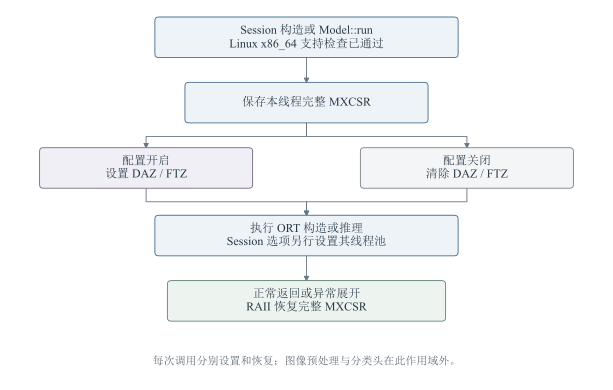

画像前処理と分類ヘッドはこの範囲外です。常駐 R50 worker の推論にも同じ guard を適用します。Mac ARM での有効化は明示的に拒否します。

### 8.4 CPU 時間、遅延、消費電力量は別の指標

wall time は利用者の待ち時間、CPU time は関連計算スレッドが消費したプロセッサー時間の合計です。例えば 60 ms 経過し、CPU 時間が合計 120 ms なら、平均で2コア相当を使います。

以前の Mac 切り抜き実験では、両バックボーン各2スレッドとスピンの構成から N150 設定へ変えると、切り抜き分類の CPU 時間が約 `192.09` から `101.62 ms/枚` へ **47.1%** 減りました。wall time は `53.23` から `57.05 ms/枚` へ約 **7.2%** 増えました。CPU 作業量と遅延のトレードオフであり、47.1% の高速化や節電とは記載できません。消費電力量には電力測定と時間積分が必要です。

この実験は切り抜き分類だけを計測し、後の完全 HTTP 実験とは入力、計時範囲、ベースラインが異なります。割合を加算、乗算して総合効果としては使えません。詳細は [N150 ガイド](N150.ja.md) にあります。

<a id="section-9"></a>

## 9. C++ コアと Go サービスの連携

### 9.1 1プロセス内の2つの担当層

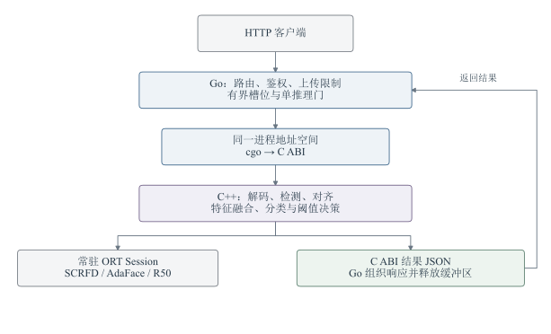

Go プロセスは同じアドレス空間の C++ 共有ライブラリを呼び、別のローカル推論サービスへ画像を送りません。モデルは起動時に1回読み込み、3つの ORT Session を継続再利用します。

C++ の並列バックボーンは R50 用の常駐 worker と AdaFace 用の呼び出しスレッドを使い、両方の完了を待って固定順に連結します。HTTP リクエスト間では1モデルを直列利用し、小メモリ機でモデル複製による常駐メモリ増加を避けます。

**品質を満たす顔1件の呼び出し順。** 両バックボーンは同じリクエストの入力を並列処理し、分類前に合流します。

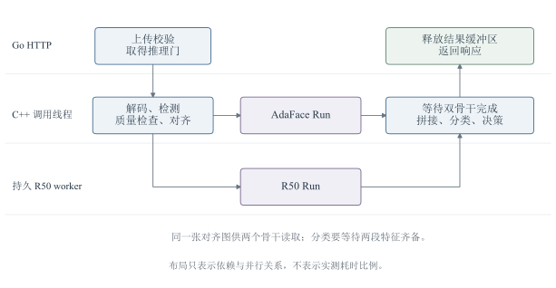

モデルが1つなので、長いリクエストは推論資源を占有します。例えばバッチが実行権を得ると全画像を順次処理します。流量制限は滞留数を制御しますが、待機中の全リクエストを同時に低遅延にはできません。

### 9.2 C ABI とリソース所有権

インターフェースは [native/include/faceid.h](../native/include/faceid.h) に定義されています。

| インターフェース | 役割 |
| --- | --- |
| `faceid_create` / `faceid_destroy` | モデルインスタンスの作成と破棄 |
| `faceid_process_encoded` | JPEG、PNG、WebP の圧縮バイト列から処理 |
| `faceid_process_bgr` | BGR 画素から処理し、一致性検証にも使用 |
| `faceid_model` | モデルメタデータの取得 |
| `faceid_free` | コアが割り当てた結果またはエラー文字列を解放 |

C++ 例外は境界内で状態コードと構造化エラーへ変換し、C ABI を越えて Go へ伝播させません。Go アダプターは処理と破棄を同じロックで守り、C++ は別のロックで推論を直列化します。C ABI の直接利用者は全呼び出し完了後にモデルを破棄する責任を持ちます。C++ 推論ロックは並行破棄を自動保護しません。

アップロードバイト列は同期呼び出し中だけ C++ に貸し、アダプターが寿命を維持します。コアは呼び出し後に Go バッファーを保持しません。[cgo のポインター受け渡しと寿命の規則](https://pkg.go.dev/cmd/cgo#hdr-Passing_pointers) に従います。ただし、デコードの画素配列、モデル入力構築、JSON から Go データへの変換でコピーや割り当てがあるため、処理全体はゼロコピーではありません。

### 9.3 アップロード、待機、キャンセル

ネイティブ HTTP の制限は次のとおりです。

| 項目 | 制限または動作 |
| --- | --- |
| 1ファイル | 10 MiB |
| 1リクエスト | multipart の付加分を含めて 81 MiB |
| 1画像 | 2,000 万画素 |
| 1バッチ | 最大 8 枚 |
| アップロード解析、待機、処理中のリクエスト合計 | 最大 8 件、満杯なら `503 server_busy` |
| 同時ネイティブ推論 | 1リクエスト |
| 形式 | 静止 JPEG、PNG、WebP |

Go が完全デコード前にヘッダーと画素数を調べ、C++ / OpenCV が実際の圧縮内容を検証します。JPEG、PNG、WebP の EXIF 全8方向はコアが処理します。アニメーション WebP とすべての APNG を拒否し、アニメーション制御チャンクのある1フレーム APNG も対象です。

multipart ファイル内容のメモリしきい値は 32 KiB で、超過分は一時ディレクトリへ書き出し、リクエスト終了時に削除します。ファイル以外のフィールドとメタデータには追加のメモリが必要です。そのため一時ディスク容量も必要で、81 MiB はリクエスト単位の上限にすぎずプロセスメモリの上限ではありません。Go ヒープ統計は C++ / ORT の割り当て全体を含まないため、総資源はプロセス RSS とコンテナー全体の指標で確認します。

待機中やバッチの次画像の開始前にはキャンセルに応答します。待機キャンセルは `408 request_cancelled` を返します。C++ / ORT 内で実行中の推論には中断フックがなく、完了後に解放します。HTTP の正常終了待機枠は 90 秒ですが、モデルの後処理はネイティブ呼び出し完了まで待つため、プロセス全体が厳密に 90 秒以内に終了する保証ではありません。

**推論前後の境界。** 8枠で処理中リクエスト総数を制限し、単一の推論ゲートでモデルの並行利用を制限します。

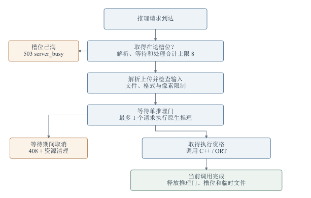

アップロード解析や入力検査の失敗も解放経路を通ります。図では正常入力と待機キャンセルの2経路だけを詳しく示します。

ネイティブの `processing_ms` はアップロードファイルを開いた時点から始まり、読み取り、形式検証、デコード、推論を含みます。先行する multipart アップロード解析と待機は含まないため、利用体験の評価にはクライアントの完全 HTTP 時間も測定します。

### 9.4 モデルのエクスポート、検証、識別子

オフラインツール [export_native_model.py](../tools/export_native_model.py) は既存の `classifier.npz` の配列を `native-model.json` に出力します。クラス順序、パラメーター精度、全設定を維持し、ONNX の重みは変えません。

Go サービスは起動時に JSON の `.sha256`、分類モデルの3つの元ファイル、検出器の SHA-256 を検証します。C++ は `classifier.npz` から分類パラメーターを読みませんが、出典ファイルとして検証するためデプロイモデルに同梱します。C ABI の `faceid_create` 単体では Go 起動入口の全ファイル検証を代替できません。

**資産を確認してから常駐モデルを作成します。** 分類パラメーターは JSON が供給し、元 NPZ は出典確認に使います。

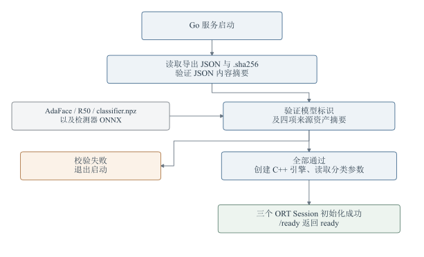

`model_id` は AdaFace、R50、元の分類ヘッドの3資産のダイジェスト対応表に由来し、Python と一致します。検出器は別途検証します。Go HTTP の `recognition_id` はネイティブ実装マーカーと JSON の生バイト列をハッシュ化し、設定と検出器ダイジェストの変更を含みます。JSON の空白だけの変更でも値が変わります。

SHA-256 検証は破損と資産の不一致を検出できますが、独立した署名の信頼連鎖はなく、出典の真正性の認証には相当しません。

### 9.5 現在の互換性の範囲

API パスは `/health`、`/ready`、`/v1/model`、`/v1/detect`、`/v1/recognize`、`/v1/recognize/batch` です。ネイティブ試作版にはアップロードトップ画面、Swagger、OpenAPI ルートはありません。コア移行だけで Python のウェブ機能が加わるわけではありません。

主要な認識結果フィールドは既存 API を引き継ぎますが、デコーダー、数学ライブラリ、ソートの実装差は残ります。例えば C++ NMS は検出同点を入力索引の逆順で扱い、Python の NumPy 既定ソートは不安定です。重なる矩形が同点なら異なるランドマークを残す可能性があります。JPEG デコード、整列補間、浮動小数点加算もプラットフォーム間で検証が必要です。

ビルドと操作は [C++ + Go 試作版ガイド](NATIVE_CPP_GO.ja.md)、全フィールドは [API 文書](API.ja.md) を参照してください。

<a id="section-10"></a>

## 10. 実験から分かること

### 10.1 数値と判定の一致

ローカル macOS ARM64 で Python と C++ が各別プロセスに ONNX Runtime 1.29.0 を読み込み、同一プロセスへの2組の動的ライブラリの読み込みによる影響を避けました。過去のホールドアウト全 1,051 枚の特徴を再抽出しました。

| 検査項目 | 結果 |
| --- | --- |
| Top-1 正解数 | 両方 1,035 / 1,051 |
| 1位の人物と順序付き上位5候補 | 全件一致 |
| 0.95 しきい値の受理判定 | 全件一致 |
| 新規誤り / 修正誤り | 0 / 0 |
| 特徴の最大絶対差 | `2.24e-8` |
| 分類確率の最大絶対差 | `3.58e-7` |

別に選んだホールドアウト出典の元画像 12 枚、検出顔 14 件では、デコード済み BGR と圧縮ファイル直接アップロードの両経路を検証しました。顔数、矩形、検出スコア、品質スコア、候補順序、受理判定が一致し、確率の最大差は `2.09e-7` でした。

結論は **この入力集合で移行による判定悪化を観測しなかった** ことです。C++ と Python はビット単位では同一ではなく、標本検査と過去の回帰結果を任意の画像への保証には拡張できません。

公開ツール [validate_native.py](../tools/validate_native.py) は指定ディレクトリの診断に便利ですが、Python と C++ を同一プロセスに読み込みます。その RSS は独立ネイティブサービスのメモリを表さないため、正式比較は別プロセスを使います。確率しきい値の比較も Python の浮動小数点の意味を保ち、`0.95` を黙って float32 に落として境界差を隠さないようにします。

### 10.2 完全 HTTP のローカル資源変化

以下は引き続き **Mac の測定値** です。N150 の値は別記録です。上の元画像一致性検証とは別の、学習出典の元画像 12 枚を使いました。各プロセスで全画像を1巡予熱し、4巡を計時して合計 48 リクエストとしました。各実装で新規プロセスを3回起動し、実行順を交互にし、両サービスを同時常駐させていません。

| 指標 | Python HTTP | C++ + Go HTTP | 変化 |
| --- | ---: | ---: | ---: |
| 平均 HTTP 時間 | 94.13 ms | 85.00 ms | 9.7% 減 |
| HTTP P95 | 113.83 ms | 103.15 ms | 9.4% 減 |
| 平均サーバー処理時間 | 92.14 ms | 82.69 ms | 10.3% 減 |
| プロセスのピーク RSS | 1160.89 MiB | 1026.94 MiB | 133.95 MiB 減、約 11.5% |

指標はまず各プロセスで計算し、3プロセスの中央値を取ります。P95 は nearest-rank で、48 リクエストを昇順にした第 46 値を取り、その3つの P95 の中央値を使います。144 リクエストを合算した P95 ではありません。列ごとの中央値が同じプロセスに由来するとは限りません。

クライアントは localhost に接続し、HTTP 時間にはローカルのアップロードと応答を含みます。ピーク RSS は終了後の `wait4` から取得し、読み込み、予熱、大きな画像の処理を含みます。プロセス CPU 秒は全ライフサイクルを対象とするため、計時リクエスト数で割って1推論の CPU コストとは主張できません。新プロセスでも OS のファイルキャッシュが空とは限りません。

3回の HTTP テストがそれぞれ保存した1巡の出力も比較に合格し、確率最大差は `2.38e-7` でした。この集合はローカル資源変化の説明に適し、新たな認識精度テストではありません。

### 10.3 検証根拠の保存先

公開リポジトリは実装、検証ツール、要約結論を保存します。元写真、サンプル別結果、サーバー内部記録は無視対象ディレクトリに保管します。

| ローカルの根拠保存先 | 内容 |
| --- | --- |
| `data/experiments/native-cpp-go-20261027/isolated_verification.json` | 別プロセスでの特徴、確率、候補、判定比較 |
| `data/experiments/native-cpp-go-20261027/http_benchmark.json` | 6つの HTTP サービスプロセスの生測定と集計 |
| `data/experiments/n150-resource-final-20261027.json` | Python のスレッド、スピン、arena の資源比較 |
| `data/experiments/n150-validation-20261027/verification.json` | Python 資源設定での全結果回帰 |
| `data/experiments/n150-remote-20261027/cleanup-report.json` | 対象機のディスクとサービス状態の保守記録 |
| `data/experiments/n150-remote-20261027/parity-linux.json` | N150 別プロセスでの全切り抜きと固定元画像の一致性 |
| `data/experiments/n150-remote-20261027/http-three-way.json` | N150 の3組、9プロセスの完全 HTTP ベースライン |
| `data/experiments/n150-remote-20261027/baseline-audit.json` | ベースラインの完全性と集計計算の独立監査 |
| `data/experiments/n150-remote-20261027/ftz-candidate-parity.json` | FTZ 候補と凍結 Python キャッシュの全件回帰 |
| `data/experiments/n150-remote-20261027/ftz-http.json` | FTZ 候補3プロセスの HTTP 結果と実際のコアライブラリ対応 |
| `data/experiments/n150-remote-20261027/candidate-audit.json` | FTZ 候補結果と相対変化の独立監査 |

これらはローカル追跡用のパスで、リポジトリを複製しても私有データは付属しません。N150 のビルド、精度、ベースラインと 2026-10-28 の本番切り替えは段階別に記録されています。1回のデプロイ確認で長期稼働の受け入れ完了とはいえません。

<a id="section-11"></a>

## 11. N150 のデプロイと受け入れ確認

### 11.1 実行ファイルにも実行時依存がある

ネイティブビルドは ONNX Runtime 1.29.0、OpenCV 5.0.0、nlohmann/json 3.12.0 を固定し、ダウンロードのダイジェストを検証します。C++17、CMake ≥ 3.20、Go ≥ 1.24 などが必要です。OpenCV は画像関連モジュールだけをビルドし、不要な動画、GUI などへの依存を減らします。

デプロイ構成は `faceid-server`、隣接する共有ライブラリディレクトリ、モデル、設定ファイルです。完全静的な単一ファイルではありません。Linux は相対ロードパスでアプリ用ライブラリを探し、今回の N150 / glibc 2.39 環境で依存解決と起動を確認しました。他のシステムライブラリ版や CPU アーキテクチャは別途検証が必要です。Mac ARM の成果物を Linux x86_64 バイナリーとして直接使えません。

互換性のある Linux 環境でビルドし、N150 で実行時の受け入れ確認を行えます。8 GB 機で直接ビルドするなら `JOBS=2` から並列度を抑えます。ビルド時のメモリと時間はサービス性能計測に混ぜません。

### 11.2 Docker と言語変更は個別に比較する

Linux コンテナーはホストのカーネルを共有するため、Docker が別の仮想マシンを実行すると考えるべきではありません。観測できる負荷は CPU 割り当て、保存経路、ネットワーク、ログなどの条件次第です。[Docker によるコンテナーと仮想マシンの説明](https://docs.docker.com/get-started/docker-concepts/the-basics/what-is-a-container/) を参照してください。

Python は Docker でもネイティブ systemd でも提供でき、C++ / Go も異なる包装方法を選べます。言語実装を固定してコンテナーとホストを比べる実験と、実行条件を固定して Python と C++ / Go を比べる実験を区別します。言語、モデル、保存先、コンテナー設定を同時変更すると効果の原因が分かりにくくなります。

### 11.3 対象機で完了した検証と残る範囲

対象機は Linux、Intel N150、メモリ 8 GB で、OS からは約 7.5 GiB RAM が見えます。ディスク整理後、SSD 上の分離ディレクトリで次を確認しました。

1. ソース、入力一覧、モデルハッシュ、クラス順序、設定、ライブラリ版を固定し、Linux ネイティブビルド、動的ロード、起動、実モデル HTTP 統合確認を完了しました。
2. 独立した Python / ネイティブプロセスで、過去のホールドアウト全 1,051 枚と固定元画像 12 枚を比較しました。N150 設定の Top-1、Top-5 順序、受理判定が一致し、正解数は 1,035 / 1,051 を維持しました。浮動小数点値はビット単位で同一ではありません。
3. 旧スレッド Python、N150 設定 Python、同設定 C++ / Go の3組で HTTP ベースラインを完了しました。各組3つの新プロセスを順番を回して実行し、計 432 リクエストを計時しました。平均、P50、P95、ピーク RSS、計時区間 CPU を記録し、独立集計監査も行いました。
4. 後続の独立段階で FTZ 候補の全件回帰と新規 HTTP 3プロセス、計 144 リクエストを測定しました。凍結 Python 元画像参照と出力が一致し、3プロセスが実際に候補共有ライブラリを読み込んだことも検証しました。この段階ではベースライン組を再起動して同時期に交互測定していません。

旧スレッド Python 組は現在のソースと Python 3.12.3 で旧パラメーターを再現し、既存本番 Python 3.13 サービスを直接測定したものではありません。HTTP 元画像 12 枚の出力比較は完了しましたが、その組でも全切り抜き比較を再実行したとは主張できません。12 枚の元画像は1人の写真 11 枚と3人の写真 1 枚で、全形式、EXIF の全方向、極端なサイズ、重なる顔の境界を網羅しません。

N150 設定は旧スレッド組より CPU 時間を約 34.4% 減らしましたが、平均 HTTP 待ち時間を約 37.9% 増やしました。同設定のネイティブ版は確かな高速化を示さず、ピーク RSS も増えました。したがってベースラインの省 CPU を低遅延と解釈できません。後の FTZ 改善は別の検証済み実験であり、元のベースラインや既定ビルドへ遡って帰属させられません。統計全体と段階別結果は [N150 実機レポート](N150_BENCHMARK.ja.md) にあります。

対象機は 2026-10-28 に FTZ/DAZ ネイティブサービスへ切り替え、元の API ポートとキーを維持しました。旧コンテナーは無効化し、復旧用に残しました。前後で元画像 12 枚の出力と実コアライブラリ対応を確認しました。同時待機、最大許可画像、完全なバッチ、キャンセル、長期実行には専用の受け入れ確認が必要です。固定画像の単一リクエスト基準では、その場合のメモリや末尾遅延を代表できません。画像形式と EXIF 境界もサンプルの拡充が必要です。

Linux の計時区間 CPU は `/proc/<pid>/stat` の `utime + stime` の増分をクロック周波数で割り、起動と予熱は別に集計できます。`wait4.ru_maxrss` は Linux で KiB、macOS でバイトなので、MiB への換算を分けます。

テスト時のバックグラウンド負荷、周波数、温度、空きメモリ、swap、コンテナー制限を記録します。他のサービスも稼働しているため、干渉による変動をすべて推論プログラムに帰属させられません。コールドキャッシュを作るためにサーバー全体のキャッシュ状態を不用意に変更してはいけません。

OpenVINO、INT8、FP16、蒸留、片方のバックボーン削除を検討する場合は、新しいバックエンドまたはモデル実験として独立したベースラインを作ります。これらは現在の精度維持を検証済みの最適化成果には含まれません。

<a id="section-12"></a>

## 12. ディスクとログも実行時構成に含める理由

### 12.1 保存領域は起動と安定性に影響する

モデル読み取り、依存ビルド、アップロード一時ファイル、ログ書き込みはディスクを使います。モデルがメモリに常駐した後の主要なネットワーク演算は、毎回全重みをディスクから読み直しません。SSD と機械式ディスクの差を推論高速化の倍率へ直接換算することはできません。

ただしシステムディスクの満杯は一時ファイル、ログ、ソフトウェア更新を妨げ、デプロイとテストの信頼性を損ねます。そのため先に主 SSD を整理し、テストを機械式データディスクへ移しませんでした。

保守終了時、主ディスク使用率は **100% から 41%** に下がり、空き容量は **63.78 GiB**、`df -h` では約 `64G` でした。主な対象は Syncthing 約 56.78 GiB、Xunlei 約 4.23 GiB の過去ログで、system journal vacuum とパッケージキャッシュ削除も行いました。この2値は削除前の論理ファイルサイズで、個別に正確に測定した物理空き容量の純増ではありません。

整理前に最近の約 2 MiB のログと元 Compose 設定を保存しました。終了後に稼働中の 10 コンテナーの ID、PID、起動時刻、マウントを確認し、FaceID `/ready` は 200 を返しました。保守でサービス個体を置き換えていないことは示しますが、各アプリの全機能を試験した意味ではありません。

### 12.2 同じパスが異なるデータを指す理由

発見した問題は、ホストの現在の `/data/...` は機械式ディスクを指す一方、一部の稼働コンテナーはそのマウントに隠れた SSD 上の旧ディレクトリを参照していることです。

2つの見え方は次のとおりです。

```text
ホストが現在解決する /data/... ──→ 機械式ディスク上のディレクトリ
稼働コンテナーの既存 bind mount ──→ SSD 上の旧ディレクトリ
```

根拠はパス文字列だけでなくデバイス番号と inode の差です。`docker inspect` が示すマウント元パスだけでは見落とします。コンテナーを再作成すると現在のパスを再解決し、別データに結び付く可能性があります。

今回は既存マウントを維持し、関連コンテナーを再作成しませんでした。今後は2つのディレクトリの内容とアプリが実際に使うデータを識別し、維持または移行を決め、その後にログ設定を適用します。直接再作成しても影響がないとは扱えません。

### 12.3 ログ制限の実際の適用状態

system journald は設定し、有効化を確認しました。

```ini
[Journal]
SystemMaxUse=512M
SystemKeepFree=1G
RuntimeMaxUse=64M
```

これはログ容量予算と空き容量確保の方針で、常時厳密に一定バイト数以下に収まる保証ではありません。保守終了時の journal 使用量は約 508.9M でした。[systemd journald 設定説明](https://www.freedesktop.org/software/systemd/man/latest/journald.conf.html) を参照してください。

大きなログを出す2つの Compose ファイルには次を追加しました。

```yaml
logging:
  driver: json-file
  options:
    max-size: "10m"
    max-file: "3"
    compress: "true"
```

既存コンテナーの実行設定にはまだこの制限が含まれず、**Docker のログローテーションは未適用です**。設定ファイルの変更だけでは作成済みコンテナーのログ設定は変わらず、マウント問題の解決後に計画的な再作成が必要です。[Docker json-file ログ説明](https://docs.docker.com/engine/logging/drivers/json-file/) を参照してください。

今回の緊急整理ではログファイルの inode を維持して過去内容を切り詰めました。Docker は daemon による専有管理を推奨し、外部変更は読み取りを妨げる可能性があるため、定期実行する恒久ローテーション方式としては使いません。実際に Xunlei の `docker logs --tail 1` 確認が1回停止し、確認用クライアントは終了させましたが、読み取り異常の対処は残ります。コンテナー稼働だけでログの正常性は証明できません。最後の10秒間に増加しなかったことも将来の増加を否定しません。[Docker の外部ログ操作に関する注意](https://docs.docker.com/engine/logging/drivers/json-file/) を参照してください。

<a id="section-13"></a>

## 13. コード参照索引

最初に Python 主処理でアルゴリズムを理解し、続いて C++ 対応実装と Go の境界を読むと分かりやすくなります。

| 確認したい内容 | ファイル / 入口 |
| --- | --- |
| 画像全体から各顔までの処理順 | [runtime/pipeline.py](../src/seiyuu_faceid/runtime/pipeline.py) の `recognize_faces`、`recognize_detection` |
| モデルインスタンスと設定 | [runtime/engine.py](../src/seiyuu_faceid/runtime/engine.py)、[configs/n150.yaml](../configs/n150.yaml) |
| SCRFD 入力、復元、NMS | [vision/detector.py](../src/seiyuu_faceid/vision/detector.py) |
| 顔品質 | [vision/quality.py](../src/seiyuu_faceid/vision/quality.py) |
| 5点テンプレートと変換 | [vision/alignment.py](../src/seiyuu_faceid/vision/alignment.py) |
| 色、正規化、512 次元特徴 | [vision/recognizer.py](../src/seiyuu_faceid/vision/recognizer.py) |
| 両バックボーン融合、標準化、softmax | [vision/classifier.py](../src/seiyuu_faceid/vision/classifier.py) |
| 受理 / 確認ルール | [runtime/results.py](../src/seiyuu_faceid/runtime/results.py) |
| 学習と出典分離探索 | [tools/train_classifier.py](../tools/train_classifier.py)、[classifier_search.py](../src/seiyuu_faceid/experiments/classifier_search.py) |
| C++ 推論と画像デコード | [faceid.cc](../native/src/faceid.cc)、[image_decode.cc](../native/src/image_decode.cc) |
| C ABI と Go 所有権アダプター | [faceid.h](../native/include/faceid.h)、[core/native.go](../native/go/internal/core/native.go) |
| Go のアップロード、待機、解放 | [httpapi/server.go](../native/go/internal/httpapi/server.go)、[httpapi/images.go](../native/go/internal/httpapi/images.go) |
| ネイティブモデル出力と起動検証 | [export_native_model.py](../tools/export_native_model.py)、[core/model.go](../native/go/internal/core/model.go) |
| ビルドと比較検証 | [native/build.sh](../native/build.sh)、[validate_native.py](../tools/validate_native.py) |

操作方法は [N150 設定](N150.ja.md)、[Python ネイティブ Linux デプロイ](DEPLOY_NATIVE_LINUX.ja.md)、[C++ / Go のビルドと起動](NATIVE_CPP_GO.ja.md) を参照してください。モデル出典と条件は [models/README.ja.md](../models/README.ja.md) にあります。

本書はリポジトリ内の技術文書です。公開方針に従い、GitHub Release にはモデルと必要なメタデータだけを公開します。デプロイパッケージ、アプリコード、学習写真、生特徴、サンプル別評価、キーは含めません。
