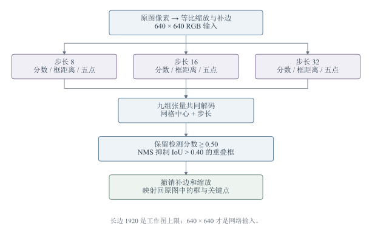
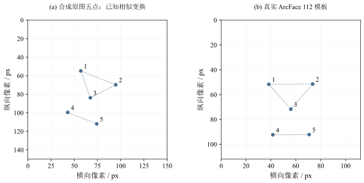
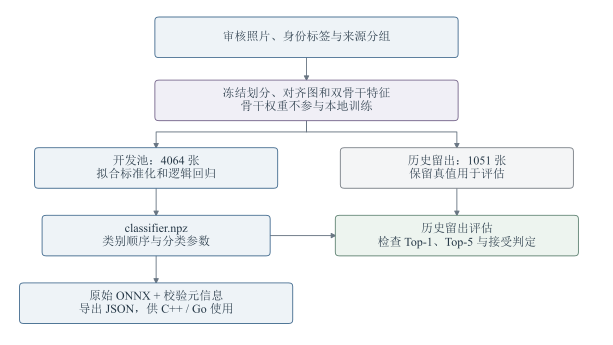
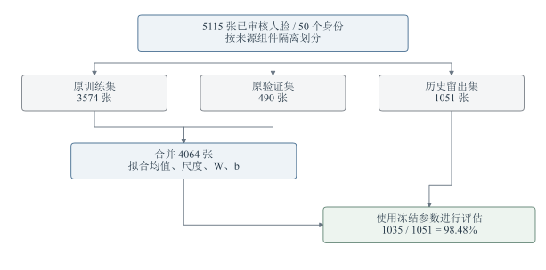
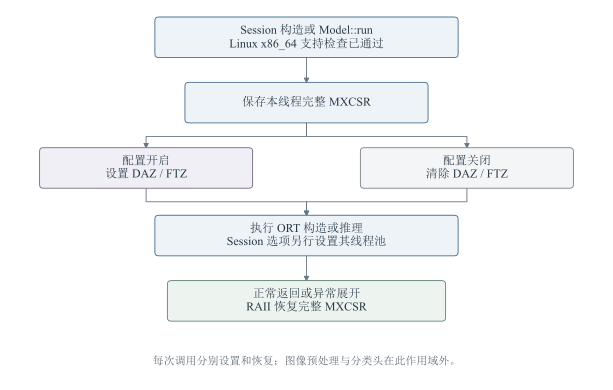
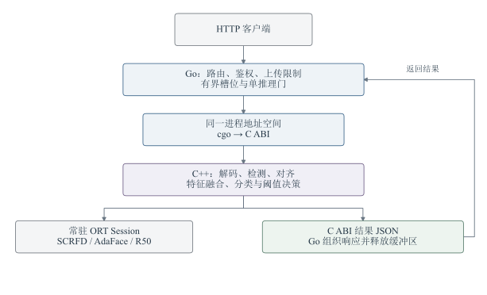
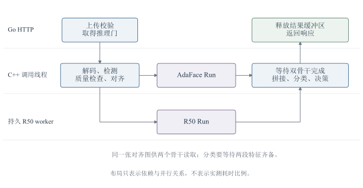
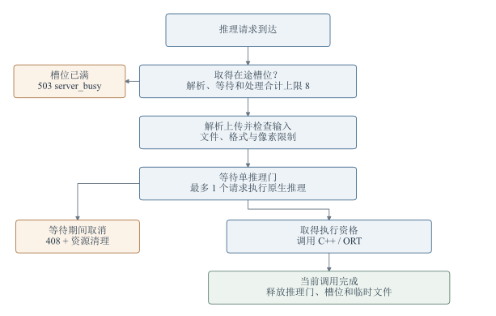
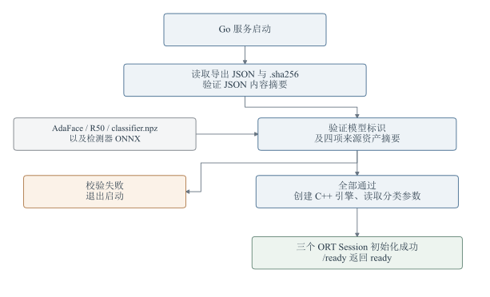

# Seiyuu-FaceID technical architecture from photos to identity decisions

[English](TECHNICAL_ARCHITECTURE.md) | [简体中文](TECHNICAL_ARCHITECTURE.zh-CN.md) | [日本語](TECHNICAL_ARCHITECTURE.ja.md)

This document describes the recognition framework from the code and experiment records of 2026-10-27 through 2026-10-28. It explains how the model recognizes people, why each stage exists, and how to interpret results and performance figures. The later sections cover the C++ / Go implementation and N150 deployment.

The system uses **SCRFD face detection → quality checks → five-point alignment → AdaFace IR101 and R50 feature fusion → standardization and logistic regression → threshold decisions**. Both feature models use frozen pretrained weights. This project trains the final classification head for 50 reviewed identities. All inference runs locally.

Python is the reference implementation. The C++ inference core and Go HTTP layer have been built and started on Mac and Linux, and three HTTP baselines have been completed on N150. Subsequent diagnosis identified subnormal-number processing overhead. The FTZ version passed regression on 1,051 crops and 12 original images, followed by HTTP measurements in three processes. Mean request time was about 0.681 seconds, with historical holdout Top-1 unchanged at 98.48%. See the [N150 report](N150_BENCHMARK.md) for the experiment phases, resource tradeoffs, and statistical scope. **On 2026-10-28 it was integrated into the product source and enabled as a systemd service on N150. Long-run and stress acceptance testing remained incomplete.**

## Reading guide

Figures are generated by [Python drawing functions](../tools/draw_documentation_figures.py) and embedded as scalable SVGs.
See the [figure source notes](figures/README.md) for PNG, PDF, and reproduction steps.

- [1. What the system does](#section-1)
- [2. The complete recognition path for a photo](#section-2)
- [3. How SCRFD finds faces](#section-3)
- [4. Quality checks and five-point alignment](#section-4)
- [5. How two backbones turn a face into features](#section-5)
- [6. How the classification head produces identities and probabilities](#section-6)
- [7. Model training and evaluation](#section-7)
- [8. Why performance is optimized this way](#section-8)
- [9. How the C++ core and Go service work together](#section-9)
- [10. What the experiments establish](#section-10)
- [11. N150 deployment and acceptance testing](#section-11)
- [12. Why disks and logs are part of runtime architecture](#section-12)
- [13. Code reading index](#section-13)

<a id="section-1"></a>

## 1. What the system does

The system receives photos, finds faces, and decides whether each face can be assigned to a trained identity. The model contains 50 classes and returns classification results among these known classes.

Three stages answer three separate questions.

| Question | Responsible stage | Output |
| --- | --- | --- |
| Where are the faces in the photo? | SCRFD detector | Face boxes, detection scores, five landmarks |
| Which visual features distinguish this face's identity? | AdaFace IR101, R50 | Two feature vectors of 512 dimensions each |
| Which trained identity best matches these features? | Local classification head | 50-class probabilities, top five candidates, acceptance or review |

Requests do not search training photos individually or query a vector database. Training photos are used to fit the classifier offline. Serving requires only model weights, classification parameters, and ordered class names, so the service does not need to load all training images.

The feature extractors can process new photos, while the names returned by the classification head are limited to trained classes. Adding an identity requires preparing labels, training, and validating the head again. Adding photos on the sample-management page does not automatically update the deployed model.

The system handles multiple faces in a photo and decides independently for each face. The current pipeline has no cross-image person tracking, temporal voting, or liveness detection. Reliable rejection of out-of-gallery people, character artwork, and heavily occluded inputs has also not been validated.

<a id="section-2"></a>

## 2. The complete recognition path for a photo


A group photo requires one image decode, one face-detection pass, and feature extraction and classification for each face that passes quality checks. More faces generally mean more executions of both backbones. Timing for single-person photos cannot directly represent large group photos.

A face that fails quality checks immediately receives a review result. Neither large backbone runs, and no identity candidates are fabricated. When quality passes but identity probability is insufficient, classification candidates are retained for manual inspection. These are two different reasons for `review`.

The Python main pipeline is in [runtime/pipeline.py](../src/seiyuu_faceid/runtime/pipeline.py). Its C++ counterpart is in [native/src/faceid.cc](../native/src/faceid.cc).

<a id="section-3"></a>

## 3. How SCRFD finds faces

### 3.1 Detection model and input

The detector uses `det_500m.onnx` from InsightFace's `buffalo_sc` model pack. SCRFD is a dedicated face detector that locates faces and landmarks. See the [official SCRFD repository](https://github.com/deepinsight/insightface/tree/master/detection/scrfd) for the upstream implementation. This project does not retrain the detector.

Preprocessing follows this order.

1. Read the image's EXIF orientation so the detector sees correctly oriented pixels.
2. If the original image's long edge exceeds 1920 pixels, reduce it proportionally to that limit.
3. Resize proportionally again, add black padding, and center the image on a 640 × 640 canvas.
4. Convert BGR to the RGB required by the detector and normalize with `(pixel - 127.5) / 128`.
5. Arrange the array as `NCHW`, meaning batch, channel, height, and width.

Padding preserves face aspect ratios when placing rectangular images on a square canvas. The 1920-pixel long edge limits the working image for detection preprocessing, while 640 × 640 is the detection network input. These are separate limits.

Upload pixel limits provide another layer of control. Resizing before detection cannot eliminate the memory needed to decode compressed data into pixels initially, so image dimensions must still be checked at the upload boundary.

### 3.2 Multiscale output and box decoding

The current SCRFD export has three scales with strides of 8, 16, and 32. Each scale outputs face scores, box distances, and five-point offsets, giving nine output groups. The scales provide different spatial sampling densities so the detector can propose faces of different sizes.

The code reconstructs candidate centers from feature-map positions and strides, then converts predicted distances into face boxes and landmarks. It keeps only candidates with detection scores `≥ 0.50`.

A face often produces several overlapping candidates. Non-maximum suppression (NMS) removes duplicates using this overlap measure.

$$
\operatorname{IoU}(A,B)=\frac{|A\cap B|}{|A\cup B|}
$$

Starting with the highest-scoring box, NMS suppresses other boxes with IoU greater than `0.40`. Padding and resizing are then reversed to restore boxes and landmarks to the decoded original image's coordinate system. Quality checks and alignment use that coordinate system.

**Detector data flow.** Each of the three strides produces three tensor groups, giving nine groups that jointly produce candidate boxes.



### 3.3 Detection scores are separate from identity scores

`detector_score` measures the detector's assessment that a region is a face. It does not identify the person. Even a face with a high detection score can be blurry, belong to an unknown person, or be difficult to distinguish among known identities.

Detection errors also affect downstream stages. Missed faces never reach classification, and landmark errors change aligned pixels. Tests on already cropped faces do not cover these failure paths.

Implementation entry points are `SCRFDDetector.detect`, `_decode`, and `_nms` in [vision/detector.py](../src/seiyuu_faceid/vision/detector.py).

<a id="section-4"></a>

## 4. Quality checks and five-point alignment

### 4.1 Rejecting faces clearly unsuitable for recognition

Quality checks use the face box in the original image and apply two inexpensive conditions.

| Condition | Current threshold | Purpose |
| --- | ---: | --- |
| Face-box short edge | At least 48 pixels | Very small faces lack distinguishable detail |
| Sharpness | Grayscale Laplacian variance of at least 20.0 | Send blurry faces with weak local edge variation for review |

The Laplacian operator measures local brightness changes. Low variance is common in blurry or low-texture regions. It is not a learned identity confidence score or a complete photo-quality assessment. Noise and high contrast can also affect it.

The returned `quality_score` averages two clipped ratios for size and sharpness.

$$
q=\tfrac12\left[\min\left(1,\frac{s}{2s_{\min}}\right)+
\min\left(1,\frac{v}{2v_{\min}}\right)\right]
$$

Here `s` is the box's short edge and `v` is sharpness. Quality acceptance requires passing each threshold separately. This average score cannot replace the two conditions. Defaults are in [configs/n150.yaml](../configs/n150.yaml), and the implementation is in [vision/quality.py](../src/seiyuu_faceid/vision/quality.py).

### 4.2 Why alignment is needed beyond cropping

Photos of the same person can differ in head tilt, camera distance, and position inside the box. Simply cropping and resizing changes where the eyes appear in the input, making the feature network handle geometric variation as well as identity differences.

Five-point alignment maps both eyes, the nose tip, and both mouth corners onto a fixed ArcFace 112 template. The aligned input is 112 × 112, with more consistent face position and orientation.

The estimated transformation is a two-dimensional similarity transform with uniform scaling, rotation, and translation.

$$
\mathbf y \approx sR\mathbf x+\mathbf t
$$

`R` is rotation, `s` is uniform scale, and `t` is translation. The code estimates the transform with `estimateAffinePartial2D(..., LMEDS)`, then uses bilinear interpolation to generate the aligned image and fills areas beyond the original image with black.

**Alignment geometry.** The face box locates the face and supports quality checks. The five landmarks determine the transform.



The left side shows illustrative points constructed from a known similarity transform, without evaluation photos. The right side uses the actual template from the code. Both use the upper-left corner as the pixel-coordinate origin and equal aspect ratios on the axes.

This step does not reconstruct a 3D face or restore a severe profile to a frontal view. It reduces positional variation that a 2D similarity transform can explain.

The implementation and fixed template are in [vision/alignment.py](../src/seiyuu_faceid/vision/alignment.py). The alignment template, interpolation method, and landmark order are part of the model input contract and require revalidation if changed.

<a id="section-5"></a>

## 5. How two backbones turn a face into features

### 5.1 What a feature vector represents

A feature-extraction network maps 112 × 112 face pixels into a numeric vector, also called an embedding. Individual dimensions are not manually specified facial measurements. The vector jointly represents identity-discriminating information learned by the network.

This project uses two frozen pretrained backbones.

| Backbone | Input color order | Pixel normalization | Output |
| --- | --- | --- | --- |
| AdaFace IR101 | BGR | `(pixel / 255 - 0.5) / 0.5` | 512 dimensions, followed by L2 normalization |
| InsightFace R50 | RGB | `pixel / 127.5 - 1` | 512 dimensions, followed by L2 normalization |

Frozen means the weights of these backbones are not updated when this project trains its identity classifier. They provide general face representations, and the final head learns the relationship between those representations and this project's identity labels.

AdaFace's upstream method uses an image-quality-dependent adaptive margin during training. This project only runs forward inference with its pretrained backbone. The earlier 48-pixel / Laplacian-variance checks are this project's runtime rules, a separate mechanism. See the [official AdaFace description](https://github.com/mk-minchul/AdaFace).

### 5.2 Why normalize separately before concatenating

Let the raw backbone outputs be `a` and `r`. First compute unit vectors.

$$
u_A=\frac{a}{\|a\|_2},\qquad
u_R=\frac{r}{\|r\|_2}
$$

Then concatenate in the fixed training order.

$$
f=\frac{[u_A;u_R]}{\sqrt2}\in\mathbb R^{1024}
$$

In ideal real-number arithmetic, `f` also has L2 norm 1. The two segments have equal norms before concatenation, preventing a backbone from dominating the overall scale solely because its raw values are larger.

The fusion operates on **features**. Neither backbone directly produces this project's 50-class identity probabilities, so there is no stage that votes between two name predictions. The final classifier reads both feature segments and can learn different weights for individual dimensions.

**Dimensions from pixels to 50-class scores.** Color processing is separate for each backbone, and the paths join at the feature level.


The two pretrained networks may offer complementary representations, motivating the dual-backbone design. The runtime migration experiments did not retrain and independently evaluate a single-backbone alternative, so they do not establish that fusion is always better on all data. Running only one backbone changes the classifier input's meaning and dimension and requires a separate model change and validation.

### 5.3 Apparently equivalent processing can still change results

Three details must be preserved.

- **Color order.** AdaFace uses BGR and R50 uses RGB, so they require different channel orders.
- **Calculation order.** AdaFace's stepwise normalization and an algebraically simplified form may differ bitwise in floating-point arithmetic.
- **Concatenation order.** The first 512 dimensions belong to AdaFace and the last 512 to R50. Reversing them applies the head's weights to the wrong features.

Normalization also checks for anomalies. Non-finite values or a near-zero norm must produce an error and cannot be used as valid face embeddings.

Entry points are `ONNXRecognizer.embed` in [vision/recognizer.py](../src/seiyuu_faceid/vision/recognizer.py) and `IdentityClassifier.embed` in [vision/classifier.py](../src/seiyuu_faceid/vision/classifier.py).

<a id="section-6"></a>

## 6. How the classification head produces identities and probabilities

### 6.1 Why standardization is still necessary

Normalizing the entire concatenated vector does not make every dimension identically distributed over the training set. Some dimensions can still vary more than others.

Training uses `StandardScaler` to estimate each dimension's mean `μ` and scale `σ` from fitting data. Inference uses those same fixed parameters.

$$
x_j=\frac{f_j-\mu_j}{\sigma_j}
$$

The online service does not re-estimate means and variances from uploaded photos. Doing so would make a face's result depend on the request batch and depart from the trained head's input distribution.

In the current parameters, `mean` and `scale` are float64, while features and classification coefficients use float32. Python subtracts the mean in place into a float32 array, writes back, then divides by scale and writes back again. C++ explicitly preserves these two rounding points. Retaining FP32 models means the network weights have not been quantized to lower precision. Some intermediate calculations still use other precision.

### 6.2 What logistic regression does here

The standardized feature has 1024 dimensions. The head has 50 weight rows, one per identity.

$$
z_k=\sum_{j=1}^{1024}W_{k,j}x_j+b_k,\qquad k=1,\ldots,50
$$

`z_k` is an unnormalized class score, or logit. A stable softmax follows.

$$
m=\max_k z_k,\qquad
p_k=\frac{\exp(z_k-m)}{\sum_{i=1}^{50}\exp(z_i-m)}
$$

Subtracting the maximum preserves softmax in real-number arithmetic while avoiding overflow from large exponentials. The 50 class probabilities sum to 1.

The linear head has only `50 × 1024 = 51,200` weight coefficients and 50 biases, far fewer parameters than the two deep feature networks. It classifies already extracted features, so accelerating only the head usually leaves the main feature-extraction work intact. The actual proportions must still be confirmed with stage timings.

By default, the five highest-probability candidates are returned. Candidates use stable descending sorting, keeping class-index order for ties to avoid unnecessary changes in results.

### 6.3 Identity acceptance and manual review

The default rule returns `recognized` and the top identity only when quality checks pass and the highest class score is `≥ 0.95`. Otherwise, it returns `review`.

| Scenario | Status | Identity | Candidates |
| --- | --- | --- | --- |
| No face detected | Empty face list | None | None |
| Quality failure | `review / quality_rejected` | None | Empty, classification skipped |
| Quality passes, highest score below threshold | `review / low_probability` | None | Top candidates retained |
| Quality passes, highest score meets threshold | `recognized` | Top identity | Top candidates retained |

For illustration only, a qualifying face with class A at `0.97` is accepted as A. If A scores `0.63` and B scores `0.31`, it goes to review. Lowering the threshold accepts more samples, without itself improving recognition ability.

### 6.4 A 0.95 score does not guarantee real-world accuracy

These 50 probabilities express which of the 50 known classes the model favors. A person never seen in training is still assigned probabilities across these 50 classes and may receive a very high score.

Thus, `0.95` is an acceptance threshold on the current classifier's scores. It does not guarantee a 95% real-world probability of a correct identity. Evaluating rejection of unknown people requires labeled out-of-gallery faces and separate measurement of false rejection and misidentification for known identities and false acceptance for unknown identities, followed by threshold selection. That validation has not been completed in the current experiments.

Entry points are [LinearIdentityHead](../src/seiyuu_faceid/vision/classifier.py) and [decide_candidates](../src/seiyuu_faceid/runtime/results.py).

<a id="section-7"></a>

## 7. Model training and evaluation

### 7.1 Offline training and online inference



Training fits standardization parameters and multinomial logistic regression while leaving both large backbones unchanged. This reuses general face features and trains a small classifier for this project's data. It also lets classification-head experiments share fixed features without rerunning the neural networks for each search.

The reproduction script uses `C=1.0`, `class_weight=balanced`, and `max_iter=1500`. `C` is the inverse regularization strength. Balanced class weights adjust the influence of unequal class sample counts on fitting. Exact settings are in [tools/train_classifier.py](../tools/train_classifier.py).

Training uses scikit-learn. Python serving needs only exported array operations and ONNX Runtime, without loading scikit-learn or PyTorch. C++ serving also removes the Python interpreter dependency. Python tools can still be used for preparation, training, and evaluation.

### 7.2 Data scope and leakage control

| Data scope | Faces | Purpose |
| --- | ---: | --- |
| Original training set | 3,574 | Development fitting data |
| Original validation set | 490 | Merged with training for the current final head |
| Actual fitting set of the current final head | **4,064** | Standardization and head training |
| Historical holdout set | **1,051** | Excluded from current head fitting |
| Total | 5,115 | 50 identities |

**Data actually used by the current model.** Training and validation are merged for fitting. Holdout data enters only the evaluation path.



The illustrated holdout set was excluded from fitting the current head but was used in earlier rounds of model selection. That history still affects how scores should be interpreted.

A split cannot rely solely on randomly shuffling photos. Faces cropped from the same original, duplicate downloads, and highly similar photos in one source group can appear in both training and testing and make evaluation overly optimistic.

This head search constructs source components from sample identifiers, source groups, original-image and crop SHA values, and optional photobook groups. Samples connected by duplicate relationships are merged transitively, then training and validation are isolated by component. Standardization parameters must also be fitted only on each fold's training data.

Source isolation reduces leakage but does not automatically create independent test evidence. Since the historical holdout participated in earlier model-selection rounds, this document retains that name and does not present its score as a new generalization guarantee.

### 7.3 Why the existing head was retained

The search evaluated 50 candidates with different regularization, class weights, feature-block weights, and source-component weights. Candidates underwent three-fold source-isolated out-of-fold (OOF) evaluation within the development pool. Each eligible sample was predicted by the fold model that had not trained on it.

Two classes each have only one source component, making it impossible to retain both training and an independent validation source for them. OOF therefore covers 4,062 samples and 48 classes, while each training fold still contains all 50 classes. The OOF denominator is 4,062. Using all 4,064 samples would overstate coverage.

| Metric | Existing head | Search-winning candidate |
| --- | ---: | ---: |
| Selection OOF Top-1 | 3,977 / 4,062 | 3,986 / 4,062 |
| Historical holdout Top-1 | **1,035 / 1,051** | 1,033 / 1,051 |
| Accepted at 0.95 | 1,011 | 986 |
| Incorrect among accepted | 4 | 4 |
| Requiring review | 40 | 65 |

In the OOF row, “existing head” means refitting standardization and the classifier in every training fold with the existing configuration. Deployed parameters fitted on all development data were not evaluated directly as OOF. Only the historical holdout rows compare final deployed parameters against the new candidate's parameters.

The candidate's small OOF advantage did not repair any of the 16 historical errors. It added two errors and sent more crops for review. The existing head was therefore retained, with performance work focused on execution and runtime implementation. Acceptance counts here come from cropped-face classification and exclude original-image detection, missed faces, and quality filtering.

See the [classifier optimization record](CLASSIFIER_OPTIMIZATION.md) for candidates, selection steps, and statistical limitations.

### 7.4 Interpreting the current accuracy

On 1,051 historical holdout crops, the existing model achieves Top-1 of **1,035 / 1,051 = 98.48%** and Top-5 of **99.14%**. Macro-F1 is **99.10%**, averaged only over the 49 identities with test ground truth.

Top-1 checks whether the first prediction is correct, and Top-5 checks whether the correct identity appears among the first five. Neither is the proportion automatically accepted at the 0.95 threshold. Macro-F1 averages per-class F1 over supported classes and also differs from accuracy weighted by the total number of crops.

These are identity-classification metrics for aligned faces. A complete upload service is also affected by decoding, missed detections, alignment, and quality filtering. They do not establish 98.48% end-to-end accuracy on arbitrary user photos. The test set also contains related source components, so its 1,051 crops cannot all be treated as independent samples.

Maintenance requires two distinct checks.

- **Accuracy evaluation.** Compare with human ground truth to determine whether identities are correct.
- **Runtime parity evaluation.** Compare Python and C++ on identical inputs to determine whether migration changes results. Two implementations returning the same wrong identity satisfy parity while remaining incorrect.

<a id="section-8"></a>

## 8. Why performance is optimized this way

### 8.1 First identify where time is spent

For an upload containing multiple faces, this decomposition helps explain end-to-end time.

$$
T_{\mathrm{HTTP}}\approx T_{\mathrm{transfer+parse}}+T_{\mathrm{queue}}+
T_{\mathrm{decode}}+T_{\mathrm{detect}}+
\sum_{\mathrm{face}}\left(T_{\mathrm{quality}}+
\mathbf1_{\mathrm{quality-passed}}(T_{\mathrm{align}}+T_{\mathrm{backbones}}+T_{\mathrm{classify}})\right)
+T_{\mathrm{response}}
$$

The formula labels denote transfer and parsing, queueing, decoding, detection, each face, quality, quality passed, alignment, both backbones, classification, and response, respectively. Each term is an approximate diagnostic quantity. Timing only 112 × 112 crops omits detection and large-image decoding. Server processing timers may exclude upload parsing and queueing, while network-client timing includes transfer. Figures with different scopes cannot be directly compared in one column.

### 8.2 Backbone parallelism and thread resource use

The two backbones read the same aligned image and have no data dependency on each other. Sequential execution takes approximately `T_A + T_R`. With sufficient resources, parallel execution approaches `max(T_A, T_R)` plus scheduling overhead. It changes when computation occurs without reducing the amount of network computation.

There is another level of parallelism. ONNX Runtime can use several threads inside a single model's operators. If each backbone uses two main compute threads, parallel execution can compete for roughly four compute threads at once. Per-model thread counts do not represent the whole service's total.

The N150 profile uses these settings.

```yaml
runtime:
  intra_op_threads: 1
  detector_intra_op_threads: 2
  inter_op_threads: 1
  parallel_backbones: true
  allow_spinning: false
  enable_cpu_mem_arena: true
```

During recognition, each backbone uses one main compute thread, while the detector retains two. Detection runs before recognition, so the three networks do not run simultaneously. Go, OpenCV, and other libraries may still own additional threads.

ORT waiting threads can spin to reduce the latency of receiving more work, consuming CPU cycles in exchange. Disabling spinning reduces resource consumption while waiting and requires checking wake-up latency as well. `intra-op` controls parallelism inside operators. `inter-op` controls parallelism between graph nodes and matters only when the corresponding execution mode is enabled. This project does not additionally enable parallel graph-node execution. See [ORT threading](https://onnxruntime.ai/docs/performance/tune-performance/threading.html).

Keeping two detector threads has local evidence. Reducing the detector to one thread changed landmarks by up to about `0.000183` pixels on 12 originals. After alignment interpolation, some classification probabilities changed by about `0.000149`. Restoring the detector setting restored full output parity on these inputs. Unchanged weights alone therefore do not establish an unchanged pixel-processing chain.

The CPU arena allocates and reuses memory during model execution. Disabling it locally reduced peak RSS by only about 17 MiB, so the default was retained. Its target-machine benefit requires separate measurement.

### 8.3 What C++ / Go can optimize

Existing Python code already invokes optimized model operators through ONNX Runtime. Convolutions are not executed element by element in Python loops. ONNX Runtime executes low-level operators through execution providers, so replacing the calling language does not automatically reduce network computation. See the [ORT Python API and execution description](https://onnxruntime.ai/docs/api/python/api_summary.html).

The C++ / Go implementation can change process dependencies, image decoding and preprocessing, object allocation, call organization, and the HTTP layer. Keeping the ONNX weights limits migration scope, but input pixels and output values still need validation.

No several-fold speedup from changing to C++ was promised. The earlier roughly 9.7% reduction in mean HTTP time was the whole native runtime's result against Python on Mac. It cannot be isolated as a language-only benefit. In the later N150 baseline, the native implementation with matching settings had only about 0.12% lower mean latency, insufficient to establish a reliable speedup, and about 19.5% higher peak RSS. See the [target-machine results](N150_BENCHMARK.md). Runtime costs remain in Go, the cgo boundary, OpenCV, and ORT.

Further diagnosis traced the main abnormal N150 compute overhead to **FP32 subnormal-number processing**. With the same three crops and sequential kernels, changing only FTZ/DAZ mode reduced median total backbone time from 11.471 seconds to 0.721 seconds, with identical raw outputs, features, and probabilities. This independently identifies a bottleneck unrelated to the language change. The candidate C++ core saves, sets, and restores the thread's MXCSR around each Session creation and run and sets ORT's own thread-pool policy. It therefore does not depend on thread state left by a previous Go/cgo call. FP32 weight files remain unchanged, but floating-point treatment of subnormals changes, requiring a full numerical regression.

Later HTTP mean latency for this version was 680.785 ms, and full historical holdout Top-1 remained 98.48%. This was an independent measurement after the baseline, without contemporaneous alternating A/B runs. Peak RSS remained about 17.9% higher than the original-thread Python group. See the [independent FTZ experiment](N150_BENCHMARK.md) for implementation and evidence. The product build includes it, enabled at export with `--flush-denormals`. An old core library does not gain this capability merely because a new JSON field exists.

**FTZ/DAZ scope.** The diagram shows the platform-checked Linux x86_64 path. Each calling thread saves and restores its own state.



Image preprocessing and the classification head are outside this scope. Inference on the persistent R50 worker uses the same guard. Enabling this option on Mac ARM is explicitly rejected.

### 8.4 CPU time, latency, and energy are separate metrics

Wall time is the user's waiting time. CPU time accumulates processor time across relevant compute threads. For example, a task taking 60 ms of wall time and 120 ms of CPU time uses the equivalent of two cores on average.

In the earlier Mac crop-resource experiment, moving from two threads per backbone with spinning to the N150 profile reduced crop-classification CPU time from about `192.09` to `101.62 ms/image`, a **47.1%** reduction. Wall time rose from `53.23` to `57.05 ms/image`, an increase of about **7.2%**. This is a tradeoff between CPU work and latency. It does not establish a 47.1% speed or energy improvement. Energy requires power sampling and integration over time.

That experiment measured only crop classification and used different inputs, timing scope, and baseline from the later full HTTP experiment. The percentages cannot be added or multiplied into an overall benefit. See the [N150 guide](N150.md) for the detailed record.

<a id="section-9"></a>

## 9. How the C++ core and Go service work together

### 9.1 One process with two responsibility layers



The Go process calls a C++ shared library in the same address space, without sending images to a separate local inference service. Models load once at startup, and three ORT Sessions are reused continuously.

Parallel C++ backbones use a persistent worker for R50 and the calling thread for AdaFace. Both complete before concatenation in the fixed order. HTTP requests use one model instance serially, avoiding increased resident memory from multiple model copies on small-memory machines.

**Call sequence for a qualifying face.** The backbones run in parallel on the same request input and join before classification.



A single model instance also means a long request holds inference resources. For example, once a batch gains execution access, its images are processed sequentially. Rate limiting controls backlog but does not give all waiting requests low latency simultaneously.

### 9.2 C ABI and resource ownership

Interfaces are defined in [native/include/faceid.h](../native/include/faceid.h).

| Interface | Purpose |
| --- | --- |
| `faceid_create` / `faceid_destroy` | Create and destroy a model instance |
| `faceid_process_encoded` | Run the pipeline from compressed JPEG, PNG, or WebP bytes |
| `faceid_process_bgr` | Run from BGR pixels, also used for parity validation |
| `faceid_model` | Query model metadata |
| `faceid_free` | Release core-allocated result or error strings |

C++ exceptions are converted to status codes and structured errors inside the boundary and must not propagate across the C ABI into Go. The Go adapter protects processing and destruction with the same lock. C++ separately serializes inference. Direct C ABI callers must still wait for all calls to finish before destroying the model. The C++ inference lock does not automatically protect concurrent destruction.

Uploaded bytes are borrowed by C++ during a synchronous call, with their lifetime maintained by the adapter. The core does not retain the Go buffer after the call. This follows [cgo pointer-passing and lifetime rules](https://pkg.go.dev/cmd/cgo#hdr-Passing_pointers). The overall chain still performs copies and allocations for decoded pixels, model input construction, and conversion of returned JSON into Go data.

### 9.3 Uploads, queueing, and cancellation

The native HTTP limits are as follows.

| Item | Limit or behavior |
| --- | --- |
| File | 10 MiB |
| Request | 81 MiB, including multipart overhead |
| Image | 20 million pixels |
| Batch | At most 8 images |
| Total requests parsing uploads, waiting, or processing | At most 8, then `503 server_busy` |
| Concurrent native inference | 1 request |
| Formats | Static JPEG, PNG, WebP |

Go parses headers and pixel counts before full decoding, and C++ / OpenCV validates the actual compressed content. The core handles all eight EXIF orientations for JPEG, PNG, and WebP. Animated WebP and all APNG are rejected, including single-frame APNG containing animation-control chunks.

The multipart uploaded-file content memory threshold is 32 KiB. Excess file content spills to a temporary directory and is cleaned up when the request ends. Non-file fields and metadata have additional memory costs. The service therefore needs temporary disk space. The 81 MiB limit applies per request and is not a hard process-memory cap. Go heap statistics omit some C++ / ORT allocations, so total resources should be observed through process RSS and whole-container metrics.

Cancellation is honored while queueing or before the next image in a batch has started. Queue cancellation returns `408 request_cancelled`. An inference already inside C++ / ORT has no interruption hook and finishes before releasing resources. HTTP graceful shutdown waits for 90 seconds, but model cleanup must still wait for native calls to finish. This does not guarantee total process exit within exactly 90 seconds.

**Boundaries before and during inference.** 8 slots cap total in-flight requests, and a single inference gate limits concurrent model-instance use.



Upload-parsing and input-validation failures also trigger cleanup. The figure expands only normal inputs and queue cancellation.

Native `processing_ms` starts when the uploaded file is opened. It includes reading, format validation, decoding, and inference, while excluding earlier multipart upload parsing and queueing. Assessing user experience also requires full client-side HTTP timing.

### 9.4 Model export, checksums, and identifiers

The offline tool [export_native_model.py](../tools/export_native_model.py) exports arrays from the existing `classifier.npz` into `native-model.json`, preserving class order, parameter precision, and full configuration without changing ONNX weights.

At startup, Go checks the JSON `.sha256`, three classification-model source files, and the detector's SHA-256. Although C++ no longer reads classification parameters from `classifier.npz`, that file remains a verified source asset and must accompany the deployment model. Calling the C ABI's `faceid_create` alone does not perform the Go entry point's full file-verification procedure.

**Verify assets before creating the resident model.** JSON supplies classification parameters, and the original NPZ verifies provenance.



`model_id` uses the digest mapping of the AdaFace, R50, and original classification-head source assets, matching Python. The detector is verified separately. The Go HTTP `recognition_id` hashes the native implementation marker and raw exported JSON bytes, covering configuration and detector-checksum changes. Even changing only JSON whitespace changes that identifier.

SHA-256 checks detect corruption or mismatched assets. They lack an independent signature trust chain and do not authenticate provenance by themselves.

### 9.5 Current compatibility boundaries

API paths include `/health`, `/ready`, `/v1/model`, `/v1/detect`, `/v1/recognize`, and `/v1/recognize/batch`. The native prototype has no upload home page, Swagger, or OpenAPI routes. Python's web features do not appear automatically after core migration.

Main recognition-result fields follow the existing API, with remaining differences in decoders, math libraries, and sorting. For example, C++ NMS handles tied detector scores in reverse input-index order, while Python's default NumPy sort is unstable. Exactly tied overlapping boxes may retain different landmarks. JPEG decoding, alignment interpolation, and floating-point accumulation also need cross-platform validation.

See the [C++ + Go prototype guide](NATIVE_CPP_GO.md) for build and interface operation, and the [API documentation](API.md) for complete fields.

<a id="section-10"></a>

## 10. What the experiments establish

### 10.1 Numerical and decision parity

On local macOS ARM64, Python and C++ each loaded ONNX Runtime 1.29.0 in separate processes to avoid interference from loading two dynamic libraries in one process. Features were re-extracted for all 1,051 historical holdout crops.

| Check | Result |
| --- | --- |
| Correct Top-1 | Both 1,035 / 1,051 |
| Top identity and ordered top five candidates | All identical |
| Acceptance at the 0.95 threshold | All identical |
| Added errors / corrected errors | 0 / 0 |
| Maximum absolute feature difference | `2.24e-8` |
| Maximum absolute probability difference | `3.58e-7` |

A separate set of 12 holdout-source originals contained 14 detected faces and tested both predecoded BGR and directly uploaded compressed-file paths. Face counts, boxes, detection scores, quality scores, candidate order, and acceptance decisions matched, with a maximum probability difference of `2.09e-7`.

The conclusion is that **no migration-induced decision regression was observed on these inputs**. C++ and Python were not bitwise identical, and sampled or historical regression results cannot guarantee arbitrary-image behavior.

The public [validate_native.py](../tools/validate_native.py) tool helps diagnose explicitly supplied directories, but loads Python and C++ into one process. Its RSS does not represent an independent native service. Formal comparisons should use separate processes. Probability-threshold comparisons must also preserve Python floating-point threshold semantics, avoiding silently reducing `0.95` to float32 and masking boundary differences.

### 10.2 Local resource gains for complete HTTP requests

These are still **Mac measurements**, with N150 results recorded separately. Another set of 12 training-source originals was used, distinct from the original-image parity samples above. Each service process warmed up for one complete round, then ran four timed rounds, totaling 48 requests. Each implementation started three fresh processes with alternating run order, without keeping both services resident simultaneously.

| Metric | Python HTTP | C++ + Go HTTP | Change |
| --- | ---: | ---: | ---: |
| Mean HTTP latency | 94.13 ms | 85.00 ms | 9.7% lower |
| HTTP P95 | 113.83 ms | 103.15 ms | 9.4% lower |
| Mean server processing time | 92.14 ms | 82.69 ms | 10.3% lower |
| Process peak RSS | 1160.89 MiB | 1026.94 MiB | 133.95 MiB lower, about 11.5% |

Each metric is computed per process, then the median of the three process metrics is taken. P95 uses nearest-rank, selecting the 46th of 48 sorted requests and then taking the median of three P95 values. It does not pool 144 requests. Medians in different table columns need not come from the same process.

Clients accessed localhost, so HTTP timing includes local upload and response. Peak RSS comes from `wait4` after process exit and includes loading, warmup, and large-image processing. Reported process CPU seconds cover the entire lifecycle and cannot be divided by timed request count to claim per-inference CPU cost. Fresh processes also do not imply a cleared operating-system file cache.

One round of outputs saved by each of the three HTTP tests also passed comparison, with a maximum probability difference of `2.38e-7`. These samples describe local resource changes and do not form a new recognition-accuracy test.

### 10.3 Where to find supporting evidence

The public repository stores implementation, validation tools, and summarized conclusions. Original photos, per-sample results, and internal server records remain in ignored directories.

| Local evidence location | Contents |
| --- | --- |
| `data/experiments/native-cpp-go-20261027/isolated_verification.json` | Separate-process feature, probability, candidate, and decision comparison |
| `data/experiments/native-cpp-go-20261027/http_benchmark.json` | Raw measurements and summaries for six HTTP service processes |
| `data/experiments/n150-resource-final-20261027.json` | Python thread, spinning, and arena resource comparison |
| `data/experiments/n150-validation-20261027/verification.json` | Full output regression for the Python resource profile |
| `data/experiments/n150-remote-20261027/cleanup-report.json` | Target disk and service-state maintenance record |
| `data/experiments/n150-remote-20261027/parity-linux.json` | N150 separate-process parity on all crops and fixed originals |
| `data/experiments/n150-remote-20261027/http-three-way.json` | N150 complete HTTP baselines across three groups and nine processes |
| `data/experiments/n150-remote-20261027/baseline-audit.json` | Independent audit of baseline completeness and summary arithmetic |
| `data/experiments/n150-remote-20261027/ftz-candidate-parity.json` | Full FTZ-candidate parity regression against frozen Python caches |
| `data/experiments/n150-remote-20261027/ftz-http.json` | Three FTZ-candidate HTTP processes and actual core-library bindings |
| `data/experiments/n150-remote-20261027/candidate-audit.json` | Independent audit of FTZ-candidate results and relative changes |

These paths support local traceability. Cloning the repository does not include private data. N150 builds, accuracy checks, baselines, and the production switch of 2026-10-28 are recorded in separate phases. A deployment check does not establish long-term runtime acceptance.

<a id="section-11"></a>

## 11. N150 deployment and acceptance testing

### 11.1 Executables also have runtime dependencies

Native builds pin ONNX Runtime 1.29.0, OpenCV 5.0.0, and nlohmann/json 3.12.0 and verify download digests. Build tools include C++17, CMake ≥ 3.20, and Go ≥ 1.24. Only image-related OpenCV modules are built to reduce unnecessary video and GUI dependencies.

Deployment consists of `faceid-server`, an adjacent shared-library directory, and model and configuration files. It is not a fully static single-file program. Linux uses relative load paths for application libraries. Dynamic dependency resolution and startup were checked on this N150 / glibc 2.39 environment. Other system-library versions and CPU architectures need separate validation. Mac ARM build artifacts cannot run directly as Linux x86_64 binaries.

Builds can run in a compatible Linux environment before runtime acceptance on N150. When building directly on an 8 GB machine, start with `JOBS=2` to control parallelism. Build memory and time must be excluded from serving performance measurements.

### 11.2 Compare Docker packaging separately from language changes

Linux containers share the host kernel, so Docker should not be assumed to run another virtual machine. Observable overhead depends on CPU quotas, storage paths, networking, logs, and other conditions. See [Docker's explanation of containers and virtual machines](https://docs.docker.com/get-started/docker-concepts/the-basics/what-is-a-container/).

Python can run in Docker or directly under systemd, and C++ / Go can also use different packaging. One comparison should hold the language implementation fixed and compare container versus host execution. Another should hold runtime conditions fixed and compare Python against C++ / Go. Changing language, models, storage, and container settings together obscures which change produced the benefit.

### 11.3 Completed target-machine validation and remaining work

The target is Linux on Intel N150 with 8 GB memory, about 7.5 GiB RAM visible to the OS. After disk cleanup, these checks ran in isolated directories on the SSD.

1. Fixed source, input manifests, model hashes, ordered classes, configuration, and library versions. Completed Linux native builds, dynamic loading, startup, and real-model HTTP integration checks.
2. Compared all 1,051 historical holdout crops and 12 fixed originals in separate Python / native processes. Top-1, ordered Top-5, and acceptance decisions matched under the N150 profile, with 1,035 / 1,051 correct. Floating-point values were not bitwise identical.
3. Completed HTTP baselines for original-thread Python, N150-profile Python, and matching-profile C++ / Go. Each group used three fresh processes in rotating order, totaling 432 timed requests. Mean, P50, P95, peak RSS, and timed-interval CPU were recorded and independently audited.
4. In a later separate phase, completed full FTZ-candidate regression and three fresh HTTP processes, totaling 144 timed requests. Outputs matched frozen Python original-image references, and all three processes were verified to load the candidate shared library. Baseline groups were not restarted for contemporaneous alternating measurements.

The original-thread Python group reproduced old parameters using current source and Python 3.12.3. It did not directly measure the existing production Python 3.13 service. Output comparison covered the 12 HTTP originals, without rerunning the full crop comparison for that group. The 12 originals comprise 11 single-face photos and 1 three-face photo. They do not cover every format, EXIF orientation, extreme size, or overlapping-face boundary.

Relative to the original-thread group, the N150 profile reduced CPU time by about 34.4% but increased mean HTTP waiting time by about 37.9%. Matching-profile native execution showed no reliable speedup and had higher peak RSS. Thus, the baseline CPU-saving profile does not establish low latency. Later FTZ gains belong to a separate validated experiment and cannot be attributed retrospectively to the original baseline or default build. Full statistics and phase-specific results are in the [N150 report](N150_BENCHMARK.md).

On 2026-10-28 the target switched to the FTZ/DAZ native service, retaining the API port and key. The old container was disabled and retained for rollback. Before and after deployment, outputs on 12 originals and actual core-library mappings were verified. Concurrent queueing, maximum allowed images, full batches, cancellation, and long runs still require dedicated acceptance tests. Fixed-image single-request benchmarks do not establish memory use or tail latency in those scenarios. Format and EXIF edge cases also need broader coverage.

Linux timed-interval CPU can be measured from the increment in `/proc/<pid>/stat` fields `utime + stime` divided by clock frequency, with startup and warmup recorded separately. `wait4.ru_maxrss` uses KiB on Linux and bytes on macOS, requiring different conversion to MiB.

Record background-service load, frequency, temperature, available memory, swap, and container limits during tests. Other services run on this machine, so interference-driven variation cannot all be attributed to inference. Do not arbitrarily alter whole-server cache state to manufacture a cold-cache test.

OpenVINO, INT8, FP16, distillation, or removing a backbone should each be treated as a new backend or model experiment with a separate baseline. They are outside the current optimizations validated to preserve accuracy.

<a id="section-12"></a>

## 12. Why disks and logs are part of runtime architecture

### 12.1 Storage affects startup and stability

Reading models, building dependencies, uploading temporary files, and writing logs all use disk. Once models remain in memory, network computation does not reread every weight from disk on each request. The difference between SSDs and mechanical disks cannot be converted directly into an inference-speed multiplier.

A full system disk can nevertheless disrupt temporary files, logging, and software updates, making deployment and tests unreliable. The main SSD was therefore cleaned first, and testing remained on that disk instead of moving to the mechanical data disk.

At the end of this maintenance, main-disk usage fell from **100% to 41%**, leaving **63.78 GiB** free, shown as approximately `64G` by `df -h`. Main cleanup targets were historical Syncthing logs of about 56.78 GiB and Xunlei logs of about 4.23 GiB, plus system journal vacuuming and package-cache cleanup. The two log figures are pre-cleanup logical file sizes, not separately measured net physical space recovered.

About 2 MiB of recent logs and the original Compose configuration were retained before cleanup. Afterwards, the IDs, PIDs, start times, and mounts of 10 running containers were checked, and FaceID `/ready` returned 200. This establishes that maintenance did not replace service instances. It does not establish full functional testing of every application.

### 12.2 The same path can refer to different data

A storage issue was found. The host's current `/data/...` points to the mechanical disk, while some running containers still reference old SSD directories hidden beneath that mount point.

The two views are illustrated below.

```text
Host resolves /data/... now       ──→ directory object on mechanical disk
Running container's existing bind mount ──→ old directory object on SSD
```

Evidence came from device-number and inode differences, beyond path strings alone. Looking only at the mount-source path shown by `docker inspect` misses the issue. Recreating a container resolves the current path again and may bind different data.

Existing mounts were therefore retained, and affected containers were not recreated. Follow-up work must identify both directory trees and actual application data, decide on retention or migration, and then apply new logging configuration. Direct recreation may affect data access.

### 12.3 Which log limits actually took effect

System journald settings were configured and verified as active.

```ini
[Journal]
SystemMaxUse=512M
SystemKeepFree=1G
RuntimeMaxUse=64M
```

These specify log-space budgets and free-space retention policies, without guaranteeing a strict byte limit at every instant. Journal usage was about 508.9M at the end of maintenance. See [systemd journald configuration](https://www.freedesktop.org/software/systemd/man/latest/journald.conf.html).

The Compose files for both large-log sources gained these settings.

```yaml
logging:
  driver: json-file
  options:
    max-size: "10m"
    max-file: "3"
    compress: "true"
```

The existing containers' runtime configurations do not yet contain those limits, so **Docker log rotation has not taken effect**. Editing configuration files does not update already-created containers. Planned recreation must wait until the mount issue is resolved. See [Docker json-file logging](https://docs.docker.com/engine/logging/drivers/json-file/).

Emergency cleanup preserved log-file inodes and truncated historical content. Docker recommends that the daemon exclusively manage these files because external edits can interfere with reads. This emergency action should not be copied into a scheduled long-term rotation method. One Xunlei `docker logs --tail 1` check did hang. The checking client was terminated, but the read issue remains for follow-up. A running container does not prove working log access. No growth was observed in the final ten seconds, which does not rule out later growth. See [Docker's warning about external log-file access](https://docs.docker.com/engine/logging/drivers/json-file/).

<a id="section-13"></a>

## 13. Code reading index

Start with the Python main pipeline to understand the algorithm, then read its C++ counterpart and the Go boundary.

| Topic | File / entry point |
| --- | --- |
| Processing a whole image and each face | [runtime/pipeline.py](../src/seiyuu_faceid/runtime/pipeline.py), `recognize_faces`, `recognize_detection` |
| Model instances and configuration | [runtime/engine.py](../src/seiyuu_faceid/runtime/engine.py), [configs/n150.yaml](../configs/n150.yaml) |
| SCRFD input, decoding, and NMS | [vision/detector.py](../src/seiyuu_faceid/vision/detector.py) |
| Face quality | [vision/quality.py](../src/seiyuu_faceid/vision/quality.py) |
| Five-point template and transform | [vision/alignment.py](../src/seiyuu_faceid/vision/alignment.py) |
| Colors, normalization, and 512-dimensional features | [vision/recognizer.py](../src/seiyuu_faceid/vision/recognizer.py) |
| Dual-backbone fusion, standardization, and softmax | [vision/classifier.py](../src/seiyuu_faceid/vision/classifier.py) |
| Acceptance / review rules | [runtime/results.py](../src/seiyuu_faceid/runtime/results.py) |
| Training and source-isolated search | [tools/train_classifier.py](../tools/train_classifier.py), [classifier_search.py](../src/seiyuu_faceid/experiments/classifier_search.py) |
| C++ inference and image decoding | [faceid.cc](../native/src/faceid.cc), [image_decode.cc](../native/src/image_decode.cc) |
| C ABI and Go ownership adapter | [faceid.h](../native/include/faceid.h), [core/native.go](../native/go/internal/core/native.go) |
| Go uploads, queueing, and cleanup | [httpapi/server.go](../native/go/internal/httpapi/server.go), [httpapi/images.go](../native/go/internal/httpapi/images.go) |
| Native model export and startup verification | [export_native_model.py](../tools/export_native_model.py), [core/model.go](../native/go/internal/core/model.go) |
| Builds and parity validation | [native/build.sh](../native/build.sh), [validate_native.py](../tools/validate_native.py) |

Operational guides cover the [N150 profile](N150.md), [native Python Linux deployment](DEPLOY_NATIVE_LINUX.md), and [C++ / Go build and startup](NATIVE_CPP_GO.md). Model provenance and terms are documented in [models/README.md](../models/README.md).

This is repository technical documentation. Under the project's release policy, GitHub Releases contain only models and necessary metadata. They exclude deployment packages, application code, training photos, raw features, per-sample evaluation data, and keys.
