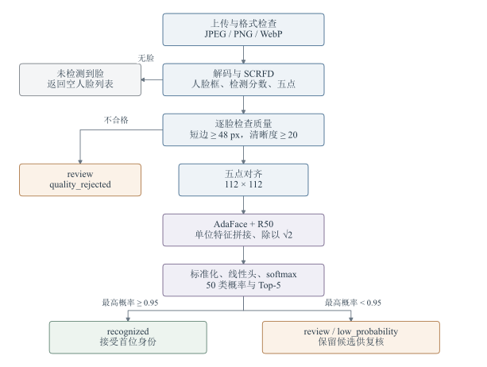
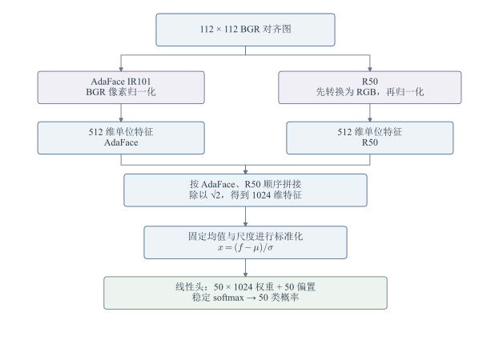

# Seiyuu-FaceID 技术详解：从照片到身份判断

本文按 2026-10-27 至 2026-10-28 的代码和实验记录说明整个识别框架。重点是模型怎样识别人、每一步为什么存在，以及结果和性能数字应当怎样理解；后半部分介绍 C++ / Go 实现与 N150 部署。

当前系统采用 **SCRFD 人脸检测 → 质量检查 → 五点对齐 → AdaFace IR101 与 R50 特征融合 → 标准化与逻辑回归 → 阈值决策**。两个特征模型使用预训练权重并保持冻结，本项目针对已审核的 50 个身份训练最后的分类头。所有推理在本机完成。

Python 是参考实现。C++ 推理核心与 Go HTTP 层已经完成 Mac 和 Linux 构建与启动，并在 N150 完成三组 HTTP 基线。后续定位次正规数处理开销，FTZ 版本完成 1,051 张裁剪、12 张原图回归及三个进程的 HTTP 测量，平均请求耗时约 0.681 秒、历史留出 Top-1 仍为 98.48%；详细阶段、资源取舍与统计边界见 [N150 实机报告](N150_BENCHMARK.md)。**2026-10-28 已集成至产品源码，并在 N150 以 systemd 服务启用；长期和压力场景验收尚未完成**。

## 阅读导航

插图由 [Python 绘图函数](../tools/draw_documentation_figures.py) 生成，文中使用可放大的 SVG；
PNG、PDF 和复现方法见 [图源说明](figures/README.md)。

- [1. 系统解决什么问题](#1-系统解决什么问题)
- [2. 一张照片的完整识别过程](#2-一张照片的完整识别过程)
- [3. SCRFD 如何找到人脸](#3-scrfd-如何找到人脸)
- [4. 质量检查与五点对齐](#4-质量检查与五点对齐)
- [5. 双骨干怎样把人脸变成特征](#5-双骨干怎样把人脸变成特征)
- [6. 分类头怎样给出身份和概率](#6-分类头怎样给出身份和概率)
- [7. 模型怎样训练和评估](#7-模型怎样训练和评估)
- [8. 为什么这样优化性能](#8-为什么这样优化性能)
- [9. C++ 核心和 Go 服务如何协作](#9-c-核心和-go-服务如何协作)
- [10. 已有实验能说明什么](#10-已有实验能说明什么)
- [11. N150 的部署与验收](#11-n150-的部署与验收)
- [12. 磁盘和日志为什么也是运行架构的一部分](#12-磁盘和日志为什么也是运行架构的一部分)
- [13. 代码阅读索引](#13-代码阅读索引)

## 1. 系统解决什么问题

系统接收照片，找到其中的人脸，然后判断每张脸是否能够归入当前训练过的身份。模型内置 50 个类别，输出的是这些已知类别之间的分类结果。

三个问题由三个不同环节回答：

| 问题 | 负责环节 | 输出 |
| --- | --- | --- |
| 照片哪里有人脸？ | SCRFD 检测器 | 人脸框、检测分数、五个关键点 |
| 这张脸有哪些可用于区分身份的视觉特征？ | AdaFace IR101、R50 | 两个各 512 维的特征向量 |
| 这些特征更符合哪个已训练身份？ | 本地分类头 | 50 类概率、前五名候选、接受或复核 |

目前没有在每次请求时逐张搜索训练照片，也没有查询向量数据库。训练照片用于离线拟合分类器；线上只需要模型权重、分类参数和有序类别名。因此，线上不必加载全部训练图片。

这里的人脸特征提取器可以处理新的照片，但分类头能返回的姓名限定在已经训练的类别中。添加新身份需要重新准备标签、训练并验证分类头。把新照片放进样本管理页面，不会自动更新部署模型。

系统处理照片中的多张脸，每张脸独立判断；当前流程没有跨图片人物跟踪、时序投票或活体检测。真人图库外身份、角色图、严重遮挡等输入的可靠拒识，也不属于已经验证的能力。

## 2. 一张照片的完整识别过程



可以把一张合照理解成一次图像解码、一次人脸检测，再对检测到的每张合格人脸分别进行特征提取和分类。人脸越多，双骨干执行次数通常越多；单人照片的耗时不能直接代表大型合照。

质量不合格时立即返回复核结果，不运行两个大骨干，也不会给这张脸编造身份候选。质量合格但身份概率不足时，才会保留分类候选供人工查看。这两种 `review` 的原因不同。

Python 的主流程位于 [runtime/pipeline.py](../src/seiyuu_faceid/runtime/pipeline.py)，C++ 的对应实现位于 [native/src/faceid.cc](../native/src/faceid.cc)。

## 3. SCRFD 如何找到人脸

### 3.1 检测模型与输入

检测器使用 `det_500m.onnx`，来源于 InsightFace 的 `buffalo_sc` 模型包。SCRFD 是专门的人脸检测模型，其任务是寻找脸的位置和关键点；上游实现见 [SCRFD 官方仓库](https://github.com/deepinsight/insightface/tree/master/detection/scrfd)。本项目没有重新训练这个检测器。

当前预处理顺序是：

1. 读取图片的 EXIF 方向，使检测器看到正确朝向的像素。
2. 若原图长边超过 1920 像素，先等比例缩小到这个上限。
3. 继续等比例缩放，并在四周补黑边，居中放入 640 × 640 画布。
4. 将 BGR 转成检测模型需要的 RGB，并按 `(pixel - 127.5) / 128` 归一化。
5. 将数组排列成 `NCHW`，也就是批次、通道、高、宽的顺序。

补边而不是直接把长方形拉成正方形，可以保留人脸的宽高比例。长边 1920 是检测预处理的工作图上限，640 × 640 才是检测网络输入；这两个值不应混为一谈。

上传像素上限是另一层控制。检测前缩小图片不能省掉最初把压缩文件解码为像素的内存，因此仍需要在上传入口检查图片尺寸。

### 3.2 多尺度输出与框解码

当前 SCRFD 导出有三个尺度，步长分别为 8、16、32，每个尺度输出人脸分数、边框距离和五点偏移，共九组输出。不同尺度对应不同的空间采样密度，使检测器能够提出不同大小的人脸候选。

代码根据特征图位置和步长恢复候选中心，再把模型输出的距离转换成人脸框和关键点。只保留检测分数 `≥ 0.50` 的候选。

同一张脸常产生多个重叠候选，需要用非极大值抑制（NMS）去重。这里使用的重叠指标为：

$$
\operatorname{IoU}(A,B)=\frac{|A\cap B|}{|A\cup B|}
$$

从高分框开始保留，抑制与之 IoU 大于 `0.40` 的其他框。最后逆向撤销补边和缩放，把框及关键点还原到解码后原图的坐标系。后续质量检查与对齐都使用这个坐标系。

**检测器内部的数据流：** 三个步长各输出三组张量，合计九组；它们共同生成候选框。


### 3.3 检测分数不能当身份分数

`detector_score` 表示检测器对“这里是人脸”的评分；它没有回答“这是谁”。即使某张脸检测分数很高，后续仍可能模糊、属于未知身份，或者在已知身份之间难以区分。

检测阶段出错还会影响下游：漏检的脸根本不会进入分类；关键点偏差会改变对齐后的像素。只测试已经裁好的人脸，无法覆盖这些失败路径。

实现入口：[vision/detector.py](../src/seiyuu_faceid/vision/detector.py) 中的 `SCRFDDetector.detect`、`_decode` 和 `_nms`。

## 4. 质量检查与五点对齐

### 4.1 先挡住明显不适合识别的人脸

质量检查使用原图中的人脸框，包含两个低成本条件：

| 条件 | 当前阈值 | 意义 |
| --- | ---: | --- |
| 人脸框短边 | 至少 48 像素 | 过小的人脸缺少可辨认细节 |
| 清晰度 | 灰度拉普拉斯方差至少 20.0 | 对局部边缘变化很弱的模糊脸请求复核 |

拉普拉斯算子关注亮度的局部变化，方差较低常见于模糊或缺少纹理的区域。但它不是学习得到的身份置信度，也不是完整的照片质量评价；噪声和高反差也可能影响它。

返回的 `quality_score` 是尺寸和清晰度两个截断比例的平均值：

$$
q=\tfrac12\left[\min\left(1,\frac{s}{2s_{\min}}\right)+
\min\left(1,\frac{v}{2v_{\min}}\right)\right]
$$

其中 `s` 是框短边，`v` 是清晰度。真正的质量接受条件是两个门槛分别通过，不能只用这个平均分替代。默认门槛见 [configs/n150.yaml](../configs/n150.yaml)，实现见 [vision/quality.py](../src/seiyuu_faceid/vision/quality.py)。

### 4.2 为什么不能直接截取人脸框

同一个人的照片可能有不同的头部倾斜、拍摄距离和框内位置。如果直接裁框缩放，眼睛在输入图中的位置会变化，特征网络就要同时处理身份差异和这些几何差异。

五点对齐使用两眼、鼻尖和两个嘴角，将它们映射到固定的 ArcFace 112 模板。对齐后的输入尺寸为 112 × 112，人脸的主要位置与朝向更加一致。

这里求的是带统一缩放、旋转和平移的二维相似变换：

$$
\mathbf y \approx sR\mathbf x+\mathbf t
$$

`R` 表示旋转，`s` 表示统一缩放，`t` 表示平移。代码使用 `estimateAffinePartial2D(..., LMEDS)` 估计变换，再用双线性插值生成对齐图，超出原图的部分填黑。

**对齐的几何关系：** 人脸框用来定位和检查质量，五点才用来估计变换。


左侧为已知相似变换构造的示意点，非评测照片；右侧采用代码中的真实模板。两侧均以左上角为像素坐标原点，保持等比例坐标轴。

这一步不做三维人脸重建，不能把严重侧脸真正恢复成正脸。它减少的是可由二维相似变换解释的位置差异。

实现和固定模板见 [vision/alignment.py](../src/seiyuu_faceid/vision/alignment.py)。对齐模板、插值方式和关键点顺序都属于模型输入契约，修改它们需要重新验证。

## 5. 双骨干怎样把人脸变成特征

### 5.1 特征向量的含义

特征提取网络把 112 × 112 的人脸像素映射为一个数值向量，也称 embedding。每一维不是一个人工指定的五官尺寸，整个向量共同表达网络学到的身份区分信息。

本项目同时使用两个冻结的预训练骨干：

| 骨干 | 输入颜色顺序 | 像素归一化 | 输出 |
| --- | --- | --- | --- |
| AdaFace IR101 | BGR | `(pixel / 255 - 0.5) / 0.5` | 512 维，随后 L2 归一化 |
| InsightFace R50 | RGB | `pixel / 127.5 - 1` | 512 维，随后 L2 归一化 |

“冻结”表示本项目训练身份分类器时不更新这两个骨干的权重。它们负责提供通用人脸表示，最后的分类头学习这些表示与本项目身份标签之间的关系。

AdaFace 的上游方法在训练时使用与图像质量相关的自适应间隔；本项目只使用其已训练好的骨干做前向推理。前述“48 像素 / 拉普拉斯方差”的质量检查是项目自己的运行规则，两者是不同机制。[AdaFace 官方说明](https://github.com/mk-minchul/AdaFace)

### 5.2 为什么要分别归一化，再拼接

设两骨干的原始输出分别为 `a` 和 `r`，先计算单位向量：

$$
u_A=\frac{a}{\|a\|_2},\qquad
u_R=\frac{r}{\|r\|_2}
$$

再按训练时固定的顺序组成：

$$
f=\frac{[u_A;u_R]}{\sqrt2}\in\mathbb R^{1024}
$$

这样在理想实数运算下，`f` 的 L2 范数也是 1。拼接前的两段具有相同范数，不会仅因为某个骨干输出数值更大就占据更大的整体尺度。

这里融合的是**特征**。两个骨干都没有直接给出本项目 50 类身份概率，因此不存在“两次姓名预测再投票”这一步。最终分类器同时读取两段特征，可以对不同维度学习不同权重。

**从像素到 50 类分数的维度变化：** 颜色处理分别进行，汇合点在特征层。



两个预训练网络可能提供互补表示，这是保留双骨干的设计动机；当前性能迁移实验没有做“删掉其中一个”的重新训练与独立评估，不能据此断言双骨干在所有数据上必然更好。只运行一个骨干会改变分类器的输入含义和维度，也就不再是保持原分类器行为的工程优化。

### 5.3 看起来等价的处理，也可能改变结果

需要保留三个细节：

- **颜色顺序**：AdaFace 使用 BGR，R50 使用 RGB，不能共用同一通道顺序。
- **计算顺序**：AdaFace 的分步归一化与代数化简形式在浮点数下不一定逐位相同。
- **拼接顺序**：前 512 维固定属于 AdaFace，后 512 维固定属于 R50。交换顺序会使分类头的权重作用于错误特征。

单位化也有异常检查：出现非有限值或接近零范数时应报错，不能把异常向量当成有效人脸特征。

实现入口：[vision/recognizer.py](../src/seiyuu_faceid/vision/recognizer.py) 的 `ONNXRecognizer.embed`，以及 [vision/classifier.py](../src/seiyuu_faceid/vision/classifier.py) 的 `IdentityClassifier.embed`。

## 6. 分类头怎样给出身份和概率

### 6.1 为什么还需要标准化

整个拼接向量单位化，并不代表它的每一维在训练集上都具有相同分布。某些维度的变化范围仍可能比其他维度大。

训练时用 `StandardScaler` 在拟合数据上估计每维均值 `μ` 和尺度 `σ`，推理时使用同一组固定参数：

$$
x_j=\frac{f_j-\mu_j}{\sigma_j}
$$

线上不会用上传图片重新估计均值和方差。否则同一张脸可能随请求批次不同而改变结果，也会偏离已训练分类头的输入分布。

当前参数中，`mean` 和 `scale` 是 float64，特征与分类系数使用 float32。Python 先对 float32 数组原地减均值并写回，再除尺度并写回。C++ 显式保留这两个舍入点。保留 FP32 模型指没有把网络权重量化成低精度，不代表每个中间计算都只使用 float32。

### 6.2 逻辑回归在这里做什么

标准化后的特征有 1024 维，分类头有 50 行权重，每行对应一个身份：

$$
z_k=\sum_{j=1}^{1024}W_{k,j}x_j+b_k,\qquad k=1,\ldots,50
$$

`z_k` 是未归一化的类别分数，称为 logit。随后使用稳定 softmax：

$$
m=\max_k z_k,\qquad
p_k=\frac{\exp(z_k-m)}{\sum_{i=1}^{50}\exp(z_i-m)}
$$

减去最大值不改变实数意义上的 softmax，但可以避免直接求很大指数导致溢出。50 个类别分数之和为 1。

线性头只有 `50 × 1024 = 51,200` 个权重系数和 50 个偏置，远小于两个深度特征网络。它的主要工作是对已经提取出的特征做分类，所以只加速最后这一步，通常不能消除前面特征提取的主要工作量；具体占比仍应通过分阶段计时确认。

默认返回概率最高的五个候选。候选按稳定降序排序，相同分数保持类别索引顺序，避免结果因不必要的排序变化而抖动。

### 6.3 身份接受与人工复核

默认规则为：质量检查通过，且最高类别分数 `≥ 0.95`，才返回 `recognized` 和第一名身份；否则返回 `review`。

| 场景 | 状态 | 身份 | 候选 |
| --- | --- | --- | --- |
| 没检测到脸 | 人脸列表为空 | 无 | 无 |
| 质量不合格 | `review / quality_rejected` | 无 | 空，未执行分类 |
| 质量合格，最高分低于阈值 | `review / low_probability` | 无 | 保留前几名 |
| 质量合格，最高分达到阈值 | `recognized` | 第一名身份 | 保留前几名 |

例如，以下分数只是说明规则的假设值：一张合格人脸得到 A 类 `0.97`，会接受 A；若 A 类 `0.63`、B 类 `0.31`，则进入复核。降低阈值会接受更多样本，但不能据此认为模型识别能力提高了。

### 6.4 0.95 不是现实世界的正确率保证

这 50 个概率回答的是“在这 50 个已知类别中，模型更偏向哪一类”。一个从未训练过的人也会被 softmax 分配到这 50 类，有时甚至得到很高的分数。

因此，`0.95` 是当前分类分数上的接受门槛，不能解释为“系统保证这个身份有 95% 的现实正确概率”。要评估未知身份拒识，需要加入有真值的图库外人脸，分别统计已知身份的误拒、误认和未知身份的误接受，再选择阈值。当前实验没有完成这项验证。

实现入口：[LinearIdentityHead](../src/seiyuu_faceid/vision/classifier.py) 和 [decide_candidates](../src/seiyuu_faceid/runtime/results.py)。

## 7. 模型怎样训练和评估

### 7.1 训练阶段与线上推理的分工


实际训练的是标准化参数和多项逻辑回归，两个大骨干保持不变。这样能够复用通用人脸特征，针对本项目的数据训练较小的分类器；也能把候选分类头实验集中在固定特征上，避免每次搜索都重跑神经网络。

当前复现脚本使用 `C=1.0`、`class_weight=balanced`、`max_iter=1500`。`C` 控制正则化强度的倒数；类别平衡权重用于调整不同类别样本数量对拟合的影响。准确设置见 [tools/train_classifier.py](../tools/train_classifier.py)。

训练使用 scikit-learn；Python 服务推理只需要导出的数组运算和 ONNX Runtime，不需要加载 scikit-learn 或 PyTorch。C++ 服务连 Python 解释器也不需要。准备模型、训练和评估仍然可以保留 Python 工具。

### 7.2 数据口径与泄漏控制

| 数据范围 | 人脸数 | 用途 |
| --- | ---: | --- |
| 原训练集 | 3,574 | 拟合开发数据 |
| 原验证集 | 490 | 与训练集合并后拟合当前最终头 |
| 当前最终头实际拟合集 | **4,064** | 标准化和分类头训练 |
| 历史留出集 | **1,051** | 不参与当前头拟合 |
| 合计 | 5,115 | 共 50 个身份 |

**当前模型实际使用的数据：** 训练和验证集合并拟合，留出集只进入评估路径。


图中的留出集未参与当前头的拟合，但曾用于多轮模型选择；这项历史使用仍影响成绩的解释。

拆分不能只把照片随机打散。同一原图裁出的脸、重复下载的照片、同一来源组中的高度相似照片，可能同时落在训练和测试中，让评估变得过于乐观。

本轮分类头搜索通过样本标识、来源组、原图及裁剪 SHA，以及可选的写真集分组建立来源组件；有重复关系的样本通过传递关系合并，再按组件隔离训练和验证。标准化参数也只能在每折训练数据上拟合。

来源隔离能降低泄漏，却不会自动创造独立测试证据。历史留出集曾参与此前多轮模型选择，所以本文把它称为“历史留出集”，不把其成绩包装为全新的泛化保证。

### 7.3 为什么最终没有替换分类头

本轮搜索了 50 组候选，包括不同正则化、类别权重、特征块权重及来源组件权重。候选在开发池内进行三折来源隔离 OOF 评估，即每个可评估样本由没有用它训练的那一折模型预测。

两类各自只有一个来源组件，无法同时保留训练和独立来源验证，因此 OOF 覆盖 4,062 张、48 类；每折训练仍包含全部 50 类。不能把 OOF 分母写成全部 4,064 张。

| 指标 | 现有分类头 | 搜索胜出的候选 |
| --- | ---: | ---: |
| 选择用 OOF Top-1 | 3,977 / 4,062 | 3,986 / 4,062 |
| 历史留出 Top-1 | **1,035 / 1,051** | 1,033 / 1,051 |
| 0.95 门槛下接受数 | 1,011 | 986 |
| 其中错误接受数 | 4 | 4 |
| 需要复核数 | 40 | 65 |

OOF 行的“现有分类头”指沿用现有头的配置，在每个训练折重新拟合标准化和分类器；没有把用全部开发数据拟合的部署参数直接拿去做 OOF。历史留出行才比较最终部署参数与新候选参数。

候选在 OOF 上有小幅优势，但没有修复原有的 16 个历史错误，还增加了两个错误，并让更多裁剪需要复核。因此保留原分类头，把性能优化集中在执行方式和运行实现上。这里的接受统计是在裁剪分类实验中计算，不包含上传原图的检测、漏检或质量过滤。

完整候选、选择流程与统计局限见 [分类优化记录](CLASSIFIER_OPTIMIZATION.md)。

### 7.4 怎样理解当前准确率

现有模型在 1,051 张历史留出裁剪上的 Top-1 为 **1,035 / 1,051 = 98.48%**，Top-5 为 **99.14%**。Macro-F1 为 **99.10%**，只对有测试真值的 49 个身份取平均。

Top-1 检查第一名是否正确，Top-5 检查正确身份是否进入前五；二者不等于“通过 0.95 门槛后自动接受的比例”。Macro-F1 让各支持类别分别计算 F1 后再平均，因此也不等于按全部裁剪数加权的正确率。

这些是已对齐人脸的身份分类指标。完整上传系统还会受到解码、检测漏检、对齐和质量筛选影响，不能直接宣称任意用户照片都有 98.48% 的端到端正确率。测试集还包含相互相关的来源组件，不能把 1,051 张裁剪都视为独立采样。

维护时需要区分两种验证：

- **准确率评估**：与人工真值比较，判断模型是否认对。
- **运行时一致性评估**：在相同输入上比较 Python 和 C++，判断迁移是否引入变化。两个实现都输出同一错误身份，也算一致，但不算识别正确。

## 8. 为什么这样优化性能

### 8.1 先分清耗时发生在哪里

对于含多张脸的上传请求，可以用下面的分解理解端到端时间：

$$
T_{\mathrm{HTTP}}\approx T_{\mathrm{传输与解析}}+T_{\mathrm{排队}}+
T_{\mathrm{解码}}+T_{\mathrm{检测}}+
\sum_{\mathrm{每张脸}}\left(T_{\mathrm{质量}}+
\mathbf1_{\mathrm{质量通过}}(T_{\mathrm{对齐}}+T_{\mathrm{双骨干}}+T_{\mathrm{分类}})\right)
+T_{\mathrm{响应}}
$$

这不是严格的系统调用计时公式，而是定位问题的方法。只测 112 × 112 的裁剪，省去了检测和大图解码；服务端处理计时可能排除了上传解析及排队；网络客户端的耗时还包含传输。不同范围的数字不应放在同一列直接比较。

### 8.2 两个骨干可以并行，但线程越多不一定越省资源

两个骨干只读取同一张对齐图，彼此没有数据依赖。顺序执行时，双骨干时间近似为 `T_A + T_R`；资源足够时并行执行，可以接近 `max(T_A, T_R)` 再加调度开销。它没有减少网络运算量，而是改变了运算的时间安排。

还有另一层并行：ONNX Runtime 可以让单个模型内部的算子使用多个线程。两个骨干各用两个主要计算线程，并行时就可能同时竞争约四个计算线程的资源；不能再把每模型的线程数当成整个服务的总数。

N150 配置采用：

```yaml
runtime:
  intra_op_threads: 1
  detector_intra_op_threads: 2
  inter_op_threads: 1
  parallel_backbones: true
  allow_spinning: false
  enable_cpu_mem_arena: true
```

识别阶段两个骨干各用一个主要计算线程，检测器单独保留两个线程。检测先于识别执行，不是三个网络同时跑。Go、OpenCV 和其他运行库仍可能拥有额外线程。

ORT 的等待线程可以通过自旋缩短再次接收工作的延迟，但也会消耗 CPU 周期。这里关闭自旋，是减少等待阶段资源消耗的选择，需要同时观察唤醒带来的延迟变化。`intra-op` 管理算子内部并行；`inter-op` 管理图节点之间的并行，后者只有相应执行模式启用时才有作用。本项目没有额外开启图节点并行执行。[ORT 线程管理](https://onnxruntime.ai/docs/performance/tune-performance/threading.html)

检测器保留两个线程有本地证据：将它也改成一个线程时，12 张原图上的关键点最大变化约 `0.000183` 像素，经过对齐插值后个别分类概率变化约 `0.000149`。保留检测器线程设置后，这组完整输出恢复一致。这说明“权重没变”仍不足以证明整个像素处理链完全相同。

CPU arena 用于模型运行时的内存分配与复用。本地关闭它只减少约 17 MiB 峰值 RSS，暂未据此改变默认设置；其目标机收益需单独测量。

### 8.3 换成 C++ / Go 能优化什么

现有 Python 代码已经通过 ONNX Runtime 调用优化后的模型算子，卷积计算不是用 Python 循环逐个完成。ONNX Runtime 通过 execution provider 执行底层算子；换掉调用语言不会自动减少这些网络计算。[ORT Python API 与执行机制](https://onnxruntime.ai/docs/api/python/api_summary.html)

C++ / Go 方案可以改变的是进程依赖、图像解码和预处理实现、对象分配、调用组织及 HTTP 服务层。保留原 ONNX 权重的收益在于降低迁移范围，但仍必须验证输入像素和输出数值。

因此我们没有承诺“改用 C++ 就快几倍”。此前约 9.7% HTTP 平均耗时下降，是整个原生运行实现相对 Python 服务在 Mac 上的结果，不能拆解成纯粹的语言收益。后续 N150 基线中，同配置原生实现平均耗时仅低约 0.12%，不足以证明可靠提速，峰值 RSS 还高约 19.5%，见 [实机结果](N150_BENCHMARK.md#6-已完成的三组基线结果)。去掉 Python 也不等于去掉所有运行时成本：Go 有自身运行时，cgo 有调用边界，OpenCV 和 ORT 仍需要内存。

继续诊断后，N150 上的主要异常计算开销定位到了 **FP32 次正规数处理**：在相同三个裁剪和顺序 kernel 中，只切换 FTZ/DAZ 模式，双骨干合计耗时中位数从 11.471 秒降至 0.721 秒，原始输出、特征与概率相同。这提供了独立于换语言的瓶颈证据。候选 C++ 核心在每次 Session 创建和运行时保存、设置、恢复线程的 MXCSR，并设置 ORT 自有线程池策略，避免依赖某次 Go/cgo 调用遗留的线程状态；原 FP32 权重文件没有改变，但次正规数浮点语义改变，因此另做了全量数值回归。

该版本后续 HTTP 平均耗时为 680.785 ms，全量历史留出 Top-1 保持 98.48%。它是基线之后的独立测量，不是同期交替 A/B；相对旧线程 Python 的峰值 RSS 仍高约 17.9%。实现与证据见 [FTZ 独立实验](N150_BENCHMARK.md#8-ftz--daz-独立跟进实验)。当前产品构建已包含该实现，导出时使用 `--flush-denormals` 开启；旧核心库不会因为 JSON 多了一个字段就自动获得该能力。

**FTZ/DAZ 的作用域：** 下图展示已通过平台检查的 Linux x86_64 路径，每个调用线程单独保存和恢复状态。


图像预处理和分类头在该作用域外；R50 持久 worker 的推理也经过同样的 guard。Mac ARM 上开启此选项会被明确拒绝。

### 8.4 CPU 时间、延迟和功耗是三个指标

wall time 是用户等待的时间，CPU time 是所有相关计算线程累计消耗的处理器时间。例如一个任务经过 60 ms、累计使用 120 ms CPU 时间，平均相当于占用两个核心。

此前 Mac 裁剪资源实验中，从“两骨干各两个线程且自旋”切到 N150 预设后，裁剪分类 CPU 时间约从 `192.09` 降至 `101.62 ms/张`，降低 **47.1%**；wall time 从 `53.23` 增至 `57.05 ms/张`，增加约 **7.2%**。这是减少 CPU 工作量与延迟之间的取舍，不能写成提速或节电 47.1%。电量还需要功耗采样和时间积分。

这组实验只计裁剪分类，与后面的完整 HTTP 实验输入、计时范围和基线不同，两个百分比不能相加或相乘后当成总收益。详细记录见 [N150 指南](N150.md)。

## 9. C++ 核心和 Go 服务如何协作

### 9.1 一个进程，两个职责层


Go 进程在同一地址空间内调用 C++ 共享库，不需要把图片发给另一个本地推理服务。模型在启动时加载一次，三个 ORT Session 持续复用。

C++ 并行骨干使用一个持久 worker 运行 R50，调用线程运行 AdaFace，等待两者完成后再按固定顺序拼接。HTTP 请求之间串行使用一个模型实例，避免小内存机器因多个模型副本而增加常驻内存。

**一次合格人脸推理的调用时序：** 两个骨干并行，但共享同一请求的输入并在分类前汇合。


一个模型实例也意味着长请求会占用推理资源；例如批量请求取得执行资格后，会顺序处理整批图片。因此限流可以控制积压，但不会让所有等待请求同时获得低延迟。

### 9.2 C ABI 与资源所有权

接口在 [native/include/faceid.h](../native/include/faceid.h) 定义：

| 接口 | 作用 |
| --- | --- |
| `faceid_create` / `faceid_destroy` | 创建和销毁模型实例 |
| `faceid_process_encoded` | 从 JPEG、PNG、WebP 压缩字节执行流程 |
| `faceid_process_bgr` | 从 BGR 像素执行流程，也用于对照验证 |
| `faceid_model` | 查询模型元信息 |
| `faceid_free` | 释放核心分配的结果或错误字符串 |

C++ 异常在边界内被转换成状态码和结构化错误，不能穿过 C ABI 传播到 Go。Go 适配器用同一把锁保护处理和销毁，C++ 另用锁串行化推理。直接使用 C ABI 的调用方仍必须确保所有调用结束后才销毁模型；C++ 的推理锁不会自动保护并发销毁。

上传字节在同步调用期间借给 C++ 使用，适配器保持其生命周期，核心不在调用结束后保存这个 Go 缓冲区。这遵循 [cgo 的指针传递与生命周期规则](https://pkg.go.dev/cmd/cgo#hdr-Passing_pointers)。但整个处理链不是零拷贝：解码产生像素数组，模型输入需要构造，返回 JSON 转为 Go 数据也有分配。

### 9.3 上传、排队与取消

当前原生 HTTP 限制如下：

| 项目 | 限制或行为 |
| --- | --- |
| 单文件 | 10 MiB |
| 单请求 | 81 MiB，包括 multipart 开销 |
| 单图 | 2,000 万像素 |
| 单批 | 最多 8 张 |
| 进入上传解析、等待或处理的请求总数 | 最多 8 个，满后返回 `503 server_busy` |
| 同时执行原生推理 | 1 个请求 |
| 格式 | 静态 JPEG、PNG、WebP |

Go 在完整解码前解析文件头和像素数，C++ / OpenCV 再验证实际压缩内容。JPEG、PNG、WebP 的 EXIF 八种方向由核心处理；动画 WebP 和所有 APNG 都拒绝，包括只有一帧但携带动画控制块的 APNG。

multipart 上传文件内容的内存阈值为 32 KiB，超出的文件内容会进入临时目录，请求结束时清理；非文件字段与元信息还有额外内存开销。于是服务仍需要临时磁盘空间；81 MiB 是单请求限额，也不是整个进程的内存硬上限。Go 堆统计不会覆盖全部 C++ / ORT 分配，观察总资源应看进程 RSS 以及容器整体指标。

排队期间或批次中尚未开始的下一张图片可以响应取消，排队取消返回 `408 request_cancelled`。已经进入 C++ / ORT 的一次推理没有中断钩子，会完成后释放资源。HTTP 优雅关闭有 90 秒等待窗口，但模型清理仍需等待原生调用收尾，因此不是整个进程严格 90 秒退出的保证。

**请求进入推理前后的边界：** 8 个槽位限制在途请求总数，单推理门限制模型实例的并发使用。


上传解析或输入检查失败也会走清理路径；图中只展开正常输入与排队取消两条路径。

原生 `processing_ms` 从打开上传文件开始，包括读取、格式校验、解码和推理，不包括之前的 multipart 上传解析和排队。评估用户体验必须再测客户端完整 HTTP 时间。

### 9.4 模型导出、校验与标识

离线工具 [export_native_model.py](../tools/export_native_model.py) 把已有 `classifier.npz` 的数组导出成 `native-model.json`，保留类别顺序、参数精度和完整配置，不修改 ONNX 权重。

Go 服务启动时校验 JSON 的 `.sha256`、三个分类模型来源文件及检测器的 SHA-256。`classifier.npz` 虽不再用于 C++ 读取分类参数，仍作为来源文件参与校验，需要随部署模型保留。单独调用 C ABI 的 `faceid_create` 并不代替 Go 入口的整套文件校验。

**启动时先确认资产，再创建常驻模型：** 分类参数由 JSON 提供，原 NPZ 用于核对来源。


`model_id` 来自 AdaFace、R50 和原分类头三项来源资产的摘要映射，与 Python 保持相同；检测器另行校验。Go HTTP 的 `recognition_id` 则对原生实现标记和导出 JSON 的原始字节求摘要，覆盖配置及检测器摘要变化。即使只调整 JSON 空白，后者也会变化。

这些 SHA-256 检查能发现文件损坏或资产不匹配，但没有独立签名信任链，不能等同于来源真实性认证。

### 9.5 当前兼容性边界

API 路径包括 `/health`、`/ready`、`/v1/model`、`/v1/detect`、`/v1/recognize` 和 `/v1/recognize/batch`。原生试验版没有上传首页、Swagger 或 OpenAPI 路由；Python 服务的网页能力不会因核心迁移自动出现。

识别结果的主要字段沿用现有 API，但解码器、数学库和排序实现仍有差异边界。例如 C++ NMS 对同分检测框按倒序输入索引处理，Python NumPy 默认排序不稳定；重叠框恰好同分时可能保留不同关键点。JPEG 解码、对齐插值和浮点累加也需跨平台验证。

构建与接口操作细节见 [C++ + Go 试验版指南](NATIVE_CPP_GO.md)，完整字段说明见 [API 文档](API.md)。

## 10. 已有实验能说明什么

### 10.1 数值与决策一致性

本地 macOS ARM64，Python 与 C++ 分别在独立进程加载 ONNX Runtime 1.29.0，避免一个进程同时加载两套动态库干扰对照。对全部 1,051 张历史留出裁剪重新提取特征：

| 检查项 | 结果 |
| --- | --- |
| Top-1 正确数 | 两者均为 1,035 / 1,051 |
| 第一名身份、前五名有序候选 | 全部一致 |
| 0.95 门槛接受判定 | 全部一致 |
| 新增错误 / 修正错误 | 0 / 0 |
| 特征最大绝对差 | `2.24e-8` |
| 分类概率最大绝对差 | `3.58e-7` |

另选 12 张留出来源原图，包含 14 张检测人脸，同时验证预解码 BGR 和直接上传压缩文件两条路径。人脸数、检测框、检测分数、质量分数、候选顺序与接受判定一致，概率最大差 `2.09e-7`。

结论是：**这批输入上没有观察到迁移造成的决策退步**。C++ 与 Python 并非逐位相同，也不能把抽样和历史回归扩展成任意图片上的保证。

公共验证工具 [validate_native.py](../tools/validate_native.py) 便于诊断指定目录，但它把 Python 与 C++ 放在同一进程，进程 RSS 不代表独立原生服务内存；正式对照应使用独立进程。比较概率门槛时也要保留 Python 浮点阈值语义，避免把 `0.95` 悄悄降成 float32 后掩盖边界差异。

### 10.2 完整 HTTP 的本地资源收益

下面仍然是 **Mac 数据，不是 N150 数据**。使用另选的 12 张训练来源原图，它们不同于上面的原图一致性样本。每个服务进程预热完整一轮，再执行四轮，共 48 个计时请求；每种实现启动三次新进程，交替运行顺序，不同时驻留两种待测服务。

| 指标 | Python HTTP | C++ + Go HTTP | 变化 |
| --- | ---: | ---: | ---: |
| 平均 HTTP 耗时 | 94.13 ms | 85.00 ms | 降低 9.7% |
| HTTP P95 | 113.83 ms | 103.15 ms | 降低 9.4% |
| 平均服务端处理耗时 | 92.14 ms | 82.69 ms | 降低 10.3% |
| 进程峰值 RSS | 1160.89 MiB | 1026.94 MiB | 减少 133.95 MiB，约 11.5% |

每一项先在一个进程内计算，再取三个进程指标的中位数。P95 采用 nearest-rank：48 个请求从小到大排序，取第 46 个；然后对三个 P95 取中位数，并非合并 144 个请求后计算。表格不同列的中位数不一定来自同一个进程。

客户端访问 localhost，HTTP 计时包含本机上传与响应。峰值 RSS 由进程退出后的 `wait4` 取得，包括加载、预热和大图处理。报告中的进程 CPU 秒数覆盖整个生命周期，不能除以计时请求数就声称是单次推理 CPU 成本；新进程也不意味着清空了系统文件缓存。

三次 HTTP 测试各自保存的一轮输出也通过对照，概率最大差 `2.38e-7`。这组样本适合说明本地资源变化，不是新的识别准确率测试。

### 10.3 复核证据在哪里

公开仓库保存实现、验证工具和汇总结论；原始照片、逐样本结果和服务器内部记录保留在忽略目录：

| 本地证据位置 | 内容 |
| --- | --- |
| `data/experiments/native-cpp-go-20261027/isolated_verification.json` | 独立进程的特征、概率、候选和决策对照 |
| `data/experiments/native-cpp-go-20261027/http_benchmark.json` | 六个 HTTP 服务进程的原始测量与汇总 |
| `data/experiments/n150-resource-final-20261027.json` | Python 线程、自旋和 arena 资源比较 |
| `data/experiments/n150-validation-20261027/verification.json` | Python 资源配置的完整结果回归 |
| `data/experiments/n150-remote-20261027/cleanup-report.json` | 目标机磁盘与服务状态维护记录 |
| `data/experiments/n150-remote-20261027/parity-linux.json` | N150 独立进程的全量裁剪与固定原图一致性结果 |
| `data/experiments/n150-remote-20261027/http-three-way.json` | N150 三组、九进程的完整 HTTP 基线 |
| `data/experiments/n150-remote-20261027/baseline-audit.json` | 基线完整性与汇总算术的独立审计 |
| `data/experiments/n150-remote-20261027/ftz-candidate-parity.json` | FTZ 候选与冻结 Python 缓存的全量一致性回归 |
| `data/experiments/n150-remote-20261027/ftz-http.json` | FTZ 候选三个服务进程的 HTTP 结果与实际核心库绑定 |
| `data/experiments/n150-remote-20261027/candidate-audit.json` | FTZ 候选结果与相对变化的独立审计 |

这些路径用于本地追溯，克隆仓库不会附带私人数据。N150 构建、准确率和基线测试与 2026-10-28 的生产切换分阶段记录；单次部署核验仍不等同于长期运行验收。

## 11. N150 的部署与验收

### 11.1 可执行文件也有运行依赖

原生构建固定 ONNX Runtime 1.29.0、OpenCV 5.0.0 和 nlohmann/json 3.12.0，并检查下载摘要。需要 C++17、CMake ≥ 3.20、Go ≥ 1.24 等构建工具。OpenCV 只构建图像相关模块，减少不需要的视频、GUI 等依赖。

部署形态为 `faceid-server` 加旁边的共享库目录，以及模型和配置文件；不是完全静态的单文件程序。Linux 使用相对加载路径寻找应用库，已在本次 N150 / glibc 2.39 环境完成动态依赖解析和启动检查；其他系统库版本和 CPU 架构仍需分别验证。Mac ARM 构建产物不能直接当作 Linux x86_64 二进制使用。

构建可以在兼容的 Linux 构建环境完成，再在 N150 做运行验收；如果直接在 8 GB 机器上构建，可从 `JOBS=2` 开始控制构建并发。编译阶段的内存和耗时不应混入服务性能计时。

### 11.2 Docker 和语言选择应分开比较

Linux 容器共享宿主机内核，因此不能把 Docker 默认理解成另外运行一套虚拟机。是否有可观测开销，要看 CPU 配额、存储路径、网络和日志等具体条件。[Docker 对容器与虚拟机的说明](https://docs.docker.com/get-started/docker-concepts/the-basics/what-is-a-container/)

Python 服务可以通过 Docker 或原生 systemd 部署；C++ / Go 也可以采用不同封装方式。要区分两类实验：保持语言实现不变，比较容器与宿主机；保持运行条件一致，比较 Python 与 C++ / Go。一次同时换语言、模型、存储和容器设置，就难以知道收益来自哪里。

### 11.3 目标机已完成验证与剩余范围

目标机是 Linux、Intel N150、8 GB 内存，系统实际可见约 7.5 GiB RAM。完成磁盘清理后，在 SSD 上使用隔离目录执行了以下检查：

1. 固定源码、输入清单、模型哈希、有序类别、配置和库版本，完成 Linux 原生构建、动态库加载、启动与真实模型 HTTP 集成检查。
2. 在独立 Python / 原生进程中对照全部 1,051 张历史留出裁剪和固定 12 张原图。N150 配置下的 Top-1、Top-5 顺序与接受判定一致，仍为 1,035 / 1,051 正确；浮点数值不是逐位相同。
3. 完成旧线程 Python、N150 配置 Python、同配置 C++ / Go 三组 HTTP 基线。每组三个新进程，以轮换顺序执行，共 432 个计时请求；记录平均、P50、P95、峰值 RSS 与计时区间 CPU，并完成独立汇总审计。
4. 在后续独立阶段完成 FTZ 候选的全量回归和三个新 HTTP 进程，共 144 个计时请求；输出与冻结 Python 原图参考一致，并核对了三个进程实际加载的候选共享库。此阶段没有重新启动基线组做同期交替测量。

三组中的旧线程 Python 使用当前源码和 Python 3.12.3 环境复现旧参数，不是直接测量现有生产 Python 3.13 服务。它在 12 张 HTTP 原图上完成了输出比较，不能据此声称旧线程组也重新完成了全量裁剪对照。12 张原图包含 11 张单脸图和 1 张三脸图，并不覆盖所有格式、EXIF 方向、极端尺寸或重叠人脸边界。

基线结果显示 N150 预设相对旧线程组减少约 34.4% CPU 时间，但平均 HTTP 等待增加约 37.9%；同配置原生实现没有显示可靠提速且峰值 RSS 更高。因此基础配置中的“省 CPU”不能解释成“低延迟”。后续 FTZ 候选的改进属于另一个已验证实验，不能反填为原基线或默认构建的能力。完整统计与分阶段结果统一记录在 [N150 实机报告](N150_BENCHMARK.md)。

目标机已在 2026-10-28 切换为 FTZ/DAZ 原生服务，原 API 端口与密钥保留，旧容器停用并保留用于回退。部署前后各验证 12 张原图的输出与实际核心库映射。并发排队、最大允许图片、完整批量与取消场景、长时间运行仍需专项验收；单请求固定图片基准不能代表这些情况下的内存和尾延迟。图像格式与 EXIF 边界也需要扩大样本覆盖。

Linux 计时区间 CPU 可以用 `/proc/<pid>/stat` 的 `utime + stime` 增量除以时钟频率，单独统计启动和预热。`wait4.ru_maxrss` 在 Linux 的单位是 KiB，在 macOS 是字节，换算 MiB 时应分别处理。

记录测试时的后台服务负载、频率、温度、可用内存、swap 与容器限制。当前机器上另有服务运行，不能把干扰下的波动全部归给推理程序。也不能为制造“冷缓存”而随意影响整台服务器的缓存状态。

后续如考虑 OpenVINO、INT8、FP16、蒸馏或删除一个骨干，应作为新的后端或模型实验建立单独基线。这些不是当前已经验证“保持准确率”的优化成果。

## 12. 磁盘和日志为什么也是运行架构的一部分

### 12.1 存储影响启动和稳定性，不等于模型算力

模型文件读取、依赖构建、上传临时文件和日志写入都需要磁盘。模型常驻内存后，主要网络运算不需要每次从磁盘重读全部权重，所以 SSD 与机械硬盘的差别不能简单换算成推理提速倍数。

但系统盘写满会影响临时文件、日志和软件更新，使部署与测试失去可靠环境。因此此次先清理主 SSD，没有把测试工作迁移到机械数据盘。

截至本次维护结束，主盘使用率由 **100% 降至 41%**，可用空间为 **63.78 GiB**，`df -h` 显示约 `64G`。主要清理对象是 Syncthing 约 56.78 GiB、迅雷约 4.23 GiB 的历史日志，另做系统 journal vacuum 和软件包缓存清理。这两个日志数值是清理前逻辑文件大小，不是分别精确测得的净物理空间释放量。

清理前分别保留最近约 2 MiB 日志和原 Compose 配置。完成后核对了 10 个运行容器的 ID、PID、启动时间与挂载，FaceID `/ready` 返回 200。这说明维护期间服务实例没有被替换，不意味着每个应用的全部功能都做过测试。

### 12.2 路径相同，为什么可能指向不同数据

发现的存储问题是：宿主机当前 `/data/...` 指向机械盘，而部分已运行容器实际引用的是 SSD 上被该挂载点遮住的旧目录。

可以把它理解为两种视角：

```text
宿主机现在解析 /data/...  ──→ 机械盘上的目录对象
已运行容器的既有 bind mount ──→ SSD 上的旧目录对象
```

证据来自设备号和 inode 的差异，而不只是路径字符串。只看 `docker inspect` 显示的挂载源路径，会错过这一点。重建容器时重新解析当前路径，可能绑定到另一份数据。

因此本次保留了既有挂载，未重建相关容器。后续需要先辨认两套目录内容和应用实际数据，再决定保留或迁移方案，然后应用新的日志配置；不能把直接重建当成无影响的操作。

### 12.3 日志限制的实际生效状态

系统 journald 已配置并验证生效：

```ini
[Journal]
SystemMaxUse=512M
SystemKeepFree=1G
RuntimeMaxUse=64M
```

这是一组日志空间预算和保留空间策略，不是任意时刻严格不超过某字节数的承诺。维护结束时 journal 占用约 508.9M。[systemd journald 配置说明](https://www.freedesktop.org/software/systemd/man/latest/journald.conf.html)

两个大日志来源的 Compose 文件已加入：

```yaml
logging:
  driver: json-file
  options:
    max-size: "10m"
    max-file: "3"
    compress: "true"
```

但现有容器的运行配置尚未包含这些限制，**Docker 日志轮转尚未生效**。更新配置文件不会自动修改已创建容器的日志配置，需要在解决挂载问题后有计划地重建。[Docker json-file 日志说明](https://docs.docker.com/engine/logging/drivers/json-file/)

本次空间应急处理保留日志文件 inode，截断其历史内容。Docker 官方建议由 daemon 独占管理这些日志文件，外部修改可能干扰读取，因此这不是推荐复制到定时任务中的长期轮转方法。本次一次迅雷 `docker logs --tail 1` 检查确实挂起，检查客户端已结束，读取异常仍需后续处理；不能用容器仍运行来证明日志功能正常。最后十秒内未观察到日志增长，也不能推断以后不会再增长。[Docker 对外部操作日志文件的提示](https://docs.docker.com/engine/logging/drivers/json-file/)

## 13. 代码阅读索引

建议先读 Python 主流程理解算法，再读 C++ 对应实现及 Go 边界。

| 想了解的内容 | 文件 / 入口 |
| --- | --- |
| 整张图到每张脸的处理顺序 | [runtime/pipeline.py](../src/seiyuu_faceid/runtime/pipeline.py)：`recognize_faces`、`recognize_detection` |
| 模型实例与配置 | [runtime/engine.py](../src/seiyuu_faceid/runtime/engine.py)、[configs/n150.yaml](../configs/n150.yaml) |
| SCRFD 输入、解码和 NMS | [vision/detector.py](../src/seiyuu_faceid/vision/detector.py) |
| 人脸质量 | [vision/quality.py](../src/seiyuu_faceid/vision/quality.py) |
| 五点模板与变换 | [vision/alignment.py](../src/seiyuu_faceid/vision/alignment.py) |
| 颜色、归一化、512 维特征 | [vision/recognizer.py](../src/seiyuu_faceid/vision/recognizer.py) |
| 双骨干组合、标准化和 softmax | [vision/classifier.py](../src/seiyuu_faceid/vision/classifier.py) |
| 接受 / 复核规则 | [runtime/results.py](../src/seiyuu_faceid/runtime/results.py) |
| 训练和来源隔离搜索 | [tools/train_classifier.py](../tools/train_classifier.py)、[classifier_search.py](../src/seiyuu_faceid/experiments/classifier_search.py) |
| C++ 推理与图像解码 | [faceid.cc](../native/src/faceid.cc)、[image_decode.cc](../native/src/image_decode.cc) |
| C ABI 与 Go 所有权适配 | [faceid.h](../native/include/faceid.h)、[core/native.go](../native/go/internal/core/native.go) |
| Go 上传、队列和资源释放 | [httpapi/server.go](../native/go/internal/httpapi/server.go)、[httpapi/images.go](../native/go/internal/httpapi/images.go) |
| 原生模型导出和启动校验 | [export_native_model.py](../tools/export_native_model.py)、[core/model.go](../native/go/internal/core/model.go) |
| 构建与对照验证 | [native/build.sh](../native/build.sh)、[validate_native.py](../tools/validate_native.py) |

操作指南分别见 [N150 配置](N150.md)、[Python 原生 Linux 部署](DEPLOY_NATIVE_LINUX.md)、[C++ / Go 构建与启动](NATIVE_CPP_GO.md)。模型来源与条款说明保留在 [models/README.zh-CN.md](../models/README.zh-CN.md)。

本文属于仓库内技术文档。按项目发布约定，GitHub Release 只发布模型及必要元信息，不附部署包、应用代码、训练照片、原始特征、逐样本评测或密钥。
